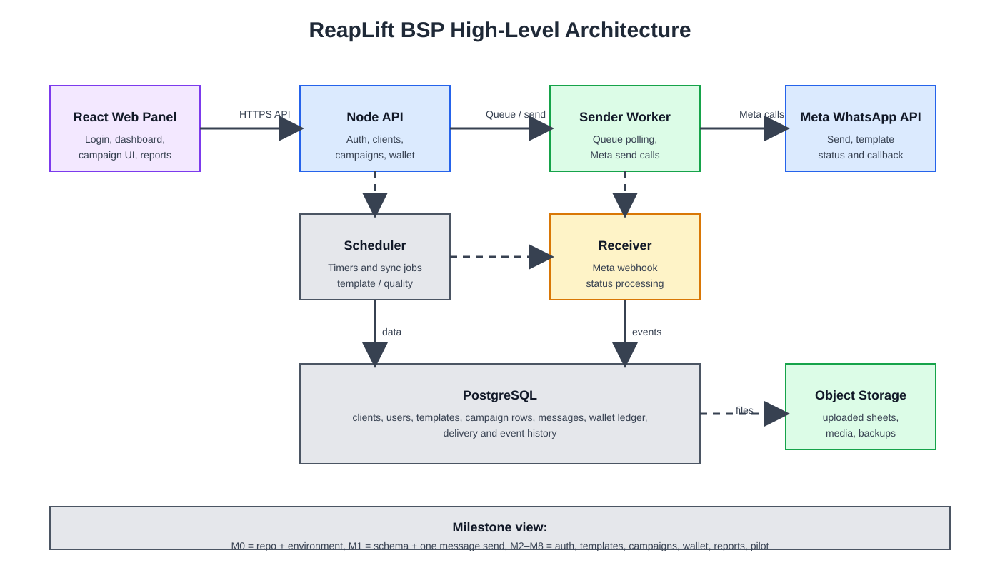

# BSP High-Level Architecture Overview

This diagram shows the component relationships for the BSP and the milestone sequence behind the build.

## Component responsibilities

### Frontend panel
- React UI for login, dashboard, campaigns, reports, and settings
- Calls the API for all authenticated actions
- Displays template and campaign status to the user

### API layer
- Validates requests and user permissions
- Reads and writes the database
- Exposes the contract used by the panel and later by CRM or API clients

### Worker
- Polls queued messages from the database
- Sends messages to Meta in a controlled rate
- Retries temporary failures and records outcomes

### Receiver
- Accepts Meta webhook delivery and status callbacks
- Verifies signatures before processing
- Updates message and campaign status to keep the system consistent

### Scheduler
- Runs timed jobs for template sync, quality checks, and campaign actions
- Keeps the operational cycle predictable without overloading the API

### PostgreSQL
- Stores all transactional data
- Keeps the queue, wallet ledger, campaigns, status events, and reporting tables in one place
- Provides the source of truth for message processing and state transitions

### Meta WhatsApp API
- Sends the actual messages
- Returns template and delivery state information
- Runs the external partner dependency for the live flow

### Object Storage
- Stores uploaded CSV and Excel files
- Keeps template media and backup artifacts
- Helps decouple large files from the database path

## Milestone view

- M0: repo, runtime, Docker, CI, and local environment
- M1: schema and one working send flow
- M2: login, roles, and user/client scope
- M3: template and number connection to Meta
- M4: upload, campaign drafting, and summary logic
- M5: campaign sending, rules, and delivery updates
- M6: wallet, price lists, and refund policy
- M7: dashboard, reports, and super-user accounting view
- M8: pilot launch and operational readiness

This is deliberately a high-level map. The detailed milestone and task decomposition remains in the tracker and the task specs.
