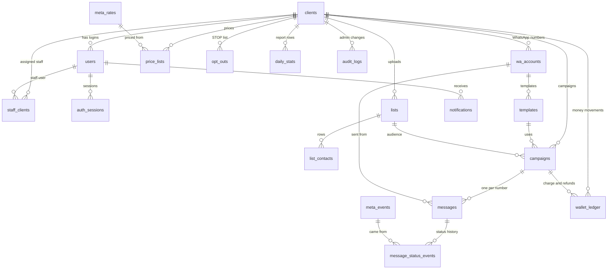

# Data model and API

Every table and route in the platform on one page: what exists today, what each milestone adds, and the conventions they all follow. Each milestone's spec has the full detail for its own tables and routes. When a spec changes a table or route, update this file in the same pull request; if the two ever disagree, the spec wins until this file is fixed.

Last reviewed: 29 October 2026, against the Solution Partner and credit-line model (see the tracker's decision log).

## Conventions

| Topic         | Rule                                                                                                                                                                                                                                                                                                    |
| ------------- | ------------------------------------------------------------------------------------------------------------------------------------------------------------------------------------------------------------------------------------------------------------------------------------------------------- |
| IDs           | `uuid` with `gen_random_uuid()`. High-volume append tables (`messages`, `meta_events`, `audit_logs`, `wallet_ledger`) use `bigint generated always as identity`.                                                                                                                                        |
| Money         | Whole paise in `bigint`, in the database, the API and the shared types. The panel converts to rupees only for display.                                                                                                                                                                                  |
| Meta's rates  | Meta's rates have fractions of a paisa, so `meta_rates` stores hundredths of a paisa (`bigint`; 8631 means 86.31 paise). Every price and ledger amount computed from a rate is rounded **up** to whole paise.                                                                                           |
| Percentages   | Basis points in `int` (2500 means 25%), never floats.                                                                                                                                                                                                                                                   |
| Big integers  | `pg` returns `bigint` columns as strings. `lib/db.ts` sets one type parser that turns them into JavaScript numbers and throws if a value is above `Number.MAX_SAFE_INTEGER` (about ₹90 trillion in paise, so it never happens in practice). The first task that reads a `bigint` adds it (M4 task 4.3). |
| Phone numbers | Digits with country code, no plus: `919812345678`.                                                                                                                                                                                                                                                      |
| Times         | `timestamptz`, stored in UTC. Shown and grouped by day in India time (`Asia/Kolkata`).                                                                                                                                                                                                                  |
| Tenant column | Every table that holds a client's data has `client_id`, and every query on it filters by `client_id` from the request scope (M1). The platform tables listed under "Tables without a client" are the only exceptions.                                                                                   |
| Migrations    | New numbered file only; never edit a merged one; only add tables, nullable columns and indexes. Claim the number in the tracker's registry first.                                                                                                                                                       |
| Routes        | `/api/clients/:clientId/...` for a client's data; `/api/admin/...` for super admin only; `/api/me/...` for the logged-in user's own data; public: `/healthz`, `/api/auth/*`, `/webhooks/meta`. M1's route-walking test fails CI for any other pattern.                                                  |
| Auth          | httpOnly session cookie `rl_session` (M1). No API keys until phase 2.                                                                                                                                                                                                                                   |
| Errors        | `{ "error": "<CODE>", "message": "<text>" }`, with `details` for field errors on 400. Another client's ID always gives 404 `NOT_FOUND`, never 403.                                                                                                                                                      |
| Schemas       | Request and response bodies are Zod schemas in `packages/shared`, used by both server and panel.                                                                                                                                                                                                        |
| Lists         | List routes take `limit` (default 50, maximum 500) and `cursor`, and return `{ items, nextCursor }`.                                                                                                                                                                                                    |

## How the tables connect

## Tables

State: **Exists** means merged in a migration (0001 to 0004); **Planned** means a milestone adds it. Planned columns on existing tables are always nullable.

### Access (M1, M3)

**`clients`** (Exists, 0002)
`id`, `name`, `status` (`active` | `suspended`), `contact_email`, `low_balance_alert_paise bigint`, `created_at`.
Planned: `country_calling_code text` (M3; picks Meta's rate in M6 and the valid numbers in M7).

**`users`** (Exists, 0003)
`id`, `client_id` (null for super admin and staff), `name`, `email` (unique), `password_hash`, `role` (`super_admin` | `staff` | `client`), `status` (`active` | `disabled`), `created_at`, `last_login_at`.
Added in 0004 (M1): `failed_login_count int`, `first_failed_login_at timestamptz` (start of the 15-minute lockout window), `locked_until timestamptz`. Added in 0006: `created_by uuid` (references `users`; the user who added this one, null for the first super admin and for users added before 0006). Planned: `must_change_password boolean` (M3).

**`auth_sessions`** (Exists, 0004)
`id`, `user_id`, `client_id` (null except for client users), `token_hash` (unique), `created_at`, `last_seen_at`, `expires_at`, `revoked_at`, `user_agent`, `ip_address`.

**`sessions`** (Exists, 0003, **not used**)
Replaced by `auth_sessions`, because its `client_id` is `not null` and a super admin has no client. Left in place because merged migrations are never edited.

**`staff_clients`** (Exists, 0003)
`id`, `staff_user_id`, `client_id`, `created_at`; unique (`staff_user_id`, `client_id`).

**`audit_logs`** (Exists, 0003)
`id`, `client_id` (null for platform changes), `user_id`, `action`, `entity_type`, `entity_id`, `details jsonb` (`before`, `after`; never passwords), `created_at`.

### Notifications (M2)

**`notifications`** (Exists, 0005)
`id`, `client_id` (null for platform events), `user_id`, `email`, `event`, `entity_id`, `payload jsonb`, `channel` (`email` | `panel`), `status` (`pending` | `sent` | `failed` | `read`), `attempts`, `next_attempt_at`, `last_error`, `read_at`, `created_at`, `sent_at`; unique (`event`, `entity_id`, `email`, `channel`).

### WhatsApp accounts and templates (M4, M5)

**`wa_accounts`** (Exists, 0002). One row per connected phone number.
`id`, `client_id`, `waba_id`, `phone_number_id` (unique), `display_phone`, `display_name`, `access_token_enc bytea` (a business token from Embedded Signup for clients; a system user token for ReapLift's own test numbers), `quality_rating`, `messaging_limit`, `meta_payer` (`reaplift_credit_line` for clients; `reaplift_card` for ReapLift's test numbers; `partner_credit_line` is in the check but unused), `send_rate_per_sec`, `status` (`active` | `paused`), `paused_reason`, `created_at`.
Added in 0007 (M5): `onboarded_via text` (`manual` | `embedded_signup`), `credit_share_ref text` (what Meta returns when ReapLift's credit line is shared), `connected_by uuid`, `connected_at timestamptz`.

**`templates`** (Exists, 0002)
`id`, `client_id`, `wa_account_id`, `meta_template_id`, `name`, `language`, `category` (`MARKETING` | `UTILITY` | `AUTHENTICATION`), `components jsonb`, `variable_count`, `status` (no check, so the M5 states need no change), `updated_at`; unique (`wa_account_id`, `name`, `language`).
Added in 0007 (M5): `validation_errors jsonb`, `submitted_at`, `submitted_by`, `rejection_reason`, `meta_recommendation`, `media_storage_key`, `created_by`.

**`settings`** (Exists, 0007). Platform table.
`key` (primary key, for example `promo_words`, `stop_words`), `value jsonb`, `updated_by`, `updated_at`.

### Sending (M4)

**`messages`** (Exists, 0002). One row per number per campaign, or per `cli` send.
`id bigint`, `client_id`, `wa_account_id`, `campaign_id` (foreign key added in M7), `template_id`, `to_number`, `variables jsonb`, `status` (`queued` | `sending` | `sent` | `delivered` | `read` | `failed` | `blocked`), `attempts`, `next_attempt_at`, `locked_at`, `meta_message_id` (unique), `queued_at`, `sent_at`, `delivered_at`, `read_at`, `failed_at`, `block_reason`, `failure_reason`, `meta_error_code`, `pricing_category` and `billable` (from Meta's webhook), `client_price_paise` (set at confirm, M7), `meta_cost_paise` (set on delivery, M9), `source` (`panel` | `api` | `crm` | `cli`), `created_date`.
There is no `cancelled` status; M8 uses `blocked` with reason `campaign_cancelled`.

**`meta_events`** (Exists, 0002). Platform table: every verified webhook body, stored before processing.
`id bigint`, `received_at`, `body jsonb`, `processed_at`, `process_error`.

**`message_status_events`** (Exists, 0002). Platform table, keyed by Meta's message ID.
`meta_message_id`, `status`, `meta_timestamp`, `meta_event_id`; primary key (`meta_message_id`, `status`).

### Money (M6)

**`meta_rates`** (Exists, 0009). Platform table.
`id`, `category`, `country_calling_code`, `rate_centipaise bigint`, `valid_from`, `entered_by`, `created_at`.

**`pricing`** (Exists, 0009). `client_id` null is the default for all clients.
`id`, `client_id`, `mode` (`markup` | `fixed`), `markup_marketing_bp`, `markup_utility_bp`, `markup_authentication_bp` (`int`, 2500 = 25%), `fixed_marketing_paise`, `fixed_utility_paise`, `fixed_authentication_paise`, `valid_from`, `updated_by`.

**`price_lists`** (Exists, 0009). The resulting price each client pays.
`id`, `client_id`, `category`, `country_calling_code`, `price_paise bigint`, `source` (`markup` | `fixed`), `meta_rate_id`, `valid_from`.
Markup price = ceiling of `rate_centipaise × (10000 + that category's markup) ÷ 1,000,000`, in whole-number arithmetic. Example: 8631 × 12000 ÷ 1,000,000 = 103.572, so 104 paise.

**`charge_policy`** (Exists, 0009). `client_id` null is the default for all clients.
`id`, `client_id`, `outcome` (`blocked`, `sent_not_delivered`, `delivered`, `failed`, and D6's `invalid`, `duplicate`), `charged boolean`.

**`wallet_ledger`** (Exists, 0009). Append-only; a trigger refuses update and delete.
`id bigint`, `client_id`, `kind` (`topup` | `adjustment` | `charge` | `refund`), `amount_paise bigint`, `balance_after_paise bigint`, `campaign_id`, `message_id`, `note`, `created_by`, `created_at`; unique (`message_id`) where `kind = 'refund'`.

### Campaigns (M7, M8)

**`lists`** (Exists, 0010)
`id`, `client_id`, `file_name`, `storage_key`, `row_count`, `blank_rows_skipped`, `columns jsonb`, `opt_in_confirmed_by`, `opt_in_confirmed_at`, `number_column`, `valid_count`, `invalid_count`, `duplicate_count`, `created_by`, `created_at`.

**`list_contacts`** (Exists, 0010)
`list_id`, `row_number`, `client_id`, `cells jsonb`, `number`, `invalid_reason`, `duplicate_of_row`; primary key (`list_id`, `row_number`).

**`campaigns`** (Exists, 0010)
`id`, `client_id`, `name`, `template_id`, `wa_account_id`, `list_id`, `variable_map jsonb`, `status` (`draft` | `scheduled` | `running` | `paused` | `completed` | `cancelled`, all listed from the start), `created_by`, `confirmed_by`, `confirmed_at`, `total`, `blocked`, `sent`, `delivered`, `read`, `failed`, `other_charged_paise`, `created_at`, `updated_at`. A trigger on `messages` keeps the status totals current.
Added in 0011 (M8): `scheduled_at`, `cancelled_at`, `cancelled_by`.

**`opt_outs`** (Exists, 0010)
`client_id`, `number`, `source` (`stop_reply` | `upload` | `manual`), `created_at`; unique (`client_id`, `number`).

**`rules`** (Exists, 0011). `client_id` null applies to all clients.
`id`, `client_id`, `type` (`repeat_within_hours` | `marketing_cap`), `values jsonb`, `enabled`, `updated_by`, `updated_at`.

### Reports (M9)

**`daily_stats`** (Planned, M9)
`client_id`, `date`, `category`, `queued`, `sent`, `delivered`, `read`, `failed`, `blocked`, `client_charge_paise`, `meta_cost_paise`; primary key (`client_id`, `date`, `category`).

**`meta_invoices`** (Planned, M9). Platform table.
`id`, `month`, `total_paise`, `per_account jsonb`, `entered_by`, `created_at`. The credit limit is a `settings` row.

### Tables without a client

These are platform-level and are the only exceptions to the tenant-column rule: `meta_events`, `message_status_events`, `settings`, `meta_rates`, `meta_invoices`. The tables where `client_id` may be null mean "platform" or "all clients" when it is: `users`, `auth_sessions`, `audit_logs`, `notifications`, `pricing`, `charge_policy`, `rules`. Client users and staff never reach any of them except through routes that filter by their own scope.

## API

Who: **SA** super admin; **C** client user of that client; **S** staff assigned to that client; **U** any logged-in user (own data only); **P** public.

| Method     | Route                                                              | Who                         | Milestone |
| ---------- | ------------------------------------------------------------------ | --------------------------- | --------- |
| GET        | `/healthz`                                                         | P                           | M0        |
| POST       | `/api/auth/login`                                                  | P                           | M1        |
| POST       | `/api/auth/logout`                                                 | U                           | M1        |
| GET        | `/api/auth/me`                                                     | U                           | M1        |
| GET        | `/api/clients/:clientId`                                           | C, S, SA                    | M1        |
| POST       | `/api/me/password`                                                 | U                           | M3        |
| GET        | `/api/me/notifications`                                            | U                           | M3        |
| PATCH      | `/api/me/notifications/:id/read`                                   | U                           | M3        |
| GET, POST  | `/api/admin/clients`                                               | SA                          | M3        |
| GET, PATCH | `/api/admin/clients/:id`                                           | SA                          | M3        |
| POST       | `/api/admin/clients/:id/suspend`, `/reactivate`                    | SA                          | M3        |
| POST       | `/api/admin/users`                                                 | SA                          | M3        |
| PATCH      | `/api/admin/users/:id`                                             | SA                          | M3        |
| POST       | `/api/admin/users/:id/reset-password`                              | SA                          | M3        |
| PUT        | `/api/admin/users/:id/clients`                                     | SA                          | M3        |
| GET        | `/api/admin/audit`                                                 | SA                          | M3        |
| GET        | `/api/admin/notifications`                                         | SA                          | M3        |
| GET, POST  | `/webhooks/meta`                                                   | P (Meta, signature checked) | M4        |
| POST       | `/api/admin/clients/:id/wa-accounts`                               | SA                          | M5        |
| POST       | `/api/admin/wa-accounts/:id/resume`                                | SA                          | M5        |
| GET        | `/api/clients/:clientId/wa-accounts`                               | C, S, SA                    | M5        |
| POST       | `/api/clients/:clientId/wa-accounts/embedded-signup`               | C, S, SA                    | M5        |
| GET, POST  | `/api/clients/:clientId/templates`                                 | C, S, SA                    | M5        |
| GET, PUT   | `/api/clients/:clientId/templates/:id`                             | C, S, SA                    | M5        |
| POST       | `/api/clients/:clientId/templates/:id/submit`, `/copy`             | C, S, SA                    | M5        |
| GET        | `/api/clients/:clientId/wallet`, `/wallet/ledger`, `/prices`       | C, S, SA                    | M6        |
| GET, POST  | `/api/admin/meta-rates`                                            | SA                          | M6        |
| GET, PUT   | `/api/admin/pricing`, `/api/admin/clients/:id/pricing`             | SA                          | M6        |
| GET, PUT   | `/api/admin/charge-policy`                                         | SA                          | M6        |
| PATCH      | `/api/admin/clients/:id/low-balance-alert`                         | SA                          | M6        |
| POST       | `/api/admin/clients/:id/wallet/topups`, `/wallet/adjustments`      | SA                          | M6        |
| POST       | `/api/clients/:clientId/lists`                                     | C, S, SA                    | M7        |
| GET        | `/api/clients/:clientId/lists/:id`, `/lists/:id/invalid`           | C, S, SA                    | M7        |
| PUT        | `/api/clients/:clientId/lists/:id/number-column`                   | C, S, SA                    | M7        |
| GET, POST  | `/api/clients/:clientId/campaigns`                                 | C, S, SA                    | M7        |
| GET, PUT   | `/api/clients/:clientId/campaigns/:id`                             | C, S, SA                    | M7        |
| GET        | `/api/clients/:clientId/campaigns/:id/summary`                     | C, S, SA                    | M7        |
| POST       | `/api/clients/:clientId/campaigns/:id/confirm`                     | C, S, SA                    | M7        |
| POST       | `/api/admin/clients/:id/opt-outs`                                  | SA                          | M7        |
| POST       | `/api/clients/:clientId/campaigns/:id/pause`, `/resume`, `/cancel` | C, S, SA                    | M8        |
| POST       | `/api/clients/:clientId/campaigns/:id/schedule`, `/unschedule`     | C, S, SA                    | M8        |
| GET, PUT   | `/api/admin/rules`                                                 | SA                          | M8        |
| GET        | `/api/clients/:clientId/dashboard`, `/reports/monthly`             | C, S, SA                    | M9        |
| GET        | `/api/clients/:clientId/campaigns/:id/report`                      | C, S, SA                    | M9        |
| GET        | `/api/admin/meta-view`                                             | SA                          | M9        |
| GET, POST  | `/api/admin/meta-invoices`                                         | SA                          | M9        |

No route under `/api/clients/` returns Meta's rate, Meta's cost, the markup or the margin. A test in M6 and M9 checks the response bodies for those fields.

Routes in today's prototype that go away: `POST /api/auth/login` with a `role` field (M1 drops the field), `GET /api/ping` (a demo route; remove in M1 task 1.0 or add it to the public list), and the `PATCH /api/admin/clients/:id/status` and `/staff` routes (replaced in M3).

## Review findings (29 October 2026)

Checked against the credit-line model and the merged migrations. None of these stops work; each is resolved in a spec or noted here.

1. **Templates are stored per phone number, but Meta keeps them per WhatsApp account.** `templates.wa_account_id` points to a number, and one WhatsApp account can hold several numbers. At launch each client has one number (decided), so this is harmless. If a client ever has two numbers in one account, add a nullable `templates.waba_id` and look templates up by it. Not needed now.
2. **The tenant-column rule needs its exceptions written down.** CLAUDE.md says every table carries `client_id`; the platform tables above cannot. The list above is the agreed exception; approved on 29 October 2026 (D14), and CLAUDE.md points here.
3. **`bigint` comes back as text** from `pg`. Without the type parser in the conventions, `balance_after_paise + amount_paise` would join two strings. Added to the conventions, and built in M4 task 4.3.
4. **`sessions` (0003) is unused** and stays that way; `auth_sessions` replaces it.
5. **`wa_accounts` needs four nullable columns for Embedded Signup and credit sharing** (M5). Added above; the existing `meta_payer` check already has `reaplift_credit_line`.
6. **Each message keeps the price it was charged** (`messages.client_price_paise`, set at confirm), so refunds and reconciliation never depend on today's price list.
7. **Invoices and GST details** (`clients` GSTIN, billing address) are not modelled, because D11's default issues invoices outside the platform. If D11 changes, M6 adds them.
