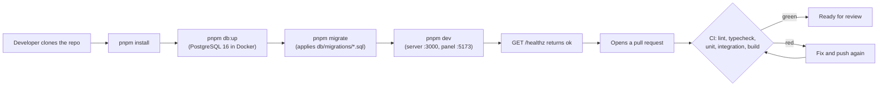

# M0. Foundation

- Status: Done
- Owner: repo setup
- Branch prefix: `m0-`
- Starts after: nothing
- External prerequisites: none

## Outcome

A developer can clone the repo, start PostgreSQL and the app on a laptop, apply migrations, and open a pull request that CI checks automatically. M0 has no product features.

## Flow diagram

## Worked example

Priya joins the team. She runs the five commands in [setup-mac.md](../../setup-mac.md), opens http://localhost:3000/healthz and sees `{"status":"ok","db":"ok"}`. She runs `pnpm migrate` a second time and nothing changes. She opens a pull request with a one-line change; CI runs on PostgreSQL 16 and reports each check.

## Scope

In: monorepo (`apps/server`, `apps/web`, `packages/shared`), `/healthz`, local PostgreSQL through `infra/compose.dev.yml`, migration runner, CI on pull requests.

Out: the container image, the cloud server, HTTPS, deploys and backups. These are in [M10](../m10-cloud-deploy/spec.md).

## Tasks

| Task | Name                       | Status |
| ---- | -------------------------- | ------ |
| 0.1  | Repo and monorepo scaffold | Done   |
| 0.2  | CI on pull requests        | Done   |
| 0.3  | Migration runner           | Done   |

### 0.1 Repo and monorepo scaffold

- Acceptance: `pnpm test` and `pnpm build` pass locally; `/healthz` reports the database state.

### 0.2 CI on pull requests

- `ci.yml` runs lint, typecheck, unit tests, integration tests against PostgreSQL 16, and build on every pull request, and on pushes to `main`.
- Acceptance: a red check blocks the merge.

### 0.3 Migration runner

- Acceptance: `pnpm migrate` applies pending files in order; running it twice changes nothing.

## Current reality

- All three tasks work.
- `pnpm lint` currently fails on code added by the M1 and M3 prototypes (`app.ts` lines 111 and 223, `apps/web/src/App.tsx` line 2), so CI is red on new pull requests. Fixing this is task 1.0 in [M1](../m1-login-and-access/spec.md); it is not an M0 defect.
- GitHub's default branch is still `m0-skeleton`. The release branch is `main` (decided 29 October 2026); the owner changes the default branch in GitHub settings.

## Demo (milestone acceptance)

1. Fresh clone, then `pnpm install && pnpm db:up && pnpm migrate && pnpm dev`.
2. `curl localhost:3000/healthz` returns 200 with `"db":"ok"`.
3. `pnpm migrate` again prints that nothing is pending.
4. A test pull request shows every CI check.
