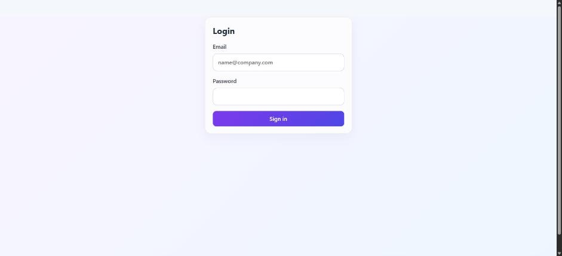
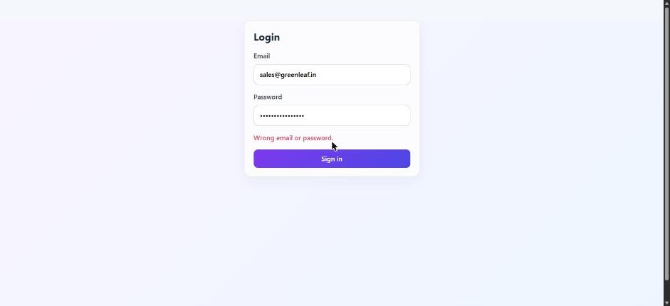
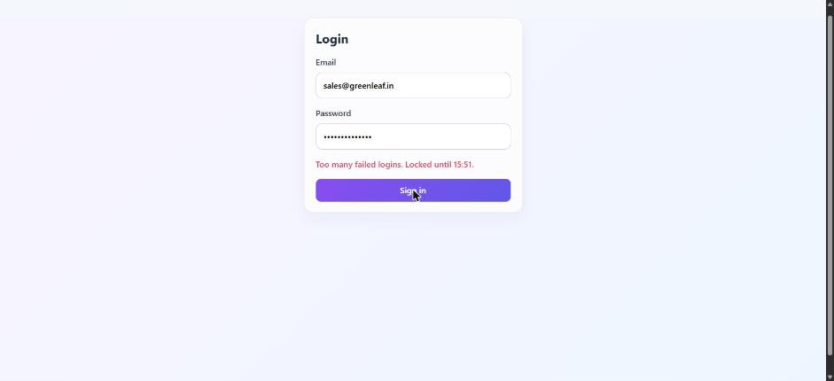
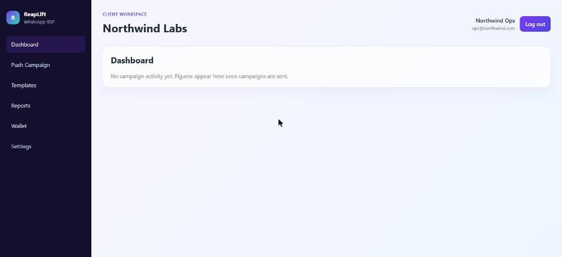
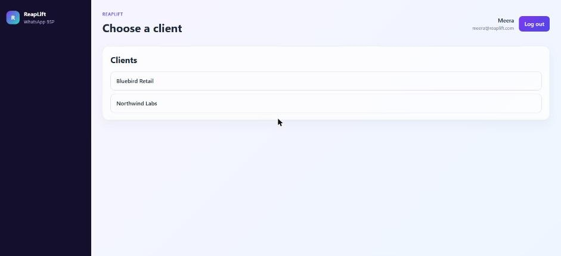
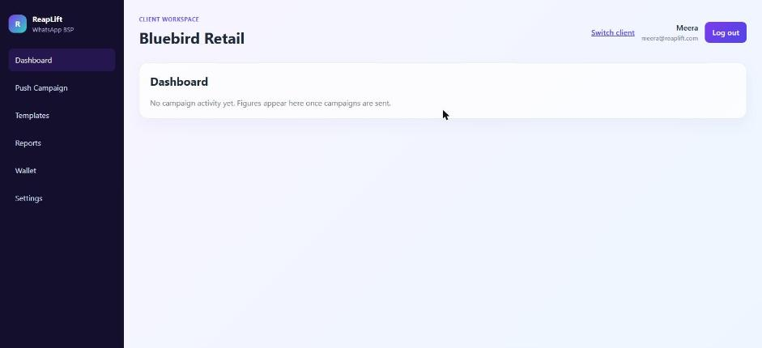
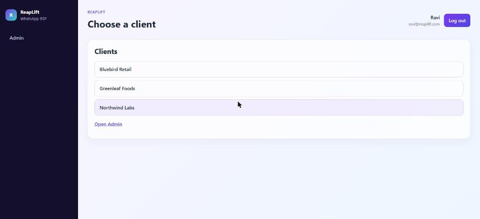
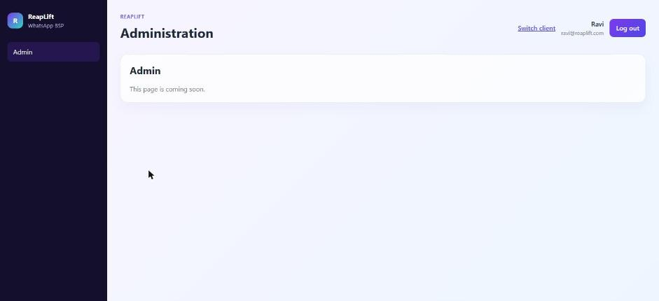

# M1 frontend: what each user sees

## 1.6.2 panel shell, mock mode (Screen ready)

Recorded on 30 October 2026 with `VITE_API_MODE=mock` (the in-browser mock in `apps/web/src/api/mock/`, seeded with the worked example; password `reaplift-dev-1`). Each user logged in through the login page. No `/api/auth` request left the browser. Screenshots are in [screens/](screens/).

| User                 | Lands on                   | Header                                 | Menu                                                            | Picker                                                       |
| -------------------- | -------------------------- | -------------------------------------- | --------------------------------------------------------------- | ------------------------------------------------------------ |
| `ops@northwind.com`  | Northwind Labs, Dashboard  | Northwind Labs; no Switch client       | Dashboard, Push Campaign, Templates, Reports, Wallet, Settings  | none                                                         |
| `sales@greenleaf.in` | Greenleaf Foods, Dashboard | Greenleaf Foods; no Switch client      | Dashboard, Push Campaign, Templates, Reports, Wallet, Settings  | none                                                         |
| `meera@reaplift.com` | Choose a client            | Bluebird Retail after picking; Switch  | The six workspace pages once a client is open; no Admin         | Bluebird Retail, Northwind Labs                              |
| `ravi@reaplift.com`  | Choose a client            | Administration on Admin; Switch client | Admin; the six workspace pages plus Admin once a client is open | Bluebird Retail, Greenleaf Foods, Northwind Labs; Open Admin |

Login errors, with the messages from `apps/web/src/api/messages.ts`:

| Case                                           | Message shown                                                 |
| ---------------------------------------------- | ------------------------------------------------------------- |
| Wrong password (or unknown email)              | Wrong email or password.                                      |
| Right password after 10 failures in 15 minutes | Too many failed logins. Locked until hh:mm.                   |
| Server unreachable                             | Cannot reach the server. Check your connection and try again. |

### Screenshots

Login page:

Wrong password:

Locked after 10 failures:

`ops@northwind.com`, straight into Northwind Labs:

`sales@greenleaf.in`, straight into Greenleaf Foods:

`meera@reaplift.com`, the picker with her two clients:

`meera@reaplift.com` in Bluebird Retail, with Switch client:

`ravi@reaplift.com`, the picker with every client and Open Admin:

`ravi@reaplift.com` on Admin (coming soon):

## 1.7 against the real server

To be recorded in C1: one screenshot per user with `VITE_API_MODE=real`.
