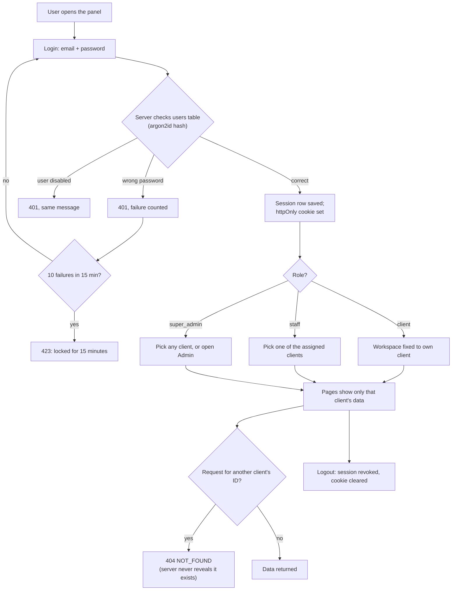

# M1. Login and access

- Status: In progress. Anirudh's part (1.0 to 1.5, the backend) is finished and verified against the live server on 29 October 2026 (see `backend-api.md`, `test-evidence.md`). **Everything left is Suraj's: 1.6.1, 1.6.2, then 1.7.** M1 is Done when 1.7 is.
- Owner: Anirudh (backend, 1.0 to 1.5), Suraj (screens, 1.6)
- Branch prefix: `m1-`
- Starts after: M0
- External prerequisites: none

## Outcome

A super admin, a staff member and a client user each log in with their own email and password and land in the right place. A client user sees only their own client's workspace. A staff member sees only the clients assigned to them. The server, not the panel, enforces this, and a test proves one client can never read another client's data.

## Flow diagram

## Worked example

Accounts (created by the seed command in 1.1, because the admin screens arrive in M3):

| Email                | Role          | Clients                         |
| -------------------- | ------------- | ------------------------------- |
| `ravi@reaplift.com`  | `super_admin` | all                             |
| `meera@reaplift.com` | `staff`       | Northwind Labs, Bluebird Retail |
| `ops@northwind.com`  | `client`      | Northwind Labs                  |
| `sales@greenleaf.in` | `client`      | Greenleaf Foods                 |

1. `ops@northwind.com` logs in. The panel opens Northwind's Dashboard. There is no client picker and no Admin menu.
2. The same user edits the URL to `/api/clients/<Greenleaf id>/templates`. The server answers 404, the same answer as for an ID that does not exist.
3. `meera@reaplift.com` logs in and sees a picker with Northwind and Bluebird only. She picks Bluebird; every page now shows Bluebird's data. Greenleaf is not in her list and its URLs return 404.
4. `ravi@reaplift.com` logs in, sees all three clients in the picker and the Admin menu.
5. Someone types a wrong password for `sales@greenleaf.in` ten times in five minutes. The eleventh attempt, even with the right password, gets "locked, try again in 15 minutes".
6. The server restarts. Everyone who was logged in is still logged in, because sessions are in PostgreSQL.

## Scope

In:

- real users with hashed passwords; a command to create users
- server-side sessions in an httpOnly cookie; logout; expiry; lockout
- the request scope every later milestone uses (below), with client workspaces
- a test that walks every route as the wrong client
- the panel shell: login page, client picker, menu by role, "coming soon" for pages not built yet

Out:

- creating clients, users and staff assignments in the panel: [M3](../m3-client-onboarding/spec.md)
- password reset by the super admin: M3
- the "login locked" email: M3's notification task (M1 does not start after M2, so it cannot send notifications)
- self-service password reset by email: later, not planned

## The scope contract (used by every milestone)

- Every route that touches a client's data has the client in its path: `/api/clients/:clientId/...`. Admin routes are `/api/admin/...`. The logged-in user's own data (password, notifications) is under `/api/me/...` and every query there filters by the user's ID. There is no other pattern.
- One Fastify hook resolves the scope before any handler runs and passes it on the request: `{ userId, role, clientId }`.
  - `client`: `clientId` in the path must equal the user's own client.
  - `staff`: `clientId` must be in the user's `staff_clients` rows.
  - `super_admin`: any existing client.
  - Anything else: 404 `NOT_FOUND`. Never 403 for another client's data, so the server never confirms that an ID exists.
- Every query takes `clientId` from the scope, never from the request body.
- `/api/admin/*` routes accept `super_admin` only and return 403 `FORBIDDEN` to others.

## Tasks

| Task  | Name                                         | Depends on                                                  | Can run in parallel with |
| ----- | -------------------------------------------- | ----------------------------------------------------------- | ------------------------ |
| 1.0   | Restore green CI                             | none                                                        | all                      |
| 1.1   | Users, password hashing, `create-user`       | none                                                        | 1.6                      |
| 1.2   | Cookie sessions, logout, expiry              | 1.1                                                         | 1.6                      |
| 1.3   | Lockout                                      | 1.2                                                         | 1.4                      |
| 1.4   | Request scope and client workspaces          | 1.2                                                         | 1.3                      |
| 1.5   | Route-walking isolation test                 | 1.4                                                         | 1.6                      |
| 1.6.1 | Web foundations (Suraj)                      | none                                                        | all                      |
| 1.6.2 | Panel shell (Suraj)                          | 1.6.1 (mock API; real routes 1.2, 1.4 wired by their owner) | 1.1 to 1.5               |
| 1.7   | Connect the panel to the real server (Suraj) | 1.6.2, 1.1 to 1.5 (done)                                    | none                     |

### 1.0 Restore green CI

- Fix the three lint errors in existing code (`app.ts` line 111 `any`, line 223 unused `received`; `apps/web/src/App.tsx` line 2 unused `AppPageId`) and the typecheck error in `lib/auth.ts` line 25. Remove the demo route `GET /api/ping` (or add it to the public list), so M1's route-walking test passes.
- Acceptance: `pnpm lint`, `pnpm typecheck` and `pnpm test` pass on `main`.
- Status: Done on 29 October 2026 (PR #7, commit `0fac2b8`). `GET /api/ping` was removed from the server in 1.5; the panel's call to it is removed in 1.7.

### 1.1 Users, password hashing, `create-user`

- 1.1.1 Passwords hashed with argon2id; plain passwords never logged or stored.
- 1.1.2 Command `pnpm --filter @reaplift/server cli create-user --email --name --role [--client]`, which prompts for the password. Creating a `client` user requires `--client`; `super_admin` and `staff` must not have one.
- 1.1.3 A dev seed script creates the four users in the worked example and their clients and staff assignments.
- 1.1.4 The role is `client` everywhere (database, shared types, panel). Rename `client_admin` in `packages/shared` and the panel.
- 1.1.5 Remove the hardcoded demo users from `app.ts`.
- Tests: the hash is not the password; the same password hashes differently twice; a `client` user without a client is refused.
- Acceptance: users created by the command can log in; no demo users remain in the code.

### 1.2 Cookie sessions, logout, expiry

- 1.2.1 New table `auth_sessions` (migration 0004, see "Data"). The existing `sessions` table from 0003 is not used, because its `client_id` is `not null` and a super admin has no client; migrations may only add, so a new table is the clean fix.
- 1.2.2 Login creates a random 32-byte token, stores only its SHA-256 hash, and sets cookie `rl_session`: httpOnly, Secure (except on localhost), SameSite=Lax, path `/`.
- 1.2.3 Sessions last 12 hours from the last request, and at most 7 days in total.
- 1.2.4 Logout sets `revoked_at` and clears the cookie.
- 1.2.5 State-changing requests (POST, PUT, PATCH, DELETE) must carry an `Origin` header matching the panel's address, which blocks cross-site requests that ride on the cookie.
- 1.2.6 Login body is `{ email, password }` only; the prototype's `role` field is removed.
- Tests: wrong password gives 401; logout then reuse gives 401; an expired session gives 401; a request with a foreign `Origin` gives 403; a session survives a server restart.
- Acceptance: a user stays logged in across a restart and is logged out everywhere the session was revoked.

### 1.3 Lockout

- 10 failed logins for one email within 15 minutes lock that login for 15 minutes, even with the right password. A successful login resets the count.
- As built: the 15 minutes are counted from the first failure in the window, not as a rolling window, so up to 18 failures can fall close together across two windows. Accepted on 29 October 2026; a rolling window would need a table of failed attempts.
- The response for an unknown email, a wrong password and a disabled user is the same 401 `INVALID_CREDENTIALS`, so nobody can test which emails exist. A locked account gets 423 `LOGIN_LOCKED` with the unlock time.
- Data: nullable columns on `users`: `failed_login_count int`, `first_failed_login_at timestamptz` (when the current 15-minute window started), `locked_until timestamptz` (migration 0004).
- Tests: the 11th attempt is locked; the lock ends after 15 minutes (fake clock); success resets the count.
- Acceptance: the worked example's step 5 behaves as written.

### 1.4 Request scope and client workspaces

- 1.4.1 The scope hook described in "The scope contract".
- 1.4.2 `GET /api/auth/me` returns the user and their workspaces: `{ user: { id, name, email, role }, workspaces: [{ clientId, name, status }] }`. A client user gets one; staff get their assigned clients; super admin gets all.
- 1.4.3 A suspended client's users can log in but get 403 `CLIENT_SUSPENDED` on every client route (the suspend action itself is built in M3).
- Tests: each role against its own, an assigned, and an unassigned client.
- Acceptance: the worked example's steps 1 to 4 behave as written, through real routes.

### 1.5 Route-walking isolation test

- A test reads every route registered on the Fastify app. For every `/api/clients/:clientId/...` route it calls it as Northwind's user with Greenleaf's client ID and expects 404. For every `/api/me/...` route it checks that user A cannot read user B's rows. A route that is not under `/api/clients/`, `/api/admin/`, `/api/me/` or the public list (`/healthz`, `/api/auth/*`, `/webhooks/meta`) fails the test.
- This test runs in CI forever, so every later milestone's routes are checked automatically.
- Acceptance: adding a route without scope makes CI red.

### 1.6.1 Web foundations (Suraj)

Everything later screens need, so no screen task has to invent it.

- Component tests in `apps/web`: Vitest with `jsdom`, `@testing-library/react` and `@testing-library/user-event`; `pnpm test` runs them in CI.
- Routing with `react-router-dom`; one route per page in the menu.
- The API layer `apps/web/src/api/`: one typed function per route, which validates the response with the shared Zod schema. `VITE_API_MODE=mock` answers from `apps/web/src/api/mock/` (in-memory fake data seeded with the worked example's users and clients); `real` (default) calls the server through Vite's `/api` proxy with `credentials: 'include'`, so the session cookie from 1.2 works without changes. Production builds ignore `mock`. Add `VITE_API_MODE` to `.env.example` blank.
- Contracts folder `packages/shared/src/contracts/` with `auth.ts` for the three routes below, re-exported from the package index.
- `formatPaise(paise: number): string` in `packages/shared/src/format/money.ts`: whole paise to rupees with two decimals and Indian grouping (`123450` gives `₹1,234.50`). The panel never does money arithmetic; it only formats.
- One map from error code to the message shown (for example `INVALID_CREDENTIALS` gives "Wrong email or password"), used by every form.
- Tests: `formatPaise` for 0, 1, 99, 100, 123450, 10000000 and a negative; the API layer rejects a response that does not match its schema; mock mode is off in a production build.
- Acceptance (Screen ready): `VITE_API_MODE=mock pnpm dev` runs the panel; tests pass in CI.
- Status: Screen ready on 30 October 2026 (PR #12). Done after 1.7. As built: `VITE_API_MODE` is read from the repo-root `.env` (`envDir`); the panel uses Vitest 3 (Vitest 2 bundles Vite 5, whose types clash with the panel's Vite 6); `packages/shared` gained a `test/` folder, a `vitest run` test script and `tsconfig.check.json` so the `formatPaise` and contract tests run and are type-checked.

### 1.6.2 Panel shell (Suraj)

- Login page posts `{ email, password }`; shows "wrong email or password" or "locked until hh:mm".
- After login the panel calls `/api/auth/me`. One workspace: open it. Several: show the picker; the chosen client appears in the header with a switch button.
- Menu by role, following the Dovesoft sidebar (HLD section 4): Dashboard, Push Campaign, Templates, Reports, Wallet, Settings for a workspace; Admin for super admin only. Pages not built yet show "coming soon".
- Dashboard and Push Campaign stop showing `apps/web/src/data/mockData.ts` figures; they show an empty state until their milestones.
- Contract details the spec leaves open, decided here: the 423 body is `{ "error": "LOGIN_LOCKED", "message", "lockedUntil": "<ISO time>" }`; the login response is `{ user: { id, name, email, role } }`.
- Tests: component tests for the menu by role, the picker, and each login error message.
- Acceptance (Screen ready): in mock mode, each user in the worked example sees exactly the menu and picker described. Done after 1.7.

### 1.7 Connect the panel to the real server (Suraj)

The backend (1.1 to 1.5) is finished, so this can start as soon as 1.6.2 is Screen ready.

- Local setup: `pnpm db:up`, `pnpm migrate`, `pnpm --filter @reaplift/server cli seed-dev` (password `reaplift-dev-1` for all four users), `pnpm dev`. Set `SESSION_COOKIE_SECURE=false` in `.env` if testing in Safari over plain http.
- Run the panel with `VITE_API_MODE=real`. The real responses are recorded in `backend-api.md`; where they differ from the contracts in `packages/shared/src/contracts/auth.ts`, change the contract and the mock to match the server.
- Remove the panel's call to `GET /api/ping` (the route is gone) and the old prototype login code (`role` field, bearer token).
- Evidence: `frontend.md` (a screenshot per user in the worked example) and `e2e.md` (the demo below, run in the panel).
- Acceptance: the milestone demo passes in the real panel, and CI on the pull request into `main` shows the route-walking test passing (demo step 7); M1 is Done.

## Who builds what

- **Suraj (screens track):** 1.6.1 and 1.6.2 against the mock API, then 1.7 against the real server. Never waits for the backend; see "Suraj's task list" in the [tracker](../../project-tracker.md).
- **Anirudh (backend):** 1.0 to 1.5, finished on 29 October 2026. If 1.7 finds the server itself wrong (not just a contract mismatch), Anirudh fixes it.

## Data and API

Migration 0004 (claim it in the tracker's registry first):

- `auth_sessions`: `id uuid`, `user_id uuid not null`, `client_id uuid null` (the user's client for client users; kept so the table carries `client_id` like every table), `token_hash text not null unique`, `created_at`, `last_seen_at`, `expires_at`, `revoked_at null`, `user_agent text null`, `ip_address text null`
- `users`: add nullable `failed_login_count int`, `first_failed_login_at timestamptz`, `locked_until timestamptz`

| Method | Route                    | Who                                 | Success                                                 | Errors                                                               |
| ------ | ------------------------ | ----------------------------------- | ------------------------------------------------------- | -------------------------------------------------------------------- |
| POST   | `/api/auth/login`        | anyone                              | 200 user; sets cookie                                   | 400 `INVALID_REQUEST`, 401 `INVALID_CREDENTIALS`, 423 `LOGIN_LOCKED` |
| POST   | `/api/auth/logout`       | logged in                           | 204; clears cookie                                      | 401 `UNAUTHENTICATED`                                                |
| GET    | `/api/auth/me`           | logged in                           | 200 user and workspaces                                 | 401 `UNAUTHENTICATED`                                                |
| GET    | `/api/clients/:clientId` | client, assigned staff, super admin | 200 `{ clientId, name, status }` (the workspace header) | 401 `UNAUTHENTICATED`, 403 `CLIENT_SUSPENDED`, 404 `NOT_FOUND`       |

All errors use `{ "error": "<CODE>", "message": "<text>" }`.

Settings: `SESSION_COOKIE_SECURE`, `PANEL_ORIGIN` (added to `.env.example` blank).

## Notifications

None in M1. The "login locked" email is sent from M3 task 3.6.

## Open questions

None. The role name, session table and cookie were decided on 29 October 2026 (see the tracker's decision log).

## Current reality

As of 29 October 2026, on `anirudh-e2e-setup`:

- Done: users with argon2id hashes and `cli create-user` / `cli seed-dev` (1.1); `auth_sessions` with the `rl_session` cookie, logout, 12-hour idle and 7-day limits, Origin check (1.2); lockout (1.3); scope hook, `/api/auth/me` and `GET /api/clients/:clientId` (1.4); route-walking test (1.5). Demo users, in-memory sessions and `GET /api/ping` are gone.
- Code: `apps/server/src/modules/auth/` (`users.ts`, `sessions.ts`, `scope.ts`, `routes.ts`), `apps/server/src/cli.ts`, `db/migrations/0004_auth_sessions.sql`.
- Tests: `test/auth.test.ts` (unit), `test/login.int.test.ts`, `test/scope.int.test.ts`.
- The old prototype panel's login (sends `role`, expects a bearer token) no longer works against the server. The panel shell (1.6.2) replaces it; until then use mock mode (1.6.1) or curl.
- M3's prototype admin routes (`/api/admin/clients`, in-memory) are now behind the scope hook: super admin only.

## Demo (milestone acceptance)

1. Run the dev seed (1.1.3). Start the server and panel.
2. Log in as each of the four users in the worked example; record what each sees (screenshots in `frontend.md`).
3. As `ops@northwind.com`, call a Greenleaf route with `curl` and the session cookie; record the 404.
4. Lock `sales@greenleaf.in` with 10 wrong passwords; record the 423.
5. Restart the server; reload the panel; the user is still logged in.
6. Log out; reuse the old cookie with `curl`; record the 401.
7. CI shows the route-walking test passing.
