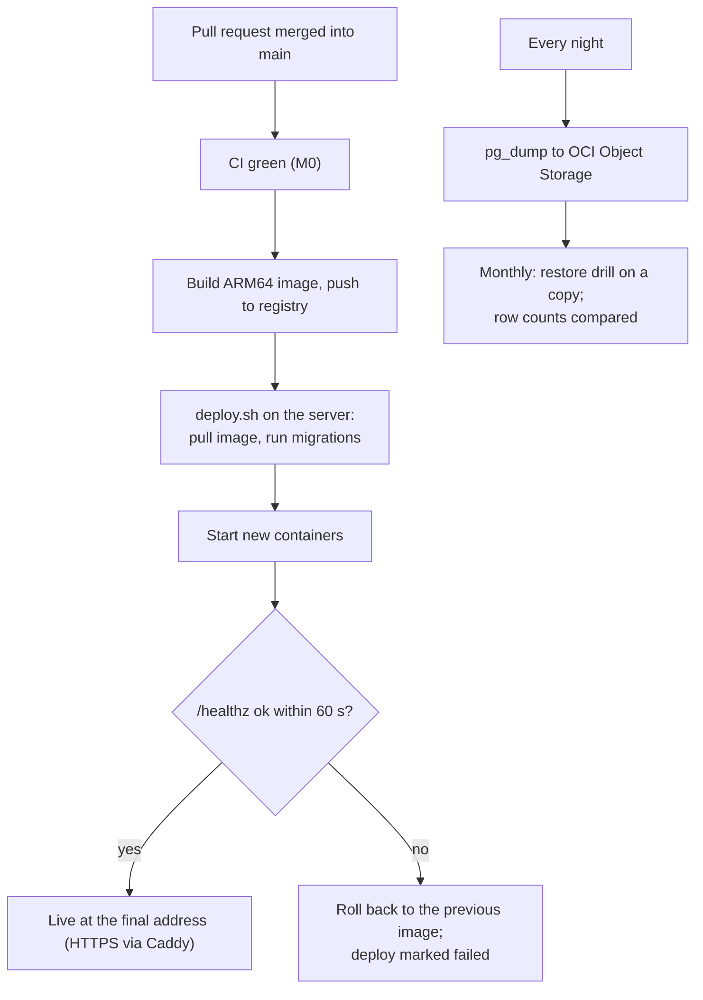

# M10. Cloud deploy

- Status: Not started
- Owner: Unassigned
- Branch prefix: `m10-`
- Starts after: M0
- External prerequisites: E4 (OCI account access and DNS for the final address)

## Outcome

A pull request merged into `main` (the release branch, decided 29 October 2026) is built, deployed to the Oracle Cloud server, and checked at `/healthz`, with no manual step. A failed health check rolls back to the previous version. The site has a valid HTTPS certificate, so Meta can deliver webhooks to it. The database is backed up every night, and a restore has been practised.

## Flow diagram

## Worked example

1. A developer merges "fix campaign page typo" into `main` at 14:02.
2. CI passes; the deploy job builds the image and runs `deploy.sh` on the server. Migrations run (none pending). New containers start; `/healthz` answers ok at 14:06. The change is live.
3. A later merge has a startup bug; `/healthz` never answers. After 60 seconds the previous image is restarted and the job is marked failed. The site never went down for more than the restart.
4. At 02:00 the nightly backup writes `reaplift-2026-11-03.dump` to Object Storage. On the first Monday of the month the drill restores it to a scratch database and the row counts match.

## Scope

In: Dockerfile and production compose file, server provisioning, Caddy HTTPS, the deploy pipeline with health wait and rollback, Object Storage for uploads and template media (replacing local disk behind the storage interface used by M5 and M7), nightly backups and a restore drill.

Out: operational alerts (account paused, stuck sends, disk, backups missing, health down) are in [M11](../m11-pilot/spec.md) task 11.1, because they watch things built in M2, M4 and M7.

## Tasks

| Task | Name                                   | Depends on | Can run in parallel with |
| ---- | -------------------------------------- | ---------- | ------------------------ |
| 10.1 | Container image and production compose | none       | 10.2                     |
| 10.2 | Provision the OCI server               | E4         | 10.1                     |
| 10.3 | Caddy HTTPS and routing                | 10.2       | 10.1                     |
| 10.4 | Deploy pipeline with rollback          | 10.1, 10.3 | 10.5                     |
| 10.5 | Object Storage for files               | 10.2       | 10.4                     |
| 10.6 | Nightly backups and restore drill      | 10.2, 10.5 | 10.4                     |

### 10.1 Container image and production compose

- Multi-stage ARM64 `Dockerfile`; `infra/compose.prod.yml` running `api`, `worker`, `receiver`, `scheduler` from the same image with different `MODE`.
- Acceptance: the image starts in CI and answers `/healthz`.

### 10.2 Provision the OCI server

- Mumbai region, ARM VM, block volume, reserved IP, DNS, firewall, `bootstrap.sh`; SSH by key only.
- Acceptance: `ssh deploy@<address>` works with a key and refuses passwords.

### 10.3 Caddy HTTPS and routing

- Acceptance: the browser shows a valid certificate; Meta's dashboard verifies the webhook address.

### 10.4 Deploy pipeline with rollback

- `deploy.yml` on push to `main`; `deploy.sh` pulls, migrates, starts, waits for `/healthz`, rolls back on failure. Secrets live in GitHub environment secrets and the server's `.env`, never in git.
- Acceptance: steps 1 to 3 of the worked example.

### 10.5 Object Storage for files

- An Object Storage implementation of the storage interface; uploads and media move from local disk.
- Acceptance: an upload made after the switch is read back from Object Storage.

### 10.6 Nightly backups and restore drill

- Acceptance: step 4; the restored copy's row counts match.

## Data and API

No tables. Settings for the registry, server, Object Storage bucket and credentials go in `.env.example` blank.

## Notifications

None here; see M11 task 11.1.

## Open questions

| Question                                                     | Default                                        | Decides |
| ------------------------------------------------------------ | ---------------------------------------------- | ------- |
| Final web address                                            | `wa.reaplift.com`                              | Owner   |
| Deploy from `main` or from a release branch cut from `main`? | `main` until there is a reason to cut releases | Owner   |

## Current reality

Nothing exists: no Dockerfile, no production compose, no server. Everything runs locally.

## Demo (milestone acceptance)

Merge a one-line change and watch it go live; merge a broken change and watch it roll back; run a restore drill. Record in `e2e.md`.
