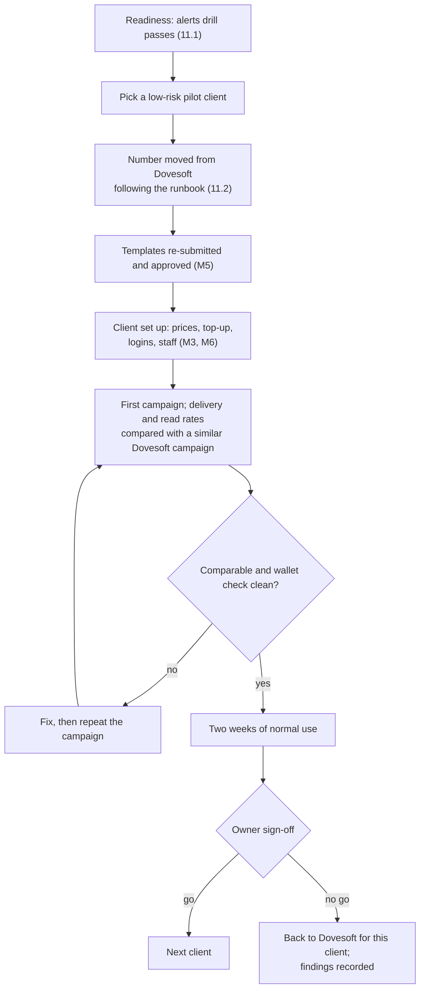

# M11. Pilot go-live

- Status: Not started
- Owner: ReapLift leads; engineering supports
- Branch prefix: `m11-`
- Starts after: M8, M9, M10
- External prerequisites: E1 to E7 done (E7: ReapLift is a Solution Partner with its credit line)

## Outcome

The first client moves from Dovesoft to ReapLift and runs its normal campaigns for two weeks with no fallback to Dovesoft, the nightly wallet checks stay clean, and the owner signs off to move the next client.

## Flow diagram

## Worked example

1. In a drill, the team stops the worker, fills a test disk to 85%, and revokes a test token. Within 5 minutes Ravi gets the "sends stuck", "disk over 80%" and "account paused" alerts.
2. Northwind is chosen as the pilot. Dovesoft releases its number; Northwind connects it through Embedded Signup following the runbook (two-step PIN, ReapLift's credit line shared with Northwind's account). Northwind's 6 templates are re-submitted and approved.
3. Ravi sets Northwind's prices, tops up ₹20,000, and creates Asha's login and Meera's assignment.
4. Northwind's first campaign of 5,000 messages delivers 94% and is read by 61%, against 93% and 60% for a similar Dovesoft campaign last month.
5. After two weeks with no fallback and clean nightly checks, the owner signs off.

## Tasks

| Task | Name                                   | Depends on |
| ---- | -------------------------------------- | ---------- |
| 11.1 | Operational alerts and readiness drill | none       |
| 11.2 | Number-move runbook from Dovesoft      | E7         |
| 11.3 | Pilot client setup                     | 11.2       |
| 11.4 | First campaign and comparison          | 11.3       |
| 11.5 | Two weeks of use and go or no-go       | 11.4       |

### 11.1 Operational alerts and readiness drill

- Alerts to super admins through M2 when: an account is paused; messages are stuck in `sending` for 5 minutes; `meta_events` are unprocessed for 5 minutes; disk is over 80%; last night's backup is missing; `/healthz` is down (checked from outside the server).
- Acceptance: all six fire once in a drill.

### 11.2 Number-move runbook from Dovesoft

- Written runbook: Dovesoft releases the number, two-step PIN, the client connects it through Embedded Signup with ReapLift's credit line shared (M5 5.2), templates re-submitted (assume templates do not carry over). Agree Dovesoft's notice period and handover terms first.
- Acceptance: followed start to end on one low-risk number without surprises.

### 11.3 Pilot client setup

- Prices, top-up, logins, staff, templates approved, opt-out list imported from Dovesoft if available.
- Acceptance: the client logs in and sees only its own data.

### 11.4 First campaign and comparison

- Acceptance: delivery and read rates are in the same range as a similar Dovesoft campaign.

### 11.5 Two weeks of use and go or no-go

- Acceptance: the owner signs off in writing in this folder.

## Notifications

Task 11.1.

## Open questions

| Question                               | Default                     | Decides  |
| -------------------------------------- | --------------------------- | -------- |
| Which client is the pilot?             | Lowest volume active client | ReapLift |
| Do templates carry over from Dovesoft? | Plan to re-submit           | ReapLift |

## Current reality

Nothing exists.

## Demo (milestone acceptance)

The two-week pilot itself, with the drill record, the comparison, the nightly check logs and the sign-off saved here.
