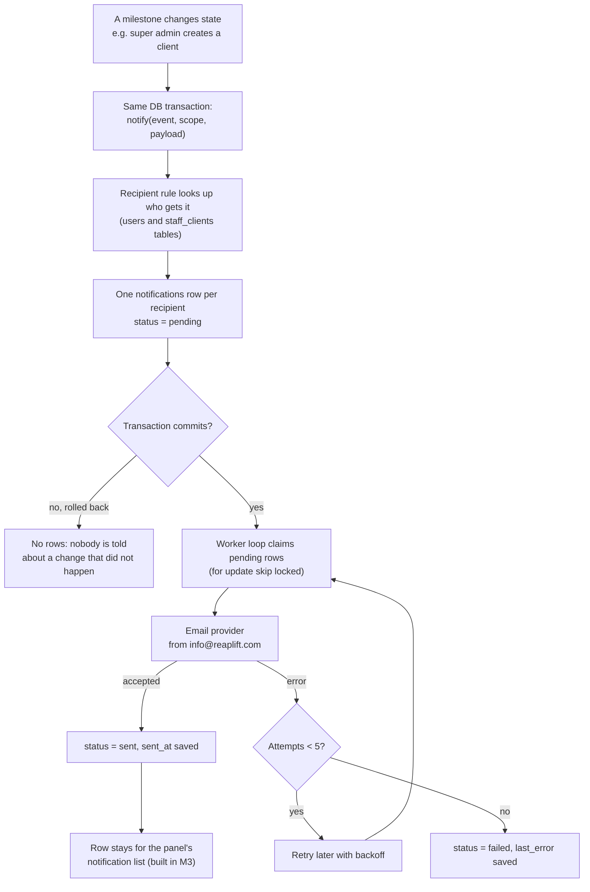

# M2. Notifications

- Status: Built on 29 October 2026 (2.1 to 2.4, see `test-evidence.md` and `e2e.md`). Done when E5 is met and demo step 4 sends a real email.
- Owner: Anirudh
- Starts after: M0
- External prerequisites: E5 (`info@reaplift.com` verified as a sender in OCI Email Delivery) for the real-email demo; everything else uses a fake provider

## Outcome

Any milestone can announce a state change by calling one function, `notify()`, inside the same database transaction as the change. The notification is then sent by email from `info@reaplift.com`, with retries, and kept as a row the panel can list later. If the change is rolled back, no notification exists. Milestones decide which events they send; M2 only builds the machinery.

## Flow diagram

## Worked example

1. In M3, Ravi (super admin) creates client "Northwind Labs" with login email `ops@northwind.com`. M3's code calls `notify(trx, 'client.created', { clientId }, { clientName: 'Northwind Labs' })` in the same transaction that inserts the client.
2. The catalogue entry for `client.created` says: recipients are the client's `client` users; subject "Your ReapLift account is ready"; text with the login address.
3. One row is written: to `ops@northwind.com`, channel `email`, status `pending`.
4. Two seconds later the worker loop sends it through OCI Email Delivery from `info@reaplift.com`. The provider times out; the row goes back to pending with attempt 1 and `last_error = "timeout"`. Thirty seconds later the second attempt succeeds and the row becomes `sent`.
5. Had the client insert failed (for example a duplicate name), the transaction would roll back and no email would ever be sent.
6. The same `client.created` event replayed for the same client and recipient writes nothing new, because of the unique key.

## Scope

In: the `notifications` table, `notify()`, recipient rules, the event catalogue, email delivery with retries through a provider interface (a fake provider and OCI Email Delivery over SMTP), and operator commands to send a test and list rows.

Out:

- which events exist and who gets them: each milestone's notification task (M3 3.6, M5 5.6, M6 6.6, M7 7.9, M8 8.5, M9 9.7 and 9.8, M11 11.1)
- the panel's notification list and the super admin's delivery log screen: M3 task 3.7, because they need logins (M1)
- WhatsApp notifications from ReapLift's own number: later (decided 29 October 2026)
- letting users switch off notifications: not at launch

## Tasks

| Task | Name                                 | Depends on | Can run in parallel with |
| ---- | ------------------------------------ | ---------- | ------------------------ |
| 2.1  | `notifications` table and `notify()` | none       | 2.3                      |
| 2.2  | Email delivery loop with retries     | 2.1        | 2.3                      |
| 2.3  | Event catalogue and recipient rules  | none       | 2.1, 2.2                 |
| 2.4  | Operator commands and real provider  | 2.2        | none                     |

### 2.1 `notifications` table and `notify()`

- 2.1.1 Migration (claim the next number in the registry): `notifications` with `id uuid`, `client_id uuid null` (null for platform events such as backup alerts, as in `audit_logs`), `user_id uuid null`, `email text not null`, `event text not null`, `entity_id text not null`, `payload jsonb not null`, `channel text not null check (channel in ('email','panel'))`, `status text not null check (status in ('pending','sent','failed','read'))`, `attempts int not null default 0`, `next_attempt_at timestamptz`, `last_error text`, `read_at timestamptz`, `created_at`, `sent_at`.
- 2.1.2 Unique key on `(event, entity_id, email, channel)` so a replayed change notifies once. `entity_id` defaults to the scope's user, then client. An event that can happen again to the same thing (suspend, reactivate, suspend) must pass an `entityId` unique to that occurrence, such as its audit row's ID, or the second one is swallowed.
- 2.1.3 `notify(trx, event, scope, payload)` in `apps/server/src/modules/notifications/`. It must receive the caller's Kysely transaction; calling it without one is a type error.
- Tests: rolled-back transaction leaves no row; the same event twice writes one row per recipient; an unknown event name fails.
- Acceptance: a test inside a transaction writes the expected rows.

### 2.2 Email delivery loop with retries

- 2.2.1 A loop in `worker` mode claims up to 50 pending email rows whose `next_attempt_at` has passed, with `for update skip locked`. If M4's worker loop has already landed, add this loop next to it; if not, create the list of loops that `modes/worker.ts` runs. One server program (CLAUDE.md).
- 2.2.2 Provider interface `send({ to, subject, text, html })`. The fake provider writes the email to the log and to an in-memory list tests can read.
- 2.2.3 Retry with backoff 30 s, 1 min, 2 min, 4 min; after 5 attempts the row is `failed` with the error.
- Tests: two loops never send the same row; a provider error retries and then fails after 5 attempts; a sent row is never sent again.
- Acceptance: a pending row is delivered by the fake provider and marked `sent`.

### 2.3 Event catalogue and recipient rules

- 2.3.1 One catalogue entry per event: name, subject, text template, channels, recipient rule. Entries are added by the milestone that owns the event; M2 ships the format and one test event.
- 2.3.2 Recipient rules (worked out from `users` and `staff_clients`, never written into code as addresses):
  - `client_users`: active `client` users of the event's client (their login emails; decided 29 October 2026)
  - `assigned_staff`: staff assigned to the event's client
  - `super_admins`: all active super admins
  - `actor`: the user who caused the event
  - `user`: a named user (for example the user who was just created)
  - `address`: one address given by the caller; used only by the operator test event (`system.test`), never by real events
- Tests: each rule against seeded users of two clients; an event for client A never reaches client B's users; a disabled user gets nothing.
- Acceptance: the test event resolves to the right recipients for each rule.

### 2.4 Operator commands and real provider

- 2.4.1 `cli notify-test --email <address>` writes one test notification and lets the loop send it.
- 2.4.2 `cli show-notifications [--status failed]` lists recent rows.
- 2.4.3 OCI Email Delivery provider over SMTP, sender `info@reaplift.com`.
- Settings (blank in `.env.example`): `EMAIL_PROVIDER` (`fake` or `smtp`; blank means `fake`), `SMTP_HOST`, `SMTP_PORT` (blank means 587, STARTTLS), `SMTP_USER`, `SMTP_PASSWORD`, `EMAIL_FROM` (blank means `info@reaplift.com`), `EMAIL_FAKE_FAIL` (fake provider only: every send fails with this text, for demo step 2).
- Acceptance: with E5 done, `notify-test` delivers a real email from `info@reaplift.com`.

## Data and API

- Table: `notifications` (2.1). No HTTP routes in M2; the panel routes are in M3 task 3.7.
- Module: `apps/server/src/modules/notifications/`.
- Mode: delivery loop in `worker`.

## Notifications

M2 is the machinery; it sends only the test event.

## Open questions

None. Provider (OCI Email Delivery), sender (`info@reaplift.com`) and recipients (the login email of the user involved) were decided on 29 October 2026.

## Current reality

As of 29 October 2026, on `anirudh-e2e-setup`:

- `notifications` table (migration 0005); `notify(trx, event, scope, payload)`, `resolveRecipients` and the catalogue in `apps/server/src/modules/notifications/`. Only a Kysely `Transaction` is accepted, so calling `notify()` outside one does not compile.
- `MODE=worker` runs a list of loops; the first is email delivery every 2 seconds. A claim pushes the row's next attempt 2 minutes ahead in one `for update skip locked` statement, so two workers never take the same row and a crashed worker's rows come back. Retries after 30 s, 1, 2, 4 minutes; `failed` after 5 attempts.
- Providers: fake (log plus in-memory list) and SMTP through nodemailer (OCI Email Delivery). The catalogue holds only `system.test`; each milestone adds its own events.
- Commands: `cli notify-test --email <address>`, `cli show-notifications [--status <s>] [--limit <n>]`.
- Not yet: the real-email demo (needs E5: `info@reaplift.com` approved as a sender and SMTP credentials from OCI).

## Demo (milestone acceptance)

1. `MODE=worker` running with `EMAIL_PROVIDER=fake`: `cli notify-test --email test@example.com` shows the email in the log and the row as `sent`.
2. Point the fake provider to fail; the row retries five times and ends `failed` with the error.
3. A test that rolls back its transaction leaves no row (shown in `test-evidence.md`).
4. With E5 done and `EMAIL_PROVIDER=smtp`: the email arrives in a real inbox from `info@reaplift.com`.
