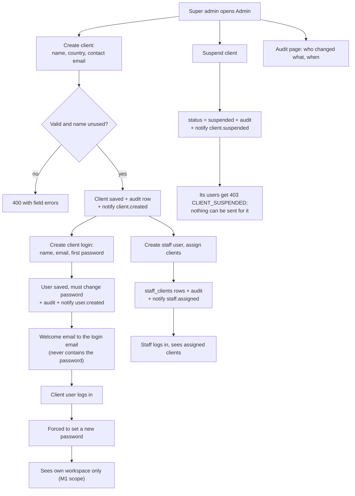

# M3. Client onboarding

- Status: In progress (prototype: the Admin page calls real routes, but clients live in an in-memory array)
- Owner: Anirudh (backend), Suraj (screens S3 to S6)
- Branch prefix: `m3-`
- Starts after: M1 (logins and scope), M2 (notifications)
- External prerequisites: none (E5 only for real emails; the fake provider is enough for the demo)

## Outcome

The super admin onboards a client from the Admin page: creates the client, its login, and a staff member assigned to it. Each person gets a welcome email and can log in to see exactly their workspace. The super admin can suspend a client, disable a user, and reset a password, and every change is recorded in an audit log with who did it and what changed.

## Flow diagram

## Worked example

1. Ravi (super admin) creates client **Northwind Labs**, country India (`91`), contact email `ops@northwind.com`. The client list shows it as Active. One audit row: `client.created` by Ravi.
2. Ravi adds a login for Northwind: Asha Rao, `asha@northwind.com`, first password `Temp-4821-north`. He tells Asha the password by phone. Asha receives "Your ReapLift login is ready" from `info@reaplift.com`, with the panel address and her email, but no password.
3. Asha logs in with the first password and must choose a new one before any page opens.
4. Ravi creates staff user Meera (`meera@reaplift.com`) and assigns her Northwind Labs and Bluebird Retail. Meera gets an email listing both clients. She logs in and the client picker shows exactly those two.
5. Bluebird has not paid. Ravi suspends it with the note "invoice overdue". Bluebird's users get an email and every Bluebird page shows "This account is suspended. Contact ReapLift." Meera can still open Northwind.
6. Asha forgets her password. Ravi resets it to a new first password; Asha gets an email saying her password was reset, and must change it at next login.
7. The audit page, filtered to Northwind, shows: client created, user created, staff assigned, password reset, each with Ravi's name, the time, and before and after values.

## Scope

In: clients, client users and staff users stored in PostgreSQL; staff assignments; suspend and reactivate; disable a user; password reset by the super admin; change-my-password; audit log and its page; M3's notifications; the panel's notification list and the super admin's delivery log (M2 builds the machinery; this is the first milestone with logins to show it).

Out:

- connecting a WhatsApp number to the client: [M5](../m5-number-and-templates/spec.md); the Admin client view gets an account box then
- prices and wallet balance: [M6](../m6-wallet/spec.md); the Admin client view gets a balance box then
- self-service "forgot password" by email: later, not planned

## Tasks

| Task | Name                                         | Depends on                       | Can run in parallel with |
| ---- | -------------------------------------------- | -------------------------------- | ------------------------ |
| 3.1  | Clients in the database                      | none                             | 3.3, 3.5                 |
| 3.2  | Client logins and change-my-password         | 3.1                              | 3.3                      |
| 3.3  | Staff users and client assignments           | 3.1                              | 3.2                      |
| 3.4  | Suspend, reactivate, disable, reset password | 3.1, 3.2                         | 3.5                      |
| 3.5  | Audit log and audit page                     | none (each task writes its rows) | all                      |
| 3.6  | Notifications for M3 events                  | 3.1 to 3.4                       | 3.7                      |
| 3.7  | Notification list and delivery log           | none                             | 3.6                      |

### 3.1 Clients in the database

- Replace the in-memory `adminClients` array in `app.ts` with the `clients` table, in a module `apps/server/src/modules/admin/`.
- Fields: name (unique, case-insensitive), country calling code (required; `91` for India; the only option at launch), contact email, status.
- Data: nullable column `clients.country_calling_code text` (migration; claim a number). The create route requires it, so every new client has one. M7 validates audience numbers against it (decided 29 October 2026).
- The prototype's free-text "assigned staff" and `walletBalance` fields are removed from the client record; staff come from 3.3, balance from M6.
- Tests: duplicate name gives 409 `CLIENT_NAME_TAKEN`; a missing country gives 400; a created client survives a restart.
- Acceptance: the Admin client list reads from PostgreSQL.

### 3.2 Client logins and change-my-password

- Super admin creates a `client` user for a client: name, email (unique), first password (at least 10 characters).
- Data: nullable column `users.must_change_password boolean`. The create-user route sets `users.created_by` (migration 0006) to the logged-in user, taken from the session and never from the request.
- A user with `must_change_password` can call only `POST /api/me/password` and `POST /api/auth/logout`; everything else returns 403 `PASSWORD_CHANGE_REQUIRED`.
- Every user can change their password from a "My account" menu item.
- Tests: first login forces a change; the old password stops working; a client user cannot be created without a client.
- Acceptance: steps 2 and 3 of the worked example.

### 3.3 Staff users and client assignments

- Super admin creates a `staff` user and sets the list of clients assigned to them. Saving the list replaces the rows in `staff_clients` and writes one audit row with the before and after lists.
- Tests: removing an assignment immediately makes that client's routes return 404 for that staff member.
- Acceptance: step 4 of the worked example.

### 3.4 Suspend, reactivate, disable, reset password

- Suspend and reactivate a client with a required note. M1's scope hook already returns 403 `CLIENT_SUSPENDED` for suspended clients; later milestones must also refuse to queue messages for them (M7 checks this).
- Disable and enable a user. A disabled user's sessions are revoked at once.
- Reset a user's password: the super admin sets a new first password; the user's sessions are revoked and `must_change_password` is set.
- Tests: suspending revokes nothing but blocks client routes; disabling revokes sessions; reset forces a change.
- Acceptance: steps 5 and 6 of the worked example.

### 3.5 Audit log and audit page

- Every admin change writes one `audit_logs` row in the same transaction: `action`, `entity_type`, `entity_id`, `client_id` (when the change concerns a client), `user_id` (the actor), and `details` with `before` and `after`.
- Passwords and hashes are never written to `details`.
- Super admin audit page: filter by client, user, action and date.
- Tests: each admin route writes exactly one audit row; a rolled-back change writes none.
- Acceptance: step 7 of the worked example.

### 3.6 Notifications for M3 events

Sent through M2's `notify()` in the same transaction as the change.

| Event                 | When                                       | Recipients                         | Channel         |
| --------------------- | ------------------------------------------ | ---------------------------------- | --------------- |
| `client.created`      | Client created                             | Contact email of the client        | Email           |
| `user.created`        | Client or staff user created               | That user (welcome, login address) | Email           |
| `staff.assigned`      | Staff assigned to or removed from a client | That staff member                  | Email and panel |
| `client.suspended`    | Client suspended                           | The client's users; assigned staff | Email and panel |
| `client.reactivated`  | Client reactivated                         | The client's users; assigned staff | Email and panel |
| `user.password_reset` | Password reset by the super admin          | That user                          | Email           |
| `user.locked`         | Login locked after failures (M1)           | That user                          | Email           |

- Tests: each event writes one row per recipient; no email ever contains a password.
- Acceptance: every email in the worked example is delivered by the fake provider.

### 3.7 Notification list and delivery log

- A bell in the panel header with the unread count; the list shows the user's own `panel` notifications; clicking marks one read.
- Super admin "Delivery log" page: every notification with status, attempts and last error; filter by status.
- Tests: a user sees only their own notifications; client and staff get 403 on the delivery log.
- Acceptance: Meera sees "You were assigned to Northwind Labs" in her bell after step 4.

## Screens (Suraj)

Built on the screens track against the mock API, so they can start before M1 and M2 are Done (tracker, "Screens track exception"). Contracts go in `packages/shared/src/contracts/admin.ts` and `me.ts`, from the route table below. Each ends as Screen ready; the backend task's owner wires it to the real route and records the evidence.

| #   | Screens                                                                                                                                                                                                                                                                                              | Backend task it pairs with |
| --- | ---------------------------------------------------------------------------------------------------------------------------------------------------------------------------------------------------------------------------------------------------------------------------------------------------- | -------------------------- |
| S3  | "My account" (change own password); the forced change-password screen whenever any route answers 403 `PASSWORD_CHANGE_REQUIRED`                                                                                                                                                                      | 3.2                        |
| S4  | Clients list; create and edit client (name, country calling code fixed to `91`, contact email); client detail with its users and staff; create user; staff assignment (pick clients, save replaces the list); suspend and reactivate with a required note; disable and enable a user; reset password | 3.1, 3.3, 3.4              |
| S5  | Audit page with filters by client, user, action and date                                                                                                                                                                                                                                             | 3.5                        |
| S6  | Notification bell (unread count, list, click marks read); super admin delivery log with a status filter                                                                                                                                                                                              | 3.7                        |

- Super admin only for S4, S5 and the delivery log; the menu hides them for other roles (the server enforces it).
- S4 replaces today's prototype Admin page; the free-text "assigned staff" and `walletBalance` fields go (balance arrives with S8 in M6).
- Tests: component tests for each form's validation and error messages (`CLIENT_NAME_TAKEN`, `EMAIL_TAKEN`, missing note), and the forced password change redirect.
- Screen ready: the worked example's steps run in mock mode; screenshots in `frontend.md`.

Anirudh builds 3.1 to 3.7's routes, tables and notifications.

## Data and API

Migration (claim one number in the registry): `clients.country_calling_code text`, `users.must_change_password boolean`, both nullable.

| Method | Route                                 | Who         | Purpose                                   |
| ------ | ------------------------------------- | ----------- | ----------------------------------------- |
| GET    | `/api/admin/clients`                  | super admin | List clients                              |
| POST   | `/api/admin/clients`                  | super admin | Create client                             |
| GET    | `/api/admin/clients/:id`              | super admin | Client detail with users and staff        |
| PATCH  | `/api/admin/clients/:id`              | super admin | Edit name and contact email               |
| POST   | `/api/admin/clients/:id/suspend`      | super admin | Suspend with a note                       |
| POST   | `/api/admin/clients/:id/reactivate`   | super admin | Reactivate with a note                    |
| POST   | `/api/admin/users`                    | super admin | Create a client or staff user             |
| PATCH  | `/api/admin/users/:id`                | super admin | Disable or enable                         |
| POST   | `/api/admin/users/:id/reset-password` | super admin | Set a new first password                  |
| PUT    | `/api/admin/users/:id/clients`        | super admin | Replace a staff member's assigned clients |
| GET    | `/api/admin/audit`                    | super admin | Audit rows with filters                   |
| GET    | `/api/admin/notifications`            | super admin | Delivery log                              |
| POST   | `/api/me/password`                    | logged in   | Change own password                       |
| GET    | `/api/me/notifications`               | logged in   | Own panel notifications                   |
| PATCH  | `/api/me/notifications/:id/read`      | logged in   | Mark one read                             |

Errors: 400 `INVALID_REQUEST` with field details, 403 `FORBIDDEN`, 404 `NOT_FOUND`, 409 `CLIENT_NAME_TAKEN` or `EMAIL_TAKEN`, all as `{ "error", "message" }`. The full request and response for each route goes in `backend-api.md` before it is coded.

## Notifications

Task 3.6.

## Open questions

None open.

## Current reality

- Admin page (`apps/web/src/pages/Admin.tsx`) lists, creates, suspends clients and changes "assigned staff" through `GET/POST /api/admin/clients` and two `PATCH` routes, validated with Zod.
- All of it is held in an in-memory array in `app.ts`, seeded with two fake clients; a restart loses changes. "Assigned staff" is free text. No users, audit rows or notifications are written.
- The other files in this folder (`README.md`, `backend-api.md`, `frontend.md`, `database.md`, `e2e.md`, `test-evidence.md`) describe that prototype as of 28 October 2026. They are rewritten as this milestone's evidence when its tasks are done.

## Demo (milestone acceptance)

Run the worked example in the real panel against PostgreSQL, with `EMAIL_PROVIDER=fake`, and record in `e2e.md`:

1. Each step's screen.
2. The rows in `clients`, `users`, `staff_clients`, `audit_logs` and `notifications` after step 7.
3. A server restart after step 4, with everything still there.
4. The emails from the fake provider's log.
