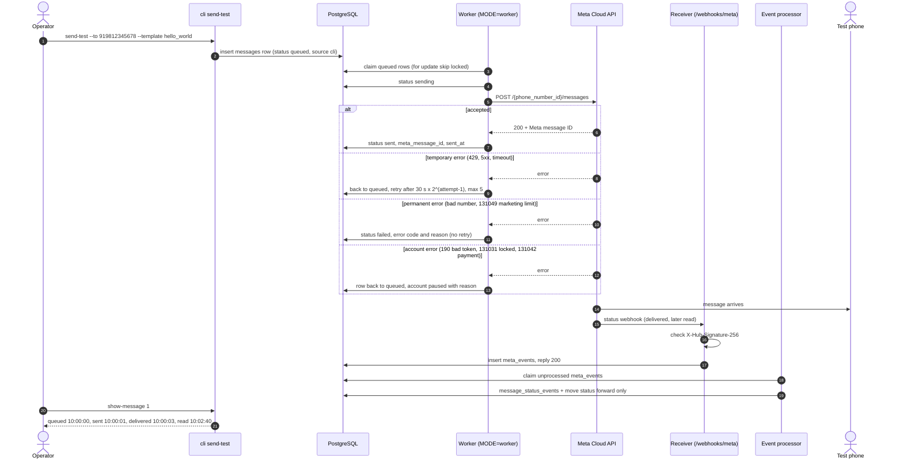

# M4. Send engine: one message end to end

- Status: Built on 30 October 2026 (4.1 to 4.6, and the 4.7 commands), tested against the fake Meta server; see [test-evidence.md](test-evidence.md). Done when E1 and E2 are met and the real-phone demo passes.
- Owner: Anirudh
- Starts after: M0
- External prerequisites: E1 (Meta app, test number, token) and E2 (app in Live mode, public HTTPS address for webhooks) for the real-phone demo. Everything else is built and tested against a fake Meta server.

## Outcome

An operator on the server queues one WhatsApp template message from the command line. The worker sends it through ReapLift's own Meta app, Meta's delivery updates arrive at the webhook, and the message moves to sent, delivered and read with the time of each. Every later milestone (templates, campaigns, notifications) sends through this engine; M4 proves it with one internal test client and no panel.

## Flow diagram

## Worked example

1. The operator runs `cli seed-account`. It asks for the WhatsApp account ID, phone number ID and token for ReapLift's test number, tests them against Meta, creates client "ReapLift Internal Test" with its account (token stored encrypted), and copies the account's templates from Meta into `templates`. `hello_world` (en_US, UTILITY, approved) appears.
2. `cli send-test --to 919812345678 --template hello_world --lang en_US` prints `queued message 1`.
3. Within a second the worker sends it; Meta answers with ID `wamid.HBgM...`; row 1 is `sent`.
4. The phone shows the message. Meta posts a `delivered` webhook; the receiver checks its signature, stores it in `meta_events`, and replies 200. The processor moves row 1 to `delivered`.
5. The phone owner opens the chat; a `read` webhook moves row 1 to `read`.
6. Meta sends the `delivered` webhook again (Meta retries). The processor sees it already has that status for that message and changes nothing.
7. A second send to `915812345678` (not a WhatsApp number) fails with Meta's permanent error; row 2 is `failed` with the code and title, and is never retried.
8. Someone revokes the token. The next send gets error 190; the account is paused with "token invalid"; the message waits in `queued` until the super admin fixes the token and resumes.

## Scope

In: encrypted token storage, the seed command, template copy from Meta, the Meta HTTP client and error classes, the fake Meta server, the sender worker, the webhook receiver, the event processor, `send-test` and `show-message`.

Out:

- connecting a client's number from the panel and template approval: [M5](../m5-number-and-templates/spec.md)
- campaigns, wallet charges and refunds: M6, M7
- STOP replies and opt-outs: M7 (M4 stores every incoming webhook, including customer replies, so nothing is lost)
- the cloud server: [M10](../m10-cloud-deploy/spec.md). Until it exists, the real-phone demo exposes the local receiver through an HTTPS tunnel (for example Cloudflare Tunnel), with the owner's approval.

## Tasks

| Task | Name                                          | Depends on | Can run in parallel with |
| ---- | --------------------------------------------- | ---------- | ------------------------ |
| 4.1  | `seed-account` command                        | none       | 4.2, 4.4                 |
| 4.2  | Meta HTTP client and fake Meta server         | none       | 4.1, 4.4                 |
| 4.3  | Sender worker loop                            | 4.2        | 4.4, 4.5                 |
| 4.4  | Webhook receiver stores events                | none       | 4.1, 4.2, 4.3            |
| 4.5  | Event processor                               | 4.4        | 4.3                      |
| 4.6  | Template copy from Meta                       | 4.1, 4.2   | 4.3 to 4.5               |
| 4.7  | `send-test`, `show-message`, real-phone check | 4.1 to 4.6 | none                     |

### 4.1 `seed-account` command

- Built: AES-256-GCM `encryptSecret` and `decryptSecret` (`lib/crypto.ts`; it was CBC until 30 October 2026, with no real tokens stored); `seedAccount()` (`lib/seed-account.ts`); the `cli seed-account` command that prompts for the token (never as a command-line argument, so it is not in shell history), and calls Meta once to check the IDs and token before saving.
- The command refuses the public development `APP_ENCRYPTION_KEY` when pointed at the real Meta API.
- Tests: encrypt and decrypt round trip; a wrong key fails; the stored token is not plain text; bad IDs are refused after the fake Meta server rejects them.
- Acceptance: the account row holds an encrypted token.

### 4.2 Meta HTTP client and fake Meta server

- Built: error classifier, message body builder and HTTP client (`lib/meta-client.ts`). A template without variables sends no `components`.
- 4.2.1 HTTP call `POST https://graph.facebook.com/<version>/<phone_number_id>/messages` with the version from `META_GRAPH_VERSION`: blank means v26.0, the latest when built (checked 30 October 2026).
- 4.2.2 Check every error code in the classifier against Meta's current error-code page and write the date checked in a comment. Treat **131049** (per-person marketing limit) as a final failure whether it comes back from the send call or in a `failed` webhook: Meta says wait at least 24 hours, so it is never retried automatically, and M7 shows it as "Meta limit". Classes as built, checked against [Meta's error-code page](https://developers.facebook.com/documentation/business-messaging/whatsapp/support/error-codes) on 30 October 2026: temporary (network, 5xx, 1, 2, 4, 80007, 130429, 131000, 131016, 131056, 131057, 133004), permanent (100, 130472, 131008, 131009, 131021, 131026, 131047, 131048, 131049, 131050, 131051, 131053, 132000, 132001, 132005, 132007, 132012, 132015, 132016, 132068, 132069), account (0, 3, 10, 190, 200 to 299, 368, 131005, 131031, 131042, 133010). A code not listed retries, up to 5 attempts.
- 4.2.3 A fake Meta server (`test/support/fake-meta.ts`) that can answer success, any error code, or a delay, and can post signed webhooks to the receiver. `pnpm --filter @reaplift/server fake-meta` runs it alone, so the flow can be run by hand with no Meta account.
- Tests: send succeeds; 429 then 200 retries once; a permanent code fails at once; 131049 fails at once; 190 is classed as account.
- Acceptance: all tests run in CI against the fake server.

### 4.3 Sender worker loop

- Built: `modules/messaging/sender.ts`, with the claim query using `for update skip locked`, and the backoff maths in `lib/worker.ts`.
- 4.3.1 A loop in `MODE=worker` that claims a batch, sends, and saves the outcome. `modes/worker.ts` runs a list of loops; M2's email loop joins the same list.
- 4.3.2 A rate limiter per WhatsApp account from `wa_accounts.send_rate_per_sec`. It counts one process's sends, so a second worker never sends a row twice but does double the rate. Run one worker until a shared limit is needed.
- 4.3.3 Outcome handling: sent; temporary error back to `queued` with `next_attempt_at`; permanent `failed` with code and title; account error pauses the account (`status = 'paused'`, `paused_reason`) and puts the row back.
- 4.3.5a Add the `bigint` type parser to `lib/db.ts` (convention in [data-model-and-api.md](../../data-model-and-api.md)): `pg` returns `bigint` as text, and `messages.id` is the first `bigint` the code reads.
- 4.3.6 The worker always sends with the token stored on the message's own account. ReapLift's test number (manual token) and client accounts (business token from Embedded Signup, M5) therefore work the same way.
- 4.3.7 Client accounts are paid through ReapLift's shared credit line (decided 29 October 2026). A payment error (131042) on a client account may mean the credit line itself has a problem and every client is about to fail, so besides pausing that account it logs an error with `alert: credit-line`, which M11 task 11.1 turns into an alert to super admins.
- 4.3.4 Rows in `sending` for more than 5 minutes are logged as stuck and never sent again automatically (sending twice would charge the customer twice). This also catches a message Meta accepted when saving its ID then failed.
- 4.3.5 A paused account's messages are not claimed.
- Tests (integration, real PostgreSQL, fake Meta): two workers never send the same row; the rate stays within the setting; each outcome above.
- Acceptance: the worker sends a queued row to the fake server and claims nothing when the queue is empty.

### 4.4 Webhook receiver stores events

- Built: `GET /webhooks/meta` verify-token check (refused when no token is configured) and `POST` signature check in constant time (`app.ts`).
- 4.4.1 Insert the verified body into `meta_events`, then answer 200. No other work in the request, so Meta never times out.
- 4.4.2 `META_VERIFY_TOKEN` and `META_APP_SECRET` are passed from config into `buildApp` in `modes/api.ts`, and `.env.example` uses the same names.
- 4.4.3 The route runs in `MODE=api`, so the real-phone demo needs the API, worker and receiver all running. Request logs drop the query string, because it carries the verify token.
- Tests: valid, altered and missing signatures; a valid POST stores exactly one row; an altered one stores nothing.
- Acceptance: a tampered POST gets 401 and stores nothing.

### 4.5 Event processor

- Built: `modules/messaging/processor.ts`, using the status ranking and forward-only rules in `lib/status-processor.ts`.
- 4.5.1 A loop that claims unprocessed `meta_events`, writes `message_status_events` (primary key message ID and status, so a repeat is skipped), and moves `messages` forward only (read never goes back to delivered).
- 4.5.2 A status for a message whose `meta_message_id` is not saved yet (the webhook beat the worker's save) is retried, and marked with `process_error` after 10 minutes.
- 4.5.3 Save `pricing.category` and `pricing.billable` from the webhook on the message. Meta has deprecated `billable` in favour of `type` and `category` (checked 30 October 2026), and `type` is not stored yet, so M7 must check this before charging on it.
- 4.5.4 Events that are not message statuses (customer replies, template updates, account updates) are marked processed with no action. M5 and M7 add handlers for them; the stored rows let them be replayed.
- 4.5.5 Meta's `played` status (voice messages) is recorded in `message_status_events` and does not change the message.
- Mode: the processor runs in `MODE=receiver` and the sender in `MODE=worker` (the design's default; both are loops in the one server program).
- Tests: every status pair including repeats and read before delivered; the same webhook three times changes the row once.
- Acceptance: replaying a stored event changes nothing.

### 4.6 Template copy from Meta

- `seed-account` (and later M5) reads the account's templates from Meta and upserts them into `templates` with name, language, category, components, variable count and status.
- Tests: fake server returns three templates; running twice leaves three rows.
- Acceptance: `hello_world` appears in `templates` as approved.

### 4.7 `send-test`, `show-message`, real-phone check

- `cli send-test --to <number> --template <name> --lang <code> [--var value ...]` queues one row with source `cli`.
- `cli show-message <id>` prints the row and every status with its time.
- Built, and run against the fake Meta server. The real-phone check is the demo below.

## Data and API

- Tables: from migration 0002 only (`clients`, `wa_accounts`, `templates`, `messages`, `meta_events`, `message_status_events`). M4 adds no migration. Schema: `db/migrations/0002_message_platform.sql`. Early contracts: [draft-api-contracts.md](draft-api-contracts.md) (old numbering; where it differs, this spec wins).
- Routes: `GET` and `POST /webhooks/meta` (public, signature-checked).
- Settings: `APP_ENCRYPTION_KEY`, `META_APP_SECRET`, `META_VERIFY_TOKEN`, `META_GRAPH_VERSION`, and `META_API_BASE_URL` (only to use the fake Meta server).
- Tenant rule: every `messages` row carries `client_id`. `meta_events` has no `client_id` because Meta's webhook arrives before the client is known; the processor finds the message by the unique `meta_message_id`.

## Notifications

None in M4. The account-paused alert is sent from M5 task 5.6 and M11 task 11.1.

## Open questions

| Question                                                                                         | Default                                    | Decides  |
| ------------------------------------------------------------------------------------------------ | ------------------------------------------ | -------- |
| A timeout may mean Meta accepted the message, so the retry could send it twice. Accept this?       | Yes, retry, as this spec says              | Owner    |
| May the local receiver be exposed through a tunnel for the real-phone demo before M10?           | Yes, only during the demo                  | Owner    |

## Current reality

- E1 is not done (owner confirmed 30 October 2026): ReapLift is still getting its Meta business account. The test receiver will be the owner's phone.
- All of M4 runs against the fake Meta server, in CI and by hand. Nothing has called the real Meta API, so the request shapes are checked only against Meta's documentation.
- No screen or command resumes a paused account or replaces its token yet; that is M5. Until then it is SQL, shown in `test-evidence.md`.
- Sending supports body variables only. A template with a header variable counts it in `variable_count`, but Meta would refuse the send (M5 or M7 extends the builder).

## Demo (milestone acceptance)

1. In CI: the integration tests for 4.3 to 4.5 pass against the fake Meta server (record in `test-evidence.md`).
2. With E1 and E2: run `seed-account`, then `send-test` to a team member's phone.
3. The phone shows the message. After it is opened, `show-message` prints sent, delivered and read times.
4. Re-post one stored webhook to the receiver; `show-message` is unchanged.
5. Record the commands, output and a phone screenshot in `e2e.md`.
