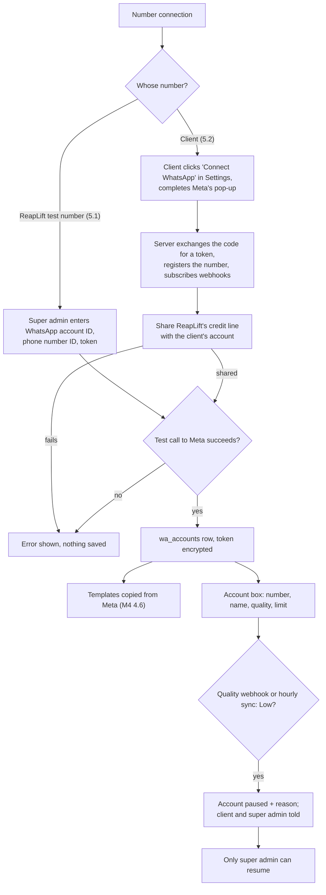
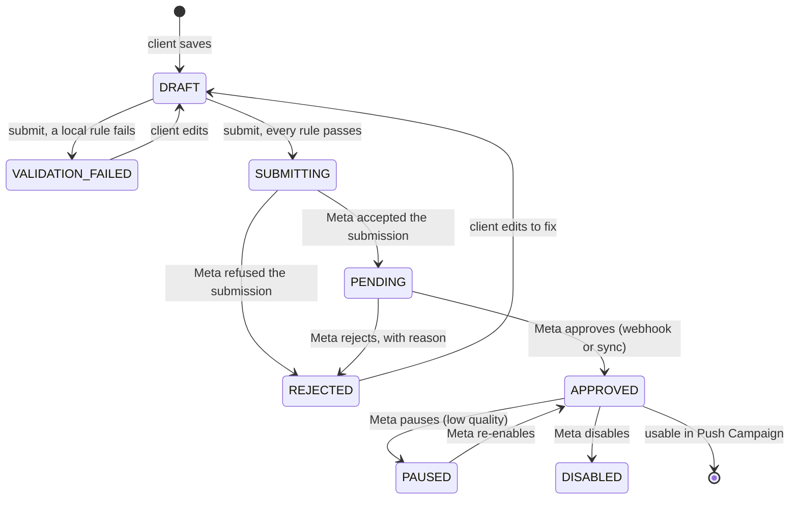

# M5. Number connection and templates

- Status: Not started
- Owner: Unassigned
- Branch prefix: `m5-`
- Starts after: M3 (clients and logins), M4 (send engine and Meta client)
- External prerequisites: E3 (Business Verification and App Review) before Embedded Signup works for anyone outside ReapLift. E7 (Solution Partner status and credit line) before credit-line sharing can be accepted against real Meta; everything is built and tested against the fake Meta server first. A real Embedded Signup run needs the panel on an HTTPS address registered in ReapLift's Meta app (an HTTPS tunnel during development, or M10's address).

## Outcome

A client's own WhatsApp number is connected to its workspace. The client (or its assigned staff) writes a template; ReapLift checks it against known rules at once, and only a template that passes goes to Meta, in the background. The template then shows Approved, or Rejected with Meta's reason and a plain explanation of how to fix it. The client fixes it and submits again. If the number's quality drops to Low, the number is paused and everyone concerned is told.

## How client numbers are connected and paid for (decided 29 October 2026)

ReapLift works as a white-label provider, as Dovesoft does today:

- Each client owns its WhatsApp account and connects it itself through Meta's **Embedded Signup** in Settings (task 5.2). Staff or the super admin can sit with the client and do it for them.
- During that onboarding, ReapLift **shares its credit line** with the client's account. Meta then bills ReapLift for the client's messages, and ReapLift charges the client's prepaid wallet at Meta's rate plus markup (M6).
- `wa_accounts.meta_payer` is `reaplift_credit_line` for client accounts. `reaplift_card` is used only for ReapLift's own test numbers.
- Manual connection by IDs and token (task 5.1) is kept for ReapLift's own test numbers and for support; it is not how clients are onboarded.
- Until E7 is done, only test businesses are onboarded (paying with their own card at Meta). Real clients stay on Dovesoft until then.

## Flow diagrams

Connecting a number:

A template's life:

Only `APPROVED` templates can be picked in Push Campaign (M7). An approved template is never edited; the client copies it into a new draft (decided 29 October 2026).

## Worked example

1. Asha (Northwind) clicks Connect WhatsApp in Settings, logs in to Meta in the pop-up and picks number `91 98200 11223`. ReapLift's server registers the number and shares ReapLift's credit line with Northwind's account, so Meta will bill ReapLift. The account box shows display name "Northwind Labs", quality Green, limit 1K a day. Northwind's existing templates from Meta are copied in.
2. Asha (client user) creates template `diwali_offer_2026`, category UTILITY, body "Hi {{1}}, flat 20% off on all orders till Sunday. Use code {{2}}." with samples "Rahul" and "DIWALI20".
3. She clicks Submit. In under a second the page shows **Validation failed**: "Category: the body contains promotional words ('flat 20% off'). Utility templates cannot advertise. Fix: change the category to MARKETING." Nothing was sent to Meta.
4. She changes the category to MARKETING and submits. The status shows **Submitting**, then **Pending at Meta** a few seconds later.
5. Two hours later Meta rejects it with reason `INVALID_FORMAT` and a recommendation. The page shows **Rejected**, Meta's recommendation word for word, and our plain explanation of the reason. Asha and Meera (her assigned staff) get an email and a panel notification.
6. Asha edits the body as recommended and submits. Local rules pass again, it goes to Meta, and the next morning it shows **Approved**. It now appears in Push Campaign's template list.
7. A week later, many recipients block Northwind's number and Meta lowers its quality to Low. The account is paused with reason "Quality dropped to Low". Asha, Meera and Ravi are told. Campaigns for Northwind cannot be confirmed until Ravi resumes it.

## Scope

In: Embedded Signup with credit-line sharing; manual connection for ReapLift's own numbers; Settings page with the account box; Templates page (list, editor, status, rejection detail); local rule checks; background submission; status by webhook and a 15-minute sync; resubmission; quality and limit tracking with pause on Low; M5's notifications.

Out:

- choosing templates in a campaign: [M7](../m7-campaigns/spec.md)
- the super admin's view of Meta cost and margin: [M9](../m9-reports/spec.md)
- moving numbers from Dovesoft: [M11](../m11-pilot/spec.md)

Who can do what: client users and their assigned staff run Embedded Signup and create and submit templates (staff can do everything the client can, decided 29 October 2026); the super admin can do everything for any client and is the only one who connects numbers manually (5.1).

## Tasks

| Task | Name                                             | Depends on                             | Can run in parallel with |
| ---- | ------------------------------------------------ | -------------------------------------- | ------------------------ |
| 5.1  | Manual number connection and account box         | none                                   | 5.3                      |
| 5.2  | Embedded Signup and credit-line sharing          | 5.1                                    | 5.3, 5.4                 |
| 5.3  | Template editor and local rules                  | 5.1 (a template belongs to an account) | 5.2, 5.5                 |
| 5.4  | Background submission, status sync, resubmission | 5.3                                    | 5.5                      |
| 5.5  | Quality and limit tracking, pause on Low         | 5.1                                    | 5.3, 5.4                 |
| 5.6  | Notifications for M5 events                      | 5.1 to 5.5                             | none                     |

### 5.1 Manual number connection and account box

- Super admin form on the Admin client view: WhatsApp account ID, phone number ID, token. The server calls Meta once to check them and reads the display number and name.
- Token stored encrypted (M4's `encryptSecret`). `wa_accounts.meta_payer` is `reaplift_card` (ReapLift's own numbers only).
- The account box (number, display name, quality, limit, status) appears in Admin and on the client's Settings page and Dashboard.
- Tests: bad IDs or token are refused after the fake Meta server rejects them; the token is never returned by any route.
- Acceptance: a second test number is connected from the panel.

### 5.2 Embedded Signup and credit-line sharing

- 5.2.1 "Connect WhatsApp" button on Settings opens Meta's Embedded Signup. The server receives the WhatsApp account ID, phone number ID and a code; exchanges the code for a business token (stored encrypted); registers the number; subscribes ReapLift's app to the account's webhooks.
- 5.2.2 Share ReapLift's credit line with the client's account, using the system user token as Meta's docs describe for Solution Partners. Save what Meta returns for the sharing on the account (nullable column) and set `meta_payer = 'reaplift_credit_line'`.
- 5.2.3 If sharing fails, the account is saved as `paused` with reason "credit line not shared", so nothing can be sent at ReapLift's cost or the client's by mistake; the super admin sees it and retries.
- 5.2.4 If Meta later reports a payment problem on the account (account-level error 131042 in M4), the account is paused and the super admin is told; M4 also raises the platform-wide credit-line alert.
- 5.2.5 A client that already has a WhatsApp account (for example on Dovesoft) may be able to bring that account through Embedded Signup instead of moving its number, keeping its templates and quality. Whether this works for Dovesoft's clients is D13 in the tracker; check Meta's docs when building.
- Check every Meta call and permission (including the billing permission for credit sharing) against Meta's current Embedded Signup and Solution Partner docs while coding, and record the date.
- Tests: the exchange, registration, subscription and credit-sharing calls against the fake Meta server, including a sharing failure.
- Acceptance: on the fake server, a client connects its own number from Settings with no help from ReapLift and the account shows "Paid by ReapLift credit line". Against real Meta this needs E3, and credit-line sharing needs E7.

### 5.3 Template editor and local rules

- 5.3.1 Editor: name, language, category, header (none, text, image, video, document), body, footer, buttons, one sample value per variable.
- 5.3.2 A rule module: each rule is one small function returning pass, or a failure with the field, a message and a suggested fix. New rules are added without changing the flow.
- 5.3.3 Save as `DRAFT`. On submit run every rule; any failure sets `VALIDATION_FAILED` and stores the failures; nothing goes to Meta.
- 5.3.4 Media header files are stored (local disk until object storage exists in M10) and uploaded to Meta to get the sample handle Meta needs for review.
- Starting rules (Meta's exact limits must be checked against Meta's current docs while coding; write the date checked next to each limit):
  - category fit: promotional words in a UTILITY or AUTHENTICATION template fail with "looks like MARKETING". The word list is a settings row the super admin edits (decided).
  - variables are `{{1}}`, `{{2}}`, ... in order with no gaps, and each has a sample
  - the body does not start or end with a variable, and two variables are not next to each other
  - lengths of name, header, body, footer and button text within Meta's limits
  - the name uses lowercase letters, digits and underscores, and is unique for the account and language
  - the language code is one Meta supports
  - a media header has a file of an allowed type and size
  - URL buttons hold a valid `https` address; phone buttons a valid number
- Data (new nullable columns on `templates`): `validation_errors jsonb`, `submitted_at timestamptz`, `rejection_reason text`, `meta_recommendation text`, `media_storage_key text`, `created_by uuid`. `templates.status` has no check constraint (0002), so the new states need no constraint change.
- Tests: one failing and one passing fixture per rule; a failing template makes no call to the fake Meta server.
- Acceptance: steps 2 and 3 of the worked example.

### 5.4 Background submission, status sync, resubmission

- 5.4.1 A template that passes every rule becomes `SUBMITTING`; the route answers 202 at once and a worker loop submits it.
- 5.4.2 Meta's answer saves `meta_template_id` and sets `PENDING`; a submission error sets `REJECTED` with Meta's error text.
- 5.4.3 Status from M4's stored `message_template_status_update` webhooks plus a 15-minute sync in `MODE=scheduler` (M5 builds the scheduler loop; it is the first milestone that needs it).
- 5.4.4 On rejection save `reason`, and `rejection_info.recommendation` when Meta sends it (Meta sends it only for `INVALID_FORMAT`). Every reason value on Meta's template status webhook page gets a plain explanation in our code; an unknown value is shown as Meta sent it.
- 5.4.5 Editing a `REJECTED` or `VALIDATION_FAILED` template returns it to `DRAFT`; submitting runs 5.3's rules again, then this flow.
- 5.4.6 One query function, `listApprovedTemplates(scope)`, returns only `APPROVED` templates of the client's active accounts. M7 uses only this function.
- Tests: a webhook and a sync for the same change update the row once; the same webhook twice changes nothing; a rejected template fixed and resubmitted reaches `APPROVED` on the fake server.
- Acceptance: steps 4 to 6 of the worked example.

### 5.5 Quality and limit tracking, pause on Low

- Quality and messaging limit from M4's stored webhooks plus an hourly sync into `wa_accounts.quality_rating` and `messaging_limit`.
- Quality Low sets `status = 'paused'` with a reason; M4's worker stops claiming its messages. Only the super admin can resume (button in Admin), and resuming is audited.
- Meta's messaging limits may now apply across a business rather than per number; check Meta's current docs while coding and record which.
- Tests: Medium to Low pauses; back to Medium does not resume on its own; resume needs the super admin.
- Acceptance: step 7 of the worked example on the fake server.

### 5.6 Notifications for M5 events

| Event                         | Recipients                                                            | Channel         |
| ----------------------------- | --------------------------------------------------------------------- | --------------- |
| `account.connected`           | Client users; assigned staff; super admins                            | Email and panel |
| `template.approved`           | The user who submitted it; client users; assigned staff               | Email and panel |
| `template.rejected`           | The user who submitted it; client users; assigned staff (with reason) | Email and panel |
| `template.paused_or_disabled` | Client users; assigned staff; super admins                            | Email and panel |
| `account.paused`              | Client users; assigned staff; super admins (with reason)              | Email and panel |
| `account.resumed`             | Client users; assigned staff                                          | Email and panel |

Local validation failures are shown on screen at once and are not notified.

- Tests: each event writes one row per recipient.
- Acceptance: an approval and a rejection on the fake server each deliver their notification.

## Data and API

- Tables: `wa_accounts`, `templates` (0002); new nullable columns on `wa_accounts` (5.1, 5.2): `onboarded_via`, `credit_share_ref`, `connected_by`, `connected_at`; new nullable columns on `templates` (5.3); a `settings` row for the promotional word list (claim a migration number if a table is needed).
- Routes (write each request, response and error in `backend-api.md` before coding):
  - `POST /api/admin/clients/:id/wa-accounts` (5.1), `POST /api/admin/wa-accounts/:id/resume` (5.5)
  - `GET /api/clients/:clientId/wa-accounts`
  - `POST /api/clients/:clientId/wa-accounts/embedded-signup` (5.2)
  - `GET`, `POST /api/clients/:clientId/templates`; `GET`, `PUT /api/clients/:clientId/templates/:id`; `POST /api/clients/:clientId/templates/:id/submit`; `POST /api/clients/:clientId/templates/:id/copy`
- Modes: submission loop in `worker`; status, quality and limit sync in `scheduler`.
- Settings: `META_APP_ID`, `META_CONFIG_ID` for Embedded Signup if used.

## Notifications

Task 5.6.

## Open questions

None. The connection and billing model was decided on 29 October 2026.

## Current reality

Tables `wa_accounts` and `templates` exist from 0002. Nothing else.

## Demo (milestone acceptance)

1. Connect a second ReapLift test number manually (5.1), and onboard a test business through Embedded Signup (5.2); with E7, show the credit line shared with it.
2. Run the worked example's steps 2 to 6 with ReapLift's real test number: one local failure, one real Meta submission, and the approval shown in the panel.
3. On the fake server, run step 7 (quality drop pauses the account) and the super admin's resume.
4. Record screens, rows and notifications in `e2e.md`.
