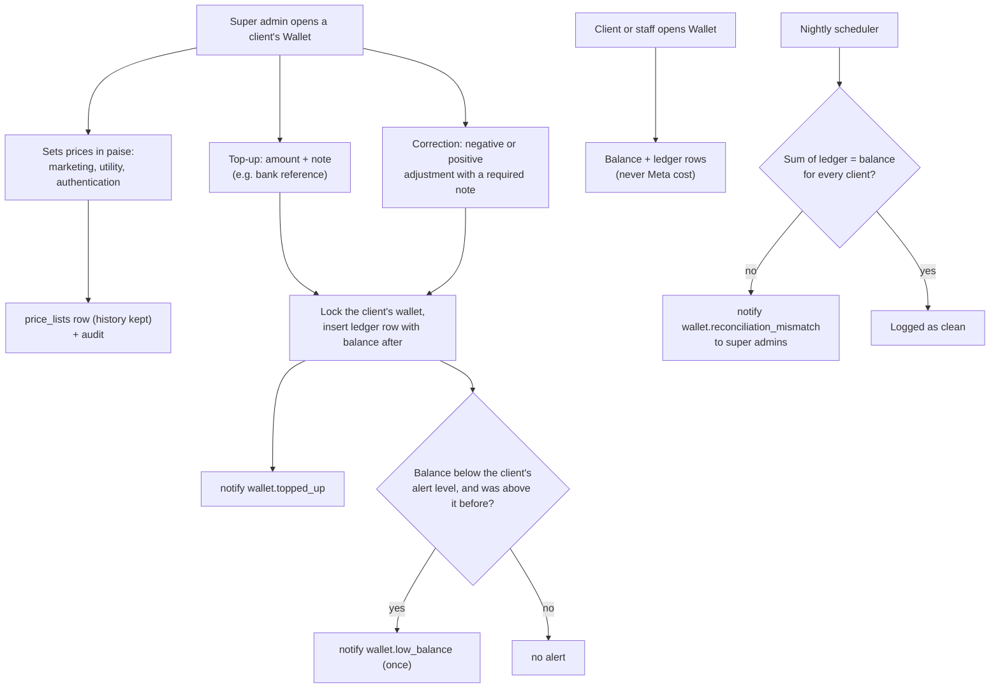

# M6. Wallet and prices

- Status: Not started
- Owner: Unassigned
- Branch prefix: `m6-`
- Starts after: M3 (clients and logins)
- External prerequisites: none. D1 changes what the price covers (Meta's cost plus margin, or ReapLift's fee only if clients pay Meta themselves), not how the wallet works.

## Outcome

The super admin sets each client's price per message type and tops up its prepaid wallet in rupees. The client, its staff and the super admin see the balance and every movement as an unchangeable ledger row. When the balance falls below the client's alert level, the right people are told. A nightly check proves the ledger and balances agree. Charging campaigns and refunding failures use this wallet in [M7](../m7-campaigns/spec.md).

## Flow diagram

## Worked example

1. Ravi opens Northwind's wallet and sets prices: marketing 95 paise (₹0.95), utility 20 paise, authentication 20 paise. He sets the low-balance alert to ₹500.
2. Ravi tops up ₹10,000 with note "NEFT UTR 4471". The ledger shows one row: +₹10,000.00, balance after ₹10,000.00, by Ravi, with the note. Asha (Northwind) gets an email and sees the same row on her Wallet page.
3. Ravi mistakenly tops up ₹1,000 twice. He cannot edit or delete the second row. He adds an adjustment of −₹1,000 with note "duplicate top-up 29 Oct". The ledger now has four rows and the balance is ₹11,000.00.
4. To test the alert, Ravi adds an adjustment of −₹10,600 (note "alert test"). The balance is ₹400, below ₹500, so Asha, Meera and Ravi are told once. A further −₹50 adjustment does not alert again. A top-up back above ₹500 re-arms the alert.
5. Asha can see prices and balance but cannot change them, and never sees Meta's cost or ReapLift's margin.
6. Overnight, the reconciliation adds up Northwind's ledger and matches the balance. A planted mismatch in a test database raises an alert to the super admins.

M7 then charges a campaign at confirm and refunds Meta failures. With a ₹100 balance, a price of ₹0.80 and a 50-number campaign with 5 Meta failures, the balance ends at ₹64 (₹100 − ₹40 + ₹4).

## Scope

In: price lists per client, charging switches (HLD section 5), the append-only ledger, top-ups and adjustments by the super admin, the Wallet page, the Admin balance box, the low-balance alert, the nightly ledger check, M6's notifications.

Out:

- charging at confirm and refunding failures: M7 (it uses this ledger)
- Meta's cost per message and the margin view: [M9](../m9-reports/spec.md)
- online payment by the client: later; top-ups are manual at launch

## Tasks

| Task | Name                              | Depends on | Can run in parallel with |
| ---- | --------------------------------- | ---------- | ------------------------ |
| 6.1  | Price lists and charging switches | none       | 6.2                      |
| 6.2  | Ledger and balance safety         | none       | 6.1                      |
| 6.3  | Top-ups and adjustments           | 6.2        | 6.1, 6.4                 |
| 6.4  | Wallet page and Admin balance box | 6.2        | 6.3                      |
| 6.5  | Nightly ledger check              | 6.2        | 6.3, 6.4                 |
| 6.6  | Notifications for M6 events       | 6.3, 6.5   | none                     |

### 6.1 Price lists and charging switches

- `price_lists`: client, message category, price in paise (`bigint`), valid from. A new price is a new row; the old row stays for history. Campaigns use the price valid at confirm.
- `charge_policy`: one switch per outcome from HLD section 5 (blocked, sent but not delivered, delivered or read, failed at Meta), each true or false, for all clients or one client. Defaults match HLD section 5. D6 (in the tracker) adds the invalid and duplicate outcomes.
- Tests: a client-level switch overrides the global one; a price change does not change an already-confirmed campaign's price.
- Acceptance: step 1 of the worked example with no code change.

### 6.2 Ledger and balance safety

- `wallet_ledger`: `id`, `client_id`, `kind` (`topup`, `adjustment`, `charge`, `refund`), `amount_paise bigint` (positive adds, negative takes), `balance_after_paise bigint`, `campaign_id null`, `message_id null`, `note`, `created_by`, `created_at`.
- A database trigger refuses `update` and `delete` on `wallet_ledger`.
- The current balance is the latest row's `balance_after_paise`. Every change locks the client's row (`select ... for update` on `clients`) first, so two changes at once cannot both read the same balance.
- One function, `applyLedgerEntry(trx, entry)`, is the only way to write the ledger. M7 calls it for charges and refunds.
- Tests: two changes at once with money for only one: exactly one succeeds; update and delete are refused by the database; a charge that would make the balance negative is refused.
- Acceptance: the balance always equals the sum of the client's ledger rows.

### 6.3 Top-ups and adjustments

- Super admin only. A top-up must be positive; an adjustment can be either sign and requires a note. Both write an audit row.
- Tests: client and staff get 403; a zero or missing amount gives 400.
- Acceptance: steps 2 and 3 of the worked example.

### 6.4 Wallet page and Admin balance box

- Wallet page in every client workspace: balance, prices, ledger with filters by kind and date, CSV download.
- Admin client view shows the balance and a top-up button.
- Client and staff see the client's prices and ledger only; never Meta cost or margin.
- Tests: another client's wallet returns 404 (M1's route-walking test covers it); amounts shown in rupees with two decimals from paise.
- Acceptance: step 5 of the worked example.

### 6.5 Nightly ledger check

- A scheduler job (the `scheduler` mode built in M5, or here if M6 lands first) checks for every client that the ledger rows add up to the latest balance and that no balance is negative. M7 adds a second check: charges minus refunds equal the campaign's messages times price.
- Tests: a planted mismatch raises the alert.
- Acceptance: the job runs nightly and logs "clean" on a correct database.

### 6.6 Notifications for M6 events

| Event                            | Recipients                                 | Channel         |
| -------------------------------- | ------------------------------------------ | --------------- |
| `wallet.topped_up`               | Client users; assigned staff               | Email and panel |
| `wallet.low_balance`             | Client users; assigned staff; super admins | Email and panel |
| `wallet.reconciliation_mismatch` | Super admins                               | Email           |

- The low-balance alert fires when a change takes the balance from at or above the client's `clients.low_balance_alert_paise` (already in 0002) to below it; it does not repeat until the balance has gone back above.
- Later (decided 29 October 2026, not at launch): send the low-balance alert on WhatsApp from ReapLift's own number too.
- Tests: crossing the line notifies once.
- Acceptance: step 4 of the worked example.

## Data and API

Migration (claim one number): `price_lists`, `charge_policy`, `wallet_ledger` with its trigger.

| Method | Route                                       | Who                                 |
| ------ | ------------------------------------------- | ----------------------------------- |
| GET    | `/api/clients/:clientId/wallet`             | client, assigned staff, super admin |
| GET    | `/api/clients/:clientId/wallet/ledger`      | client, assigned staff, super admin |
| GET    | `/api/clients/:clientId/prices`             | client, assigned staff, super admin |
| PUT    | `/api/admin/clients/:id/prices`             | super admin                         |
| PATCH  | `/api/admin/clients/:id/low-balance-alert`  | super admin                         |
| POST   | `/api/admin/clients/:id/wallet/topups`      | super admin                         |
| POST   | `/api/admin/clients/:id/wallet/adjustments` | super admin                         |
| GET    | `/api/admin/charge-policy`, PUT same        | super admin                         |

Money is whole paise in `bigint` everywhere, in the database, the API and the shared types; the panel converts to rupees only for display.

## Notifications

Task 6.6.

## Open questions

| Question                                                         | Default     | Decides              |
| ---------------------------------------------------------------- | ----------- | -------------------- |
| D6 (in the tracker): are invalid numbers and duplicates charged? | Not charged | Owner, with ReapLift |

## Current reality

Nothing exists except `clients.low_balance_alert_paise` (0002). The prototype Admin page shows a plain `walletBalance` number that is not a ledger.

## Demo (milestone acceptance)

Run the worked example's steps 1 to 6 in the panel against PostgreSQL. Record the ledger rows, the notifications, the refused `update` on `wallet_ledger`, and the nightly check's log in `e2e.md`.
