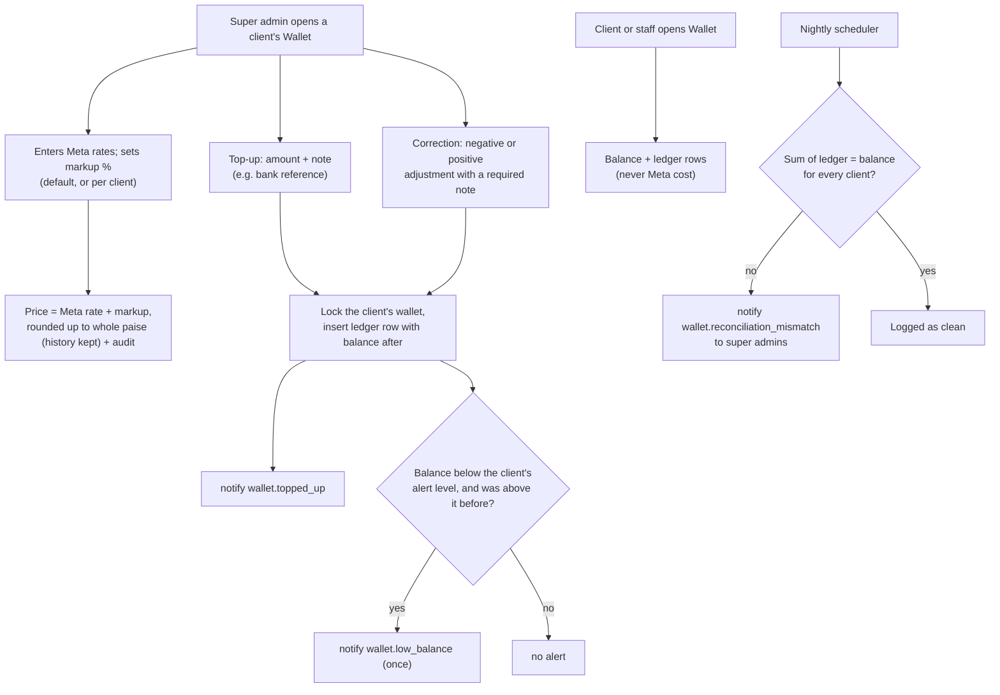

# M6. Wallet and prices

- Status: Not started
- Owner: Anirudh (backend), Suraj (screens S7 to S9)
- Starts after: M3 (clients and logins)
- External prerequisites: none. D10 (markup rules) has a default, so work can start.

## Outcome

ReapLift pays Meta through its own credit line and charges clients Meta's rate plus a markup (decided 29 October 2026). The super admin enters Meta's rates, sets the markup (a default for everyone, overridable per client), and tops up each client's prepaid wallet in rupees. Because Meta bills ReapLift whether or not a client pays, the prepaid wallet is what protects ReapLift's credit line. The client, its staff and the super admin see the balance and every movement as an unchangeable ledger row. When the balance falls below the client's alert level, the right people are told. A nightly check proves the ledger and balances agree. Charging campaigns and refunding failures use this wallet in [M7](../m7-campaigns/spec.md).

## Flow diagram

## Worked example

1. Ravi enters Meta's India rates from Meta's rate card (example figures, not real ones): marketing 86.31 paise, utility 11.50 paise, authentication 11.50 paise. The default markup is 25%; Northwind has negotiated 20%. Northwind's prices become: marketing 86.31 × 1.20 = 103.57, rounded up to **104 paise**; utility and authentication 11.50 × 1.20 = 13.80, rounded up to **14 paise**. Asha sees these prices; she never sees Meta's rate or the markup. Ravi sets the low-balance alert to ₹500.
   - When Meta changes a rate, Ravi adds the new rate with its start date, and prices for campaigns confirmed after that date follow automatically.
2. Ravi tops up ₹10,000 with note "NEFT UTR 4471". The ledger shows one row: +₹10,000.00, balance after ₹10,000.00, by Ravi, with the note. Asha (Northwind) gets an email and sees the same row on her Wallet page.
3. Ravi mistakenly tops up ₹1,000 twice. He cannot edit or delete the second row. He adds an adjustment of −₹1,000 with note "duplicate top-up 29 Oct". The ledger now has four rows and the balance is ₹11,000.00.
4. To test the alert, Ravi adds an adjustment of −₹10,600 (note "alert test"). The balance is ₹400, below ₹500, so Asha, Meera and Ravi are told once. A further −₹50 adjustment does not alert again. A top-up back above ₹500 re-arms the alert.
5. Asha can see prices and balance but cannot change them, and never sees Meta's cost or ReapLift's margin.
6. Overnight, the reconciliation adds up Northwind's ledger and matches the balance. A planted mismatch in a test database raises an alert to the super admins.

M7 then charges a campaign at confirm and refunds Meta failures. With a ₹100 balance, a price of ₹0.80 and a 50-number campaign with 5 Meta failures, the balance ends at ₹64 (₹100 − ₹40 + ₹4).

## Scope

In: Meta rates, markup (default and per client), fixed prices for special deals, price lists per client, charging switches (HLD section 5), the append-only ledger, top-ups and adjustments by the super admin, the Wallet page, the Admin balance box, the low-balance alert, the nightly ledger check, M6's notifications.

Out:

- charging at confirm and refunding failures: M7 (it uses this ledger)
- recording Meta's cost on each message and the margin view: [M9](../m9-reports/spec.md) (it reads M6's `meta_rates`)
- resellers (other agencies selling ReapLift under their own brand): a long-term future use case, not built now (decided 29 October 2026)
- online payment by the client: later; top-ups are manual at launch

## Tasks

| Task | Name                              | Depends on | Can run in parallel with |
| ---- | --------------------------------- | ---------- | ------------------------ |
| 6.1  | Price lists and charging switches | none       | 6.2                      |
| 6.2  | Ledger and balance safety         | none       | 6.1                      |
| 6.3  | Top-ups and adjustments           | 6.2        | 6.1, 6.4                 |
| 6.4  | Wallet page and Admin balance box | 6.2        | 6.3                      |
| 6.5  | Nightly ledger check              | 6.2        | 6.3, 6.4                 |
| 6.6  | Notifications for M6 events       | 6.3, 6.5   | none                     |

### 6.1 Price lists and charging switches

- `meta_rates`: message category, recipient country calling code, Meta's rate, valid from. Entered by the super admin from Meta's published rate card. Meta's rates have fractions of a paisa, so the rate is stored as a whole number of hundredths of a paisa (`bigint`, for example 8631 for 86.31 paise); it is a rate, not money held, so the whole-paise rule applies to every price and ledger amount computed from it.
- `pricing`: the default markup for all clients (starting at 25%, D10), and per client either a markup per category or a fixed price per category (proposed, to discuss with ReapLift: P1 to P9 in [open-questions.md](../../open-questions.md)), for example utility 15% and marketing 25%, or utility 15 paise and marketing 88 paise. The super admin sets it when registering the client; a client with none set uses the default. Markups are stored in basis points (2500 = 25%), never as floats. Full columns in [data-model-and-api.md](../../data-model-and-api.md).
- `price_lists`: the resulting price per client, category and country in whole paise (`bigint`), with valid from. Recomputed when a Meta rate or a markup changes; a new price is a new row and the old row stays for history. Price = Meta rate × (1 + markup), **rounded up** to the whole paisa. Campaigns use the price valid at confirm.
- The client's country calling code (M3) picks the Meta rate, which matches M7's rule that audience numbers must be from the client's country.
- The client is charged at confirm, by the template's category, so the client knows the price before sending. Meta bills ReapLift by the category it decides when the message is delivered (its webhook's `pricing.category`), which can differ, for example a utility message inside a customer's 24-hour reply window, which Meta does not charge. The client's charge is not adjusted afterwards; the difference shows as margin in M9.
- `charge_policy`: one switch per outcome from HLD section 5 (blocked, sent but not delivered, delivered or read, failed at Meta), each true or false, for all clients or one client. Defaults match HLD section 5. D6 (in the tracker) adds the invalid and duplicate outcomes.
- Tests: the worked example's rounding (103.57 becomes 104); a client markup overrides the default; a fixed price overrides the markup; a new Meta rate changes prices only from its start date; a client-level switch overrides the global one; a price change does not change an already-confirmed campaign's price.
- Acceptance: step 1 of the worked example with no code change.

### 6.2 Ledger and balance safety

- `wallet_ledger`: `id`, `client_id`, `kind` (`topup`, `adjustment`, `charge`, `refund`), `amount_paise bigint` (positive adds, negative takes), `balance_after_paise bigint`, `campaign_id null`, `message_id null`, `note`, `created_by`, `created_at`.
- A database trigger refuses `update` and `delete` on `wallet_ledger`.
- The current balance is the latest row's `balance_after_paise`. Every change locks the client's row (`select ... for update` on `clients`) first, so two changes at once cannot both read the same balance.
- One function, `applyLedgerEntry(trx, entry)`, is the only way to write the ledger. M7 calls it for charges and refunds.
- Tests: two changes at once with money for only one: exactly one succeeds; update and delete are refused by the database; a charge that would make the balance negative is refused.
- Acceptance: the balance always equals the sum of the client's ledger rows.

### 6.3 Top-ups and adjustments

- Super admin only. A top-up must be positive; an adjustment can be either sign and requires a note. Both write an audit row.
- Tests: client and staff get 403; a zero or missing amount gives 400.
- Acceptance: steps 2 and 3 of the worked example.

### 6.4 Wallet page and Admin balance box

- Wallet page in every client workspace: balance, prices, ledger with filters by kind and date, CSV download.
- Admin client view shows the balance and a top-up button.
- Client and staff see the client's prices and ledger only; never Meta cost or margin.
- Tests: another client's wallet returns 404 (M1's route-walking test covers it); amounts shown in rupees with two decimals from paise.
- Acceptance: step 5 of the worked example.

### 6.5 Nightly ledger check

- A scheduler job (the `scheduler` mode built in M5, or here if M6 lands first) checks for every client that the ledger rows add up to the latest balance and that no balance is negative. M7 adds a second check: charges minus refunds equal the campaign's messages times price.
- Tests: a planted mismatch raises the alert.
- Acceptance: the job runs nightly and logs "clean" on a correct database.

### 6.6 Notifications for M6 events

| Event                            | Recipients                                 | Channel         |
| -------------------------------- | ------------------------------------------ | --------------- |
| `wallet.topped_up`               | Client users; assigned staff               | Email and panel |
| `wallet.low_balance`             | Client users; assigned staff; super admins | Email and panel |
| `wallet.reconciliation_mismatch` | Super admins                               | Email           |

- The low-balance alert fires when a change takes the balance from at or above the client's `clients.low_balance_alert_paise` (already in 0002) to below it; it does not repeat until the balance has gone back above.
- Later (decided 29 October 2026, not at launch): send the low-balance alert on WhatsApp from ReapLift's own number too.
- Tests: crossing the line notifies once.
- Acceptance: step 4 of the worked example.

## Screens (Suraj)

Built on the screens track against the mock API, so they can start before M3 is Done (tracker, "Screens track exception"). Contracts go in `packages/shared/src/contracts/wallet.ts` and `pricing.ts`, from the route table below. Amounts are whole paise, sent as JSON numbers (the server turns `bigint` into numbers; see the conventions in data-model-and-api.md) and are shown only through `formatPaise`; the panel never computes a price or a balance.

| #   | Screens                                                                                                                                                                                                                 | Backend task it pairs with |
| --- | ----------------------------------------------------------------------------------------------------------------------------------------------------------------------------------------------------------------------- | -------------------------- |
| S7  | Wallet page in every workspace: balance, the client's prices by category, ledger with filters by kind and date, CSV download (built in the browser from the filtered rows)                                              | 6.4, 6.1                   |
| S8  | Admin client view: balance box, top-up form (positive amount), adjustment form (either sign, note required), low-balance alert setting                                                                                  | 6.3, 6.6                   |
| S9  | Admin prices: Meta rates list and add form (rate in paise with up to two decimals, stored as hundredths), default markup in percent (stored as basis points), per-client markup or fixed prices, charge-policy switches | 6.1                        |

- Client and staff never see Meta rates, markup or margin; S8 and S9 are super admin only.
- Converting typed rupees to paise (and percent to basis points) happens in one tested helper next to `formatPaise`, using whole-number maths only.
- Tests: rupees-to-paise for "1", "1.5", "1.05", "0.01" and refusing "1.005"; percent-to-basis-points for "25" and "22.5"; each form's validation.
- Screen ready: the worked example's steps 1 to 5 run in mock mode; screenshots in `frontend.md`.

Anirudh builds the tables, the ledger, `applyLedgerEntry`, price calculation, routes and notifications (6.1 to 6.6), and wires each screen when its route merges.

## Data and API

Migration (claim one number): `meta_rates`, `pricing`, `price_lists`, `charge_policy`, `wallet_ledger` with its trigger.

| Method    | Route                                                                                                 | Who                                 |
| --------- | ----------------------------------------------------------------------------------------------------- | ----------------------------------- |
| GET       | `/api/clients/:clientId/wallet`                                                                       | client, assigned staff, super admin |
| GET       | `/api/clients/:clientId/wallet/ledger`                                                                | client, assigned staff, super admin |
| GET       | `/api/clients/:clientId/prices`                                                                       | client, assigned staff, super admin |
| PUT       | `/api/admin/clients/:id/prices`                                                                       | super admin                         |
| PATCH     | `/api/admin/clients/:id/low-balance-alert`                                                            | super admin                         |
| POST      | `/api/admin/clients/:id/wallet/topups`                                                                | super admin                         |
| POST      | `/api/admin/clients/:id/wallet/adjustments`                                                           | super admin                         |
| GET       | `/api/admin/charge-policy`, PUT same                                                                  | super admin                         |
| GET, POST | `/api/admin/meta-rates`                                                                               | super admin                         |
| GET, PUT  | `/api/admin/pricing` (default markup) and `/api/admin/clients/:id/pricing` (override or fixed prices) | super admin                         |

Money is whole paise in `bigint` everywhere, in the database, the API and the shared types; the panel converts to rupees only for display.

## Notifications

Task 6.6.

## Open questions

| Question                                                                     | Default                                                                                                                                           | Decides                           |
| ---------------------------------------------------------------------------- | ------------------------------------------------------------------------------------------------------------------------------------------------- | --------------------------------- |
| D6 (in the tracker): are invalid numbers and duplicates charged?             | Not charged                                                                                                                                       | Owner, with ReapLift              |
| D10 (in the tracker; proposal to discuss with ReapLift)                       | Per client and per message type, as a markup or a fixed price; a client with none set uses the default 25%                                                   | Owner, with ReapLift              |
| D11 (in the tracker): who issues GST invoices, per top-up or monthly?        | Issued outside the platform at launch; the Wallet page exports each client's monthly statement (top-ups, charges, refunds) as CSV                 | Owner, with ReapLift's accountant |
| D12 (in the tracker): which currency Meta invoices ReapLift's credit line in | Rupees; if Meta invoices in dollars, `meta_rates` stores the rupee rate the super admin decides, and the markup must cover exchange-rate movement | ReapLift, from Meta during E7     |

## Current reality

Nothing exists except `clients.low_balance_alert_paise` (0002). The prototype Admin page shows a plain `walletBalance` number that is not a ledger.

## Demo (milestone acceptance)

Run the worked example's steps 1 to 6 in the panel against PostgreSQL. Record the ledger rows, the notifications, the refused `update` on `wallet_ledger`, and the nightly check's log in `e2e.md`.
