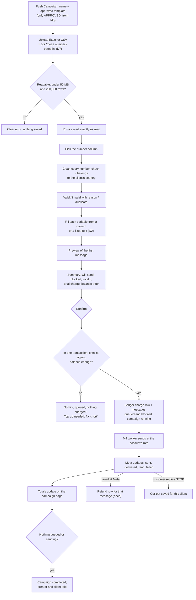

# M7. Campaigns: create, send, track

- Status: Not started
- Owner: Unassigned
- Branch prefix: `m7-`
- Starts after: M5 (approved templates, connected numbers), M6 (prices and wallet)
- External prerequisites: none beyond those of M4 and M5

## Outcome

On the Push Campaign page, a client user (or their assigned staff, or the super admin) picks an approved template, uploads the audience file, chooses the number column and fills the template's variables, and sees a summary: how many will send, how many are blocked or invalid and why, and the total charge. On confirm, the wallet is charged and the messages are queued in one step; if the balance is short, nothing happens. The campaign page then shows the totals moving to sent, delivered, read and failed, Meta failures are refunded, and a customer who replies STOP is never messaged by that client again.

Pause, resume, cancel, schedule and the rules engine are [M8](../m8-campaign-controls/spec.md).

## Flow diagram



## Worked example

Northwind's marketing price is 95 paise (Meta's rate plus Northwind's markup, from M6; a round figure for easy sums); its wallet holds ₹2,000.00; its number is connected and template `diwali_offer_2026` ("Hi {{1}}, flat 20% off till Sunday. Use code {{2}}.") is approved.

1. Meera (staff, in Northwind's workspace) opens Push Campaign, names the campaign "Diwali 2026 wave 1" and picks the template.
2. She uploads `diwali_customers.xlsx` with 1,000 rows and columns `Name`, `Mobile`, `City`, and ticks "Every number in this file has opted in to receive messages from Northwind Labs". The page shows 1,000 rows and the first 10 as a preview.
3. She picks `Mobile` as the number column. Cleaning gives: 950 valid; 40 invalid (25 `not_mobile`, 8 `too_short`, 4 `scientific_notation`, 3 `wrong_country` for numbers starting `+44`); 10 duplicates. She can download the 50 rows with their reasons.
4. She fills `{{1}}` from the `Name` column and `{{2}}` with the fixed text `DIWALI20` (D2). The preview shows "Hi Rahul, flat 20% off till Sunday. Use code DIWALI20."
5. Summary: 1,000 total; 930 will send; 20 blocked (`opted_out`); 40 invalid; 10 duplicate. Charge: (930 + 20 blocked) × ₹0.95 = ₹902.50 (invalid and duplicates are not charged, D6; blocked are charged per HLD section 5). Balance after: ₹1,097.50.
6. She confirms. In one transaction: one ledger charge of −₹902.50, 930 `queued` and 20 `blocked` rows in `messages`, campaign `running`. The creator and Northwind's users get "Campaign started".
7. The worker sends at the account's rate. The campaign page shows sent, delivered, read and failed counts rising.
8. 12 messages fail at Meta, 5 of them with 131049 (Meta's marketing limit, shown as "Meta limit, not retried"). Each failure adds one refund row of +₹0.95: ₹11.40 in total. Net charge ₹891.10; balance ₹1,108.90.
9. A customer replies "STOP". From now on that number is blocked with `opted_out` in every Northwind campaign, but not for other clients.
10. When nothing is queued or sending, the campaign is `completed` and Meera and Northwind's users get the final totals by email.

What-if: had the wallet held ₹500, step 6 would have shown "Top up needed: ₹402.50 short" and nothing would have been queued or charged.

## Scope

In: audience upload, number cleaning, variable mapping, campaign drafts, summary checks, confirm with charge, sending through M4, totals and completion, refunds on Meta failure, opt-outs (STOP replies and a super admin upload), the campaign list and campaign page, M7's notifications, a 200,000-message load test.

Out:

- pause, resume, cancel, schedule, and rules such as "no repeat within X hours": [M8](../m8-campaign-controls/spec.md). The `campaigns.status` check lists every status now, so M8 needs no constraint change.
- downloads of per-number results and month-wise reports: [M9](../m9-reports/spec.md)
- Google Sheets: not supported (decided 29 October 2026)
- a public API with per-client API keys and inline contacts: phase 2 (HLD section 4). The panel uses the same JSON routes, so the routes can be called with a session cookie, but there is no API key.

## Tasks

| Task | Name                                       | Depends on                                     | Can run in parallel with |
| ---- | ------------------------------------------ | ---------------------------------------------- | ------------------------ |
| 7.1  | Audience upload                            | none                                           | 7.3, 7.8                 |
| 7.2  | Number column, cleaning and validation     | 7.1                                            | 7.3, 7.8                 |
| 7.3  | Campaign draft and variable mapping        | none (uses 7.1's list when ready)              | 7.1, 7.2, 7.8            |
| 7.4  | Summary                                    | 7.2, 7.3, 7.8                                  | 7.6 UI work              |
| 7.5  | Confirm: charge and queue in one step      | 7.4                                            | 7.6                      |
| 7.6  | Sending, totals, completion, campaign page | 7.5 for real data; UI can start on seeded rows | 7.7                      |
| 7.7  | Refunds on Meta failure                    | 7.5                                            | 7.6                      |
| 7.8  | Opt-outs                                   | none                                           | 7.1 to 7.3               |
| 7.9  | Notifications for M7 events                | 7.5, 7.6                                       | 7.10                     |
| 7.10 | Load test                                  | 7.5 to 7.7                                     | 7.9                      |

### 7.1 Audience upload

- Excel (`.xlsx`) or CSV, up to 50 MB and 200,000 data rows (settings `UPLOAD_MAX_BYTES`, `LIST_MAX_ROWS`).
- The upload form requires the opt-in tick (D7); the tick, the user and the time are saved on the list.
- The file is stored behind a storage interface (local disk under `UPLOAD_DIR` until object storage exists in M10) and its rows are saved exactly as read in `list_contacts.cells jsonb`, in one transaction with the `lists` row.
- Blank rows are skipped and counted. Every upload makes a new list (decided).
- Note from the closed `m4-skeleton` branch: exceljs's streaming reader returned incomplete data on large files in measurement; test the chosen reader against a 200,000-row file before relying on it.
- Tests: blank rows, merged header cells, numbers stored as text, a 200,000-row file, a file over the limit, a corrupt file, another client's list returning 404.
- Acceptance: step 2 of the worked example.

### 7.2 Number column, cleaning and validation

- The user picks the column; it is saved on the list; every row is cleaned in set-based SQL or batches, never one query per row.
- Valid numbers must belong to the client's country (`clients.country_calling_code`, from M3; decided 29 October 2026). India rules at launch:
  1. Remove spaces, hyphens, dots, brackets and a trailing `.0` (Excel number cells).
  2. Scientific notation (for example `9.19812E+11`) is invalid, reason `scientific_notation`: its digits are already lost.
  3. Remove a leading `+`; remove a leading `00`; remove one leading `0` from an 11-digit number.
  4. 10 digits starting 6, 7, 8 or 9: add `91`. No other number is "fixed" (decided).
  5. 12 digits starting `91` then 6 to 9: valid.
  6. Starts with another country's code: invalid, reason `wrong_country`.
  7. Anything else: invalid with the matching reason.
  8. Stored as digits with country code, no plus (`919812345678`).
- Reasons: `empty`, `not_a_number`, `too_short`, `too_long`, `not_mobile`, `scientific_notation`, `wrong_country`, `duplicate`. A repeat within the list is marked `duplicate` and points to the first row.
- Data: nullable columns. `lists`: `number_column int`, `valid_count`, `invalid_count`, `duplicate_count`. `list_contacts`: `number text`, `invalid_reason text`, `duplicate_of_row int`.
- Tests: a table of at least 25 raw inputs and expected results covering every rule. Examples: `98123 45678` → `919812345678`; `+91-98123-45678` → `919812345678`; `09812345678` → `919812345678`; `00919812345678` → `919812345678`; `9812345678.0` → `919812345678`; `9.81234E+09` → `scientific_notation`; `5812345678` → `not_mobile`; `12345` → `too_short`; `+447911123456` → `wrong_country`; empty → `empty`; the same number in rows 4 and 9 → row 9 `duplicate` of row 4.
- Acceptance: counts and reasons match a hand-checked fixture file committed with the tests; 200,000 rows clean in under a minute locally.

### 7.3 Campaign draft and variable mapping

- Migration (claim a number): `campaigns` with `id`, `client_id`, `name`, `template_id`, `wa_account_id` (from the template), `list_id`, `variable_map jsonb` (per variable: `{ "column": 2 }` or `{ "text": "DIWALI20" }`), `status` with the check listing `draft`, `scheduled`, `running`, `paused`, `completed`, `cancelled`, `created_by`, `confirmed_by null`, `confirmed_at null`, `created_at`, `updated_at`; and the foreign key from `messages.campaign_id` that 0002 left for later. Totals columns are added in 7.6.
- Templates come only from M5's `listApprovedTemplates(scope)`.
- A draft can be saved partly mapped; it can be summarised only when every variable is mapped.
- Push Campaign stops using `apps/web/src/data/mockData.ts`.
- Errors: 400 `TEMPLATE_NOT_APPROVED`, `VARIABLE_NOT_MAPPED`, `COLUMN_OUT_OF_RANGE`, `LIST_NOT_READY` (no number column); 404 `NOT_FOUND` for another client's list or template.
- Tests: an unapproved template is refused; another client's IDs give 404; a fixed-text variable renders the same for every row.
- Acceptance: steps 1 and 4 of the worked example.

### 7.4 Summary

- A check interface: each check is one SQL query over the campaign's contacts returning `(row, reason)`. M8's rules plug into the same interface.
- Checks in M7: invalid and duplicate (from 7.2), opted out (7.8), client suspended, WhatsApp account paused, template no longer approved.
- Messaging limit warning: each client now has its own WhatsApp account, and a new account starts with a low daily limit on how many customers it can message. If will-send is above the account's `messaging_limit` (M5 5.5), the summary shows a warning with the limit, so the client can split the campaign. It does not block. Check what Meta does with messages above the limit while coding, and record it.
- `GET /api/clients/:clientId/campaigns/:id/summary` computes on request; it is not stored, because confirm runs the checks again.
- Charge = price at confirm time × the outcomes the charging switches say are charged (M6 6.1, D6).
- Response:
  ```json
  {
    "total": 1000,
    "willSend": 930,
    "blocked": { "total": 20, "byReason": { "opted_out": 20 } },
    "invalid": {
      "total": 40,
      "byReason": { "not_mobile": 25, "too_short": 8, "scientific_notation": 4, "wrong_country": 3 }
    },
    "duplicate": 10,
    "chargePaise": 90250,
    "balancePaise": 200000,
    "balanceAfterPaise": 109750
  }
  ```
- Tests: one fixture per check; `willSend + blocked + invalid + duplicate = total`.
- Acceptance: step 5 of the worked example; a 200,000-row summary within the target in the open questions.

### 7.5 Confirm: charge and queue in one step

- One transaction: lock the client's wallet (M6's `applyLedgerEntry`), run every check again, compute the charge, refuse with 402 `INSUFFICIENT_BALANCE` (amount short) if the balance is not enough, otherwise write one ledger charge row for the campaign, insert `queued` rows for will-send and `blocked` rows with `block_reason` for blocked numbers, each with `client_price_paise` set to the price it was charged (so refunds and reconciliation never depend on a later price list), set the campaign `running` with `confirmed_by` and `confirmed_at`.
- Confirming twice charges and queues once (the second call sees status `running` and answers 409 `ALREADY_CONFIRMED`).
- A suspended client or a paused account refuses confirm with 409 and the reason.
- Who: client users, assigned staff, super admin (decided).
- Tests: short balance leaves no messages and no ledger row; an opt-out added after the summary is caught at confirm; double confirm; 200,000 rows queued in one transaction.
- Acceptance: step 6 of the worked example and the "what-if".

### 7.6 Sending, totals, completion, campaign page

- Messages are sent by M4's worker; nothing new sends here.
- Totals columns on `campaigns` (nullable, new migration or 7.3's): `total`, `blocked`, `sent`, `delivered`, `read`, `failed`, changed in the same transaction as each message status change by M4's processor.
- The campaign is `completed` when nothing is `queued` or `sending`.
- Campaign list and campaign page: status, totals, the charge, refunds, failure reasons grouped (131049 shown as "Meta limit, not retried").
- Tests: after a randomised run on the fake server, totals equal a count of the rows.
- Acceptance: step 7 and 10 of the worked example; totals on screen equal a `count(*)` of the campaign's messages.

### 7.7 Refunds on Meta failure

- When M4's processor moves a message to `failed` and the charging switch says failed is not charged, write a refund ledger row for that message's price in the same transaction.
- A unique key on (`message_id`, `kind = 'refund'`) makes it happen once, even if Meta repeats the webhook.
- Adds M6's second nightly check: for each campaign, charges minus refunds equal the charged outcomes times the price.
- Tests: the same failure webhook three times refunds once; a message failed before being sent (worker permanent error) is refunded too.
- Acceptance: step 8 of the worked example.

### 7.8 Opt-outs

- Migration: `opt_outs` (`client_id`, `number`, `source` (`stop_reply`, `upload`, `manual`), `created_at`), unique on (`client_id`, `number`).
- A customer reply whose text is a stop word (STOP, UNSUBSCRIBE, and the list the super admin edits) is read from M4's stored webhooks and saved for the client that owns the number it was sent to.
- Super admin can upload a list of numbers to opt out for a client.
- Opt-outs are per client (HLD section 6): a STOP to Northwind does not block that person for Greenleaf.
- Meta's policy requires opt-out requests to be honoured; this must be live before any real client sends (M11).
- Tests: STOP to client A does not block client B; the same STOP twice saves one row.
- Acceptance: step 9 of the worked example with a real phone.

### 7.9 Notifications for M7 events

| Event                      | When                                                                  | Recipients                                | Channel         |
| -------------------------- | --------------------------------------------------------------------- | ----------------------------------------- | --------------- |
| `campaign.started`         | Confirmed                                                             | The creator; client users                 | Panel           |
| `campaign.completed`       | Nothing left queued or sending, with final totals                     | The creator; client users; assigned staff | Email and panel |
| `campaign.stalled`         | Delayed, as D4 defines                                                | The creator; client users; super admins   | Email and panel |
| `campaign.high_failure`    | More than 10% failed once at least 200 messages have a result         | The creator; client users; super admins   | Email and panel |
| `campaign.account_paused`  | The account was paused by a Meta account error while the campaign ran | The creator; client users; super admins   | Email and panel |
| `campaign.blocked_balance` | Confirm refused for a short balance                                   | The user who tried; client users          | Panel           |

The creator is always told about problems with their campaign, as well as the super admin (decided 29 October 2026).

- Tests: each event once per campaign, even if the triggering update repeats.
- Acceptance: the worked example produces `started` and `completed`; a stopped worker on the fake server produces `stalled`.

### 7.10 Load test

- 200,000 messages against the fake Meta server at the configured rate.
- Checks: no message sent twice; the rate stays at the setting; totals equal row counts; charge and refunds reconcile.
- Acceptance: the report is saved in this folder.

## Data and API

Migrations (claim numbers): `lists`, `list_contacts`, `campaigns`, `opt_outs`, and their nullable columns. `messages` (0002) has no `cancelled` status; M8 uses `blocked` with reason `campaign_cancelled`.

| Method | Route                                            | Purpose                          |
| ------ | ------------------------------------------------ | -------------------------------- |
| POST   | `/api/clients/:clientId/lists`                   | Upload a file, create a list     |
| GET    | `/api/clients/:clientId/lists/:id`               | List with preview and counts     |
| PUT    | `/api/clients/:clientId/lists/:id/number-column` | Choose the column; runs cleaning |
| GET    | `/api/clients/:clientId/lists/:id/invalid`       | Invalid rows with reasons (CSV)  |
| GET    | `/api/clients/:clientId/campaigns`               | Campaign list                    |
| POST   | `/api/clients/:clientId/campaigns`               | Create a draft                   |
| GET    | `/api/clients/:clientId/campaigns/:id`           | Campaign with totals             |
| PUT    | `/api/clients/:clientId/campaigns/:id`           | Edit a draft                     |
| GET    | `/api/clients/:clientId/campaigns/:id/summary`   | Summary                          |
| POST   | `/api/clients/:clientId/campaigns/:id/confirm`   | Charge and queue                 |
| POST   | `/api/admin/clients/:id/opt-outs`                | Upload opt-outs                  |

Request and response bodies are Zod schemas in `packages/shared`, used by both server and panel, and written in `backend-api.md` before coding.

## Notifications

Task 7.9.

## Open questions

These need the owner; the default is built if nobody decides. D-numbers match the tracker.

**D2. Can a variable use one fixed text for every row?**
Example: template "Hi {{1}}, use code {{2}}". `{{1}}` is each customer's name, from the `Name` column. `{{2}}` is `DIWALI20` for everyone. Without fixed text, the client must add a column to the sheet with `DIWALI20` typed in every row. Default: **yes**, each variable is either a column or a fixed text.

**D3. Can a new campaign reuse an audience uploaded earlier?**
Example: on Monday Meera uploads `diwali_customers.xlsx` for "wave 1". On Friday she wants "wave 2" to go to the same 1,000 people. With reuse, she picks "diwali_customers.xlsx (uploaded Monday)" from a list instead of uploading the file again. Default: **no** at launch; she uploads again. Reuse can be added later without changing the tables.

**D4. When is a campaign "delayed"?**
A big campaign is slow on purpose: 50,000 messages at 20 a second take about 42 minutes, so "still sending after 15 minutes" would alert on every large campaign. What matters is a campaign that has **stopped moving**. Example: the worker crashes at 10:12; at 10:22 the campaign still has 30,000 queued and nothing has been sent since 10:12. Default: alert when messages are still queued and none of the campaign's messages were sent in the last **10 minutes**, while its account is active.

**D6. Are invalid numbers and duplicates charged?** Default: no, they are never sent. Blocked numbers (opted out, rules) are charged, as HLD section 5 says, through M6's switches. To discuss with ReapLift.

**D7. Opt-in proof.** Default: the upload tick described in 7.1.

**D8. How long are uploaded files and per-number rows kept?** Default: 180 days, then deleted.

Also open:

| Question                                                                                                                                                                                                                       | Default                                                                                                             | Decides |
| ------------------------------------------------------------------------------------------------------------------------------------------------------------------------------------------------------------------------------ | ------------------------------------------------------------------------------------------------------------------- | ------- |
| Target time for a 200,000-row summary. "30 seconds" came from low-level-design.md task 4.4, where it is marked "target, to confirm"; it is a guess at how long someone will wait on the summary screen, not a measured figure. | Keep 30 seconds as the target; measure on CI now and on the server after M10; show a progress message while it runs | Owner   |

## Current reality

Nothing exists on `main`. The Push Campaign page shows mock figures. The `m4-skeleton` branch (upload and lists) was closed without merging on 29 October 2026.

## Demo (milestone acceptance)

1. Run the worked example in the panel with ReapLift's test number and three team phones in the file, plus generated rows sent to numbers on the fake Meta server where real phones are not needed.
2. Record the summary, the ledger rows (charge and refunds), the campaign page totals against `count(*)`, a STOP from a real phone, and the notifications in `e2e.md`.
3. Attach the 7.10 load test report.
