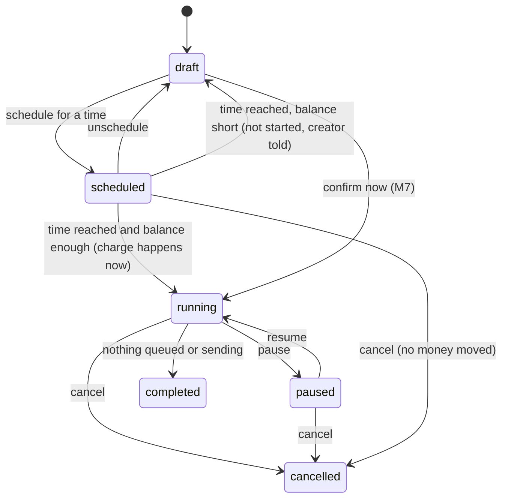

# M8. Campaign controls and rules

- Status: In progress. Backend 8.1 to 8.5 built on 31 October 2026; see [test-evidence.md](test-evidence.md). Screens are not started.
- Owner: Anirudh (backend); screens unassigned
- Starts after: M7. The backend started early (tracker, 31 October 2026).
- External prerequisites: none. D5 (approve the cancel money flow) before task 8.2 is coded.

## Outcome

A user can pause, resume, cancel or schedule a campaign, and the wallet is always exact: nobody is charged for a message that was never sent because of a cancel, and nothing already sent is refunded by mistake. The super admin can switch on rules (for example "no repeat of the same template to a number within 24 hours") that block numbers at summary and confirm, without code changes.

## Flow diagrams

Campaign statuses (the `campaigns.status` check already lists all of them, from M7):

What cancel does to each message, in one transaction:

```mermaid
flowchart TD
  A["User clicks Cancel"] --> B["Lock the campaign row;<br/>must be running or paused"]
  B --> C["Campaign status = cancelled<br/>(worker stops claiming its rows)"]
  C --> D{"Each message's status at this moment"}
  D -- "queued (never sent)" --> E["blocked, reason campaign_cancelled<br/>+ refunded"]
  D -- "sending (worker has it now)" --> F["Left alone; finishes normally:<br/>sent = charged, failed = refunded (M7 7.7)"]
  D -- "sent, delivered, read" --> G["Left alone, stays charged"]
  D -- "failed" --> H["Left alone, already refunded"]
  D -- "blocked at confirm" --> I["Left alone, stays charged<br/>(HLD section 5)"]
  E --> J["One refund ledger row:<br/>count of cancelled x price"]
  J --> K["Commit; creator and client told"]
```

## Worked example: cancel

Northwind confirms "Diwali wave 2": 10,000 messages queued at ₹0.95, charged ₹9,500.00 at confirm. Forty minutes later the client spots a typo and cancels. At that instant:

| Message status at cancel | Count | What happens                                  | Money                                  |
| ------------------------ | ----- | --------------------------------------------- | -------------------------------------- |
| sent, delivered or read  | 3,200 | nothing                                       | stays charged                          |
| sending (worker has it)  | 15    | finishes: 14 sent, 1 failed at Meta           | 14 charged, 1 refunded ₹0.95 by M7 7.7 |
| queued                   | 6,785 | become `blocked`, reason `campaign_cancelled` | refunded ₹6,445.75 in one row          |

Net charge: ₹9,500.00 − ₹6,445.75 − ₹0.95 = ₹3,053.30, which is exactly 3,214 sent messages × ₹0.95. The nightly check (M6, M7) confirms it.

Why it is exact: the worker claims rows with `for update skip locked`, and cancel changes only rows that are still `queued` when it locks them. A row the worker claimed a moment earlier is already `sending`, so cancel skips it, and the worker's result decides its charge. A row cannot be both sent and refunded.

## Worked example: pause, resume, schedule, rules

1. Meera pauses "Diwali wave 2" at 10:15. Rows already `sending` finish; no new rows are claimed. Nothing is charged or refunded. At 10:40 she resumes and sending continues.
2. Meera schedules "Diwali wave 3" for 31 October 09:00 (India time). Its charge goes on hold, and she is refused if that much is not available. At 09:00 the scheduler runs the same confirm as M7: checks, charge, queue. If it cannot start then, the hold is released, the campaign returns to `draft`, and Meera, Northwind's users and the super admin are told.
3. Ravi switches on the rule "no repeat of the same template to a number within 24 hours" for all clients. A campaign that targets 300 numbers who got the same template yesterday shows them as `blocked: repeat_within_24h` in its summary.
4. Ravi sets "at most 2 marketing messages per number per week" for Greenleaf only. Northwind is not affected.

## Scope

In: pause, resume, cancel, schedule, the scheduler starting due campaigns, the rules table and checks, the super admin Rules screen, M8's notifications.

Out:

- quiet hours: not built. Meta sets no time-of-day rule (decided 29 October 2026).
- pause on Low quality: already in M5. Opt-out skipping: already in M7.

## Tasks

| Task | Name                          | Depends on | Can run in parallel with |
| ---- | ----------------------------- | ---------- | ------------------------ |
| 8.1  | Pause and resume              | none       | 8.3, 8.4                 |
| 8.2  | Cancel with exact refunds     | D5         | 8.3, 8.4                 |
| 8.3  | Schedule                      | none       | 8.1, 8.2, 8.4            |
| 8.4  | Rules engine and Rules screen | none       | 8.1 to 8.3               |
| 8.5  | Notifications for M8 events   | 8.1 to 8.3 | none                     |

### 8.1 Pause and resume

- M4's claim query takes only messages whose campaign is `running` (or that have no campaign, such as `cli` sends).
- Pause and resume are allowed for client users, assigned staff and super admin; each writes an audit row.
- Tests: pause stops claims within one batch; resume continues; no ledger rows are written.
- Acceptance: step 1 of the pause example.

### 8.2 Cancel with exact refunds

- The transaction in the diagram above. The refund is one ledger row (`kind = 'refund'`, `campaign_id`, note "6,785 messages cancelled") for the count of rows changed by the update, times the price used at confirm.
- Cancel is allowed once: a second cancel answers 409 `ALREADY_CANCELLED`.
- Cancelling a `scheduled` campaign charges nothing, as it was never charged, and releases its hold.
- Tests (integration, with the worker running against the fake Meta server during the cancel): cancelled count + sent + failed + still-sending-then-finished = queued at confirm; net charge equals charged outcomes × price; a second cancel changes nothing.
- Acceptance: the cancel example on the fake server, with the nightly check clean afterwards.

### 8.3 Schedule

- A draft can be scheduled for a time at least 5 minutes ahead, in India time; it can be unscheduled back to draft.
- Scheduling holds the charge (see Current reality). The scheduler checks every minute and runs M7's confirm transaction for due campaigns, which turns the hold into the charge.
- Tests: a campaign scheduled for 09:00 starts by 09:01; a short balance at start leaves it as `draft` with no ledger row and a notification.
- Acceptance: step 2 of the pause example.

### 8.4 Rules engine and Rules screen

- Migration: `rules` (`id`, `client_id null` for all clients, `type`, `values jsonb`, `enabled`, `updated_by`, `updated_at`).
- One SQL check per type, plugged into M7's check interface:
  - `repeat_within_hours`: same template to the same number within X hours
  - `marketing_cap`: at most N marketing messages per number per day or week
- A rule for one client overrides the all-clients rule of the same type.
- Super admin Rules screen; each change is audited and applies from the next summary or confirm.
- Tests: each type on and off, for all clients and for one client.
- Acceptance: steps 3 and 4 of the pause example.

### 8.5 Notifications for M8 events

| Event                                 | Recipients                                              | Channel         |
| ------------------------------------- | ------------------------------------------------------- | --------------- |
| `campaign.paused`, `campaign.resumed` | The creator; client users (with who did it)             | Panel           |
| `campaign.cancelled`                  | The creator; client users; with the refund              | Email and panel |
| `campaign.scheduled_started`          | The creator; client users                               | Email and panel |
| `campaign.scheduled_not_started`      | The creator; client users; super admins (balance short) | Email and panel |

- Acceptance: each event in the examples above is delivered once.

## Data and API

| Method   | Route                                             | Purpose           |
| -------- | ------------------------------------------------- | ----------------- |
| POST     | `/api/clients/:clientId/campaigns/:id/pause`      | Pause             |
| POST     | `/api/clients/:clientId/campaigns/:id/resume`     | Resume            |
| POST     | `/api/clients/:clientId/campaigns/:id/cancel`     | Cancel            |
| POST     | `/api/clients/:clientId/campaigns/:id/schedule`   | Schedule `{ at }` |
| POST     | `/api/clients/:clientId/campaigns/:id/unschedule` | Back to draft     |
| GET, PUT | `/api/admin/rules`                                | Rules screen      |

Migrations: `rules`; nullable `campaigns.scheduled_at timestamptz`, `campaigns.cancelled_at`, `campaigns.cancelled_by`; `wallet_holds` (0013).

## Notifications

Task 8.5.

## Open questions

| Question                                                                                             | Default                                                                                      | Decides |
| ---------------------------------------------------------------------------------------------------- | -------------------------------------------------------------------------------------------- | ------- |
| D5: approve the cancel money flow above (queued rows refunded; blocked-at-confirm rows stay charged) | As written                                                                                   | Owner   |

## Current reality

- All routes above are real. D5 is built as written, the default, still for the owner to approve.
- The marketing cap counts a rolling 24 hours or 7 days, not calendar days.
- **Money on hold (owner, 31 October 2026).** Scheduling sets the campaign's charge aside in `wallet_holds`, so no other campaign or correction can spend it. Example: with ₹1,000, a campaign of 1,000 messages at ₹1 is scheduled, so balance ₹1,000, on hold ₹1,000, available ₹0, and a new 500-message campaign is refused as ₹500 short. At the scheduled time the hold becomes the actual charge in one transaction. Unscheduling or cancelling gives it back. The Wallet route returns `balancePaise`, `onHoldPaise`, `availablePaise` and the list of holds.
- The charge is worked out again at start, as prices and opt-outs can change. If it now exceeds what is available, the hold is released and the campaign returns to draft, as it does for any other problem at start, such as a paused number.

## Demo (milestone acceptance)

1. On the fake Meta server with a 10,000-message campaign: pause, resume, then cancel midway. Record the counts, the ledger rows, and the nightly check.
2. Schedule a campaign 5 minutes ahead and watch it start; schedule one with a short balance and watch it stay a draft.
3. Switch each rule on for one client and show the blocked counts in a summary.
4. Record everything in `e2e.md`.
