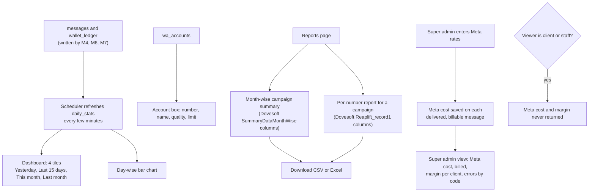

# M9. Reports and dashboard

- Status: Not started
- Owner: Unassigned
- Branch prefix: `m9-`
- Starts after: M7
- External prerequisites: D1 for the super admin's margin view (what Meta's cost is depends on who pays Meta)

## Outcome

A client opens the Dashboard and Reports and sees figures that match a hand count of its messages, laid out like the Dovesoft panel it already knows, and downloads files that open in Excel with the same column headings. The super admin also sees Meta's cost, the amount billed and the margin per client. Clients and staff never see Meta's cost or margin.

## Flow diagram

## Worked example

1. On 1 November, Asha opens Northwind's Dashboard. "This month" shows 0; "Last month" shows 11,214 messages and ₹10,653.30 spent; "Yesterday" (31 October) shows the Diwali wave 3 numbers. The chart shows one bar per day for the last 15 days.
2. She opens Reports, chooses October, and downloads the month-wise summary. Row 1: Sr No. 1, Month October, Year 2026, Campaign Name "Diwali 2026 wave 1", Total Count 1,000, Failed 12, Blocked 20, Delivered 902, Read 610, and so on. The file opens in Excel with exactly Dovesoft's headings.
3. She downloads the per-number report for "Diwali 2026 wave 1": 1,000 rows with `mobile_no`, `status`, `reason`, and times as `dd/mm/yyyy hh:mm:ss`.
4. Ravi enters Meta's marketing rate for India (from Meta's rate card, as the super admin reads it). The super admin view shows, for Northwind in October: billed ₹10,653.30, Meta cost (delivered billable messages × rate), and the margin. Asha calling the same route gets 403.
5. A count of `messages` rows for October equals every figure on the dashboard and in the downloads.

## Scope

In: `daily_stats` and its refresh, dashboard tiles and chart, account box, month-wise and per-number reports with downloads, Meta rates and cost per message, the super admin's cost, margin and Meta error view.

Out: log cleanup and archiving after 180 days (phase 2 in the HLD; D8 sets the retention); emailed month-end reports (not planned).

## Tasks

| Task | Name                                     | Depends on | Can run in parallel with |
| ---- | ---------------------------------------- | ---------- | ------------------------ |
| 9.1  | Daily stats and refresh                  | none       | 9.3, 9.4, 9.5            |
| 9.2  | Dashboard tiles, chart, account box      | 9.1        | 9.3, 9.4                 |
| 9.3  | Month-wise campaign report               | none       | all                      |
| 9.4  | Per-number campaign report               | none       | all                      |
| 9.5  | Meta rates and cost per message          | D1         | 9.1 to 9.4               |
| 9.6  | Super admin cost, margin and errors view | 9.5        | none                     |

### 9.1 Daily stats and refresh

- `daily_stats` (client, date in India time, category, counts by status, client charge in paise, Meta cost in paise), refreshed by the scheduler.
- Tests: a rebuild from `messages` equals the running table; a message at 23:59 and 00:01 India time lands on the right days.
- Acceptance: the dashboard loads in under a second for a client with 6 months of data.

### 9.2 Dashboard tiles, chart, account box

- Replaces the Dashboard's empty state (M1) with the four tiles (spend and count), the day-wise chart and the account box (HLD section 4).
- Tests: date edges in India time.
- Acceptance: step 1 of the worked example; figures match a hand count.

### 9.3 Month-wise campaign report

- Columns in Dovesoft's order (`SummaryDataMonthWise`): Sr No., Month, Year, User Id, Campaign Name, Total Count, Pending, Failed, Blocked, Sent, Delivered, Not Delivered, DR Not Available, Read Count, Total Unit.
- Tests: each row's totals equal the campaign's messages.
- Acceptance: step 2; the file opens in Excel with the same headings.

### 9.4 Per-number campaign report

- Dovesoft's columns (`Reaplift_record1`): `sr_no`, `mobile_no`, `reason`, `status`, `sent_time`, `delivery_status`, `delivery_time`, `read_time`, `que_time`; times as `dd/mm/yyyy hh:mm:ss` in India time; streamed so a 200,000-row campaign does not run out of memory.
- Tests: a 200,000-row export within memory limits.
- Acceptance: step 3.

### 9.5 Meta rates and cost per message

- `meta_rates` (category, country calling code, rate in paise, valid from), entered by the super admin from Meta's published rate card.
- Meta cost saved on each delivered, billable message (`messages.meta_cost_paise`, from 0002) using the rate valid when it was delivered and the `pricing.category` from Meta's webhook.
- If D1 means clients pay Meta directly, this records an estimate for information only.
- Tests: cost by category and date.
- Acceptance: step 4's Meta cost equals a hand calculation.

### 9.6 Super admin cost, margin and errors view

- Per client and month: billed, Meta cost, margin; number quality and limit; Meta errors grouped by code.
- Tests: client and staff get 403 on every route here.
- Acceptance: step 4.

## Data and API

Migration: `daily_stats`, `meta_rates`.

Routes: `GET /api/clients/:clientId/dashboard`, `GET /api/clients/:clientId/reports/monthly?month=`, `GET /api/clients/:clientId/campaigns/:id/report` (CSV or Excel), `GET`/`PUT /api/admin/meta-rates`, `GET /api/admin/meta-view?month=`.

## Notifications

None. Reports are made when someone asks for them.

## Open questions

| Question                                     | Default                                                | Decides |
| -------------------------------------------- | ------------------------------------------------------ | ------- |
| Report counts: Dovesoft buckets or a funnel? | Dovesoft buckets in downloads, funnel on the dashboard | Owner   |

## Current reality

The Dashboard shows mock figures (`apps/web/src/data/mockData.ts`) until M1 replaces them with an empty state.

## Demo (milestone acceptance)

Using the campaigns from M7 and M8's demos: run the worked example, compare every figure to a SQL `count(*)`, open both downloads in Excel, and show the 403 for a client on the super admin view. Record in `e2e.md`.
