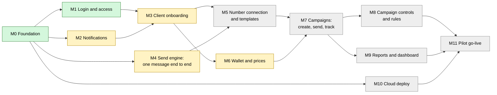

# Project tracker

This is the one place for overall status, the order of work, the rules everyone follows, and the decisions the owner has made. Each milestone's full detail (flow diagram, worked example, tasks, tests, data, open questions) lives in its own spec under [docs/milestones/](milestones/README.md). Every table and route, existing and planned, is listed in [data-model-and-api.md](data-model-and-api.md). Read this file first, then the spec for the milestone you are working on.

Last updated: 30 October 2026.

## How the plan is organised

- **One milestone = one flow.** A milestone is a flow a person can run and watch work from start to finish, for example "a super admin onboards a client and the client logs in". When that flow passes its demo, the milestone is Done. Nothing else makes it Done.
- **One spec per milestone.** Each spec is short enough to review in one sitting and is owned by the milestone's developer. Two people working on different milestones never edit the same file, except for one row each in this tracker's status board.
- **Tasks live inside a spec.** People work in parallel by taking different tasks inside one milestone, or different milestones that have no arrow between them in the roadmap below.

This replaces the earlier tracker, which kept two clashing plans side by side and split one flow across several milestones (for example, campaign creation in M4 and sending in M5). Milestones were renumbered on 29 October 2026. The milestone numbers in [low-level-design.md](low-level-design.md) are the old ones; that document is still the reference for technical detail, and each spec points to the sections it uses.

## Roadmap

Arrows mean "must be Done before the next one starts". Milestones with no arrow between them can be built at the same time by different people.

Green: Done. Yellow: in progress or prototype. Grey: not started.

Lanes that can run in parallel today: **M3** (client onboarding, Suraj), the rest of the **screens track** (Suraj's M6 screens against a mock API; see below) and, once OCI access exists, **M10** (cloud deploy).

## Status board

Update your row in the same pull request that changes a task's status.

| Milestone                                                                     | Flow it delivers                                                                                    | Status                                                                                                   | Owner                              | Starts after | External prerequisites         |
| ----------------------------------------------------------------------------- | --------------------------------------------------------------------------------------------------- | -------------------------------------------------------------------------------------------------------- | ---------------------------------- | ------------ | ------------------------------ |
| [M0](milestones/m0-foundation/spec.md) Foundation                             | Developer clones the repo, runs it locally, CI checks every pull request                            | Done                                                                                                     | repo setup                         | none         | none                           |
| [M1](milestones/m1-login-and-access/spec.md) Login and access                 | Super admin, staff and client each log in and see only what their role and clients allow            | Done (30 October 2026, PR #15)                                                                           | Anirudh (backend), Suraj (screens) | M0           | none                           |
| [M2](milestones/m2-notifications/spec.md) Notifications                       | A state change sends an email from `info@reaplift.com` and shows in the panel's notification list   | Built (backend 2.1 to 2.4); Done when E5 allows the real-email demo                                      | Anirudh                            | M0           | E5                             |
| [M3](milestones/m3-client-onboarding/spec.md) Client onboarding               | Super admin creates a client, its login and its staff; they get welcome emails and can log in       | In progress: backend 3.1 to 3.7 built; screens not connected | Anirudh (backend), Suraj (screens) | M1, M2 (started early, see the decision log) | none                           |
| [M4](milestones/m4-send-engine/spec.md) Send engine                           | Operator queues one template message; it reaches a phone; sent, delivered and read are recorded     | Built against the fake Meta server (4.1 to 4.6, 4.7 commands); Done when E1 and E2 allow the real-phone demo | Anirudh | M0           | E1, E2 for the real-phone demo |
| [M5](milestones/m5-number-and-templates/spec.md) Number connection, templates | A client's number is connected; a template passes our checks, goes to Meta, shows approved/rejected | In progress: backend 5.1 to 5.6 built against the fake Meta server; screens not started | Anirudh (backend); screens unassigned | M3, M4 (backend started early, see the decision log) | E3; E7 for credit-line sharing |
| [M6](milestones/m6-wallet/spec.md) Wallet and prices                          | Super admin sets prices and tops up; client sees balance and every ledger row                       | In progress: backend 6.1 to 6.6 built; screens not connected | Anirudh (backend), Suraj (screens) | M3 (started early, see the decision log) | none                           |
| [M7](milestones/m7-campaigns/spec.md) Campaigns                               | Client uploads an audience, sees the summary, confirms, is charged, and watches messages deliver    | In progress: backend 7.1 to 7.10 built; screens not started | Anirudh (backend); screens unassigned | M5, M6 (started early, see the decision log) | none                           |
| [M8](milestones/m8-campaign-controls/spec.md) Campaign controls and rules     | Client pauses, resumes, cancels or schedules a campaign with exact money handling; rules apply      | In progress: backend 8.1 to 8.5 built; screens not started | Anirudh (backend); screens unassigned | M7 (started early, see the decision log) | none                           |
| [M9](milestones/m9-reports/spec.md) Reports and dashboard                     | Dashboard and downloads match a hand count; super admin sees Meta cost and margin                   | Not started                                                                                              | Unassigned                         | M7           | none                           |
| [M10](milestones/m10-cloud-deploy/spec.md) Cloud deploy                       | A merge to `main` deploys to the cloud server with HTTPS, health check, rollback and backups        | Not started                                                                                              | Unassigned                         | M0           | E4                             |
| [M11](milestones/m11-pilot/spec.md) Pilot go-live                             | One client runs its campaigns on ReapLift for two weeks with no fallback to Dovesoft                | Not started                                                                                              | ReapLift                           | M8, M9, M10  | E1 to E7                       |

## Dependency rule

There is one rule: **a milestone starts only when every milestone in its "Starts after" column is Done.** There are no partial or "contract only" dependencies any more. Since each milestone is a whole flow, one milestone never needs half of another.

- Work in parallel by taking a different milestone that has no arrow to yours, or a different task inside your milestone. Each spec's task table says which tasks can run at the same time.
- An **external prerequisite** is something outside the code (a Meta setting, an account, an owner decision). The milestone can be built without it, but it cannot be called Done until the prerequisite is met, because its demo needs it. These are listed below so nobody is surprised at the end.
- The pull request that starts a milestone links the Done evidence of each milestone it starts after. A reviewer rejects it otherwise.
- **Screens track exception.** A screen task in [Suraj's task list](#surajs-task-list-screens-track) may start at any time, before its milestone's "Starts after" milestones are Done, because it runs against a mock API and touches only `apps/web` and the contract files in `packages/shared`. It ends as **Screen ready**, never Done. The matching backend task becomes Done only when the screen works against the real route (Definition of Done, check 2).
- If a milestone that was Done turns out to be broken, it goes back to In progress, and milestones that start after it keep going but cannot be called Done until it is fixed.

### External prerequisites

| ID  | Prerequisite                                                                                                                                                                                                                                                | Who      | Needed by                                    | State                                                                                                                                                              |
| --- | ----------------------------------------------------------------------------------------------------------------------------------------------------------------------------------------------------------------------------------------------------------- | -------- | -------------------------------------------- | ------------------------------------------------------------------------------------------------------------------------------------------------------------------ |
| E1  | ReapLift's own Meta developer app, a test WhatsApp number and a system user token                                                                                                                                                                           | ReapLift | M4 demo                                      | Not done (owner confirmed 30 October 2026): ReapLift is still getting its Meta business account. M4 is built against the fake Meta server until then. Test receiver: the owner's phone (never committed).                                                                                      |
| E2  | The Meta app switched to **Live mode**, which needs a public privacy policy page. Meta says some webhooks are not sent while an app is in Dev mode.                                                                                                         | ReapLift | M4 demo (delivery updates from a real phone) | Not done. See "Meta rules checked" below.                                                                                                                          |
| E3  | Meta **Business Verification** and **App Review** (advanced access to `whatsapp_business_messaging` and `whatsapp_business_management`)                                                                                                                     | ReapLift | M5 for client numbers; M11                   | Not started. Meta says no business customers can be onboarded until advanced access is approved.                                                                   |
| E4  | Oracle Cloud (OCI) account access and DNS for the final web address                                                                                                                                                                                         | ReapLift | M10                                          | Not available                                                                                                                                                      |
| E5  | `info@reaplift.com` set up as a sender in OCI Email Delivery (domain verified, SPF and DKIM records)                                                                                                                                                        | ReapLift | M2 demo                                      | Not started. Development uses a fake email provider until then.                                                                                                    |
| E6  | Templates approved under ReapLift's setup and the Dovesoft number-move runbook agreed                                                                                                                                                                       | ReapLift | M11                                          | Not started                                                                                                                                                        |
| E7  | Meta **Solution Partner** status and a **credit line**, so ReapLift pays Meta for its clients (decided 29 October 2026). The design's path is Tech Provider first (E3), then Solution Partner. Meta's exact requirements and timeline are not yet verified. | ReapLift | M5 task 5.2 acceptance; M11                  | Started 29 October 2026: ReapLift is working with Meta on the credit line. Likely the longest lead item in the project. Clients stay on Dovesoft until it is done. |

## Decisions that need the owner

Each has a default, so work does not stop; the default is built unless the owner says otherwise. The spec named in the last column holds the detail.

| ID  | Question                                                                                                                                                                                                                                                         | Default if nobody decides                                                                                                                                     | Blocks                     | Spec                                          |
| --- | ---------------------------------------------------------------------------------------------------------------------------------------------------------------------------------------------------------------------------------------------------------------- | ------------------------------------------------------------------------------------------------------------------------------------------------------------- | -------------------------- | --------------------------------------------- |
| D2  | Can a template variable use one fixed text for every row instead of a sheet column? Example in the M7 spec.                                                                                                                                                      | Yes                                                                                                                                                           | M7 task 7.3                | [M7](milestones/m7-campaigns/spec.md)         |
| D3  | Can a new campaign reuse an audience uploaded for an earlier campaign? Example in the M7 spec.                                                                                                                                                                   | No; each campaign uploads its file                                                                                                                            | M7 task 7.1                | [M7](milestones/m7-campaigns/spec.md)         |
| D4  | When is a running campaign "delayed" and worth an alert? Example in the M7 spec.                                                                                                                                                                                 | Messages still queued and none of the campaign's messages sent in the last 10 minutes (a stalled campaign, not a slow one)                                    | M7 task 7.9                | [M7](milestones/m7-campaigns/spec.md)         |
| D5  | Approve the cancel money flow written in the M8 spec (what is charged and refunded when a campaign is cancelled midway).                                                                                                                                         | The flow as written                                                                                                                                           | M8 task 8.2                | [M8](milestones/m8-campaign-controls/spec.md) |
| D6  | Are invalid numbers and duplicates charged? You said "not charged for now, discuss with ReapLift". The design's locked policy (HLD section 5) charges blocked numbers.                                                                                           | Invalid and duplicate: not charged, never sent. Blocked by rules: charged, as HLD section 5 says.                                                             | M7 task 7.5                | [M7](milestones/m7-campaigns/spec.md)         |
| D7  | Opt-in proof. Meta's policy allows messages only to people who opted in to that business. ReapLift cannot check a client's list.                                                                                                                                 | On every upload the client ticks "every number in this file opted in to receive messages from us"; the tick, user and time are stored with the campaign.      | M7 task 7.1                | [M7](milestones/m7-campaigns/spec.md)         |
| D8  | How long are uploaded audience files and per-number results kept? They are personal data.                                                                                                                                                                        | Kept 180 days, then deleted (the HLD's log cleanup period)                                                                                                    | M7, M9                     | [M7](milestones/m7-campaigns/spec.md)         |
| D10 | Client pricing: rates per client and per message type, as a fixed price or a percentage on Meta's rate. Proposed by Anirudh; to discuss with ReapLift. Questions P1 to P9 in [open-questions.md](open-questions.md). | As proposed; a client with none set uses a 25% markup | M6 task 6.1 | [M6](milestones/m6-wallet/spec.md) |
| D11 | Who issues GST invoices to clients, and per top-up or monthly? No milestone builds invoices today.                                                                                                                                                               | Outside the platform at launch; M6's Wallet page exports each client's monthly statement as CSV for ReapLift's accountant                                     | M6 task 6.4                | [M6](milestones/m6-wallet/spec.md)            |
| D12 | In which currency does Meta invoice ReapLift's credit line? If dollars, the markup also has to cover exchange-rate changes. Ask Meta during E7.                                                                                                                  | Rupees                                                                                                                                                        | M6 task 6.1                | [M6](milestones/m6-wallet/spec.md)            |
| D13 | Do ReapLift's clients own their WhatsApp accounts on Dovesoft, or does Dovesoft own them? If clients own them, they may bring the whole account to ReapLift through Embedded Signup (keeping templates and quality) instead of moving each number. Ask Dovesoft. | Assume numbers are moved and templates re-submitted                                                                                                           | M5 task 5.2, M11 task 11.2 | [M11](milestones/m11-pilot/spec.md)           |

## Decision log

Answered questions move here with their date, and the spec is updated in the same pull request.

### 31 October 2026

- **Anirudh builds all remaining backend (owner):** M3, M6, M7, M8 and M9's backend, in order, each tested with integration tests against the fake Meta server, as an exception to the dependency rule. **M3's backend moves from Suraj to Anirudh; Suraj stays on screens.** No milestone is Done until its screens and demo are.
- **M5 backend started before M3 and M4 are Done (owner).** This is an exception to the dependency rule. The backend runs against the fake Meta server and needs only the `clients` table. M5's screens and M5 being Done still wait for M3, and for M4's real-phone demo. All of M5's backend is built, including a route to replace a token and a route to retry the credit-line share, neither of which the spec named.
- **Questions waiting on ReapLift or Meta now live in one place:** [open-questions.md](open-questions.md).
- **Timeouts and double sends (owner):** Meta has no status lookup or idempotency key, so a send that times out may already have been accepted. M4 now waits 30 seconds instead of 15 and puts our message ID in `biz_opaque_callback_data` on every send. Before campaigns, [M7 task 7.6a](milestones/m7-campaigns/spec.md#76a-check-for-a-webhook-before-retrying-a-timeout) holds a timed-out message and checks for a webhook before retrying. `cli send-stats` reports the percent of messages sent twice, per client, from the stored webhooks.

### 30 October 2026

- **M4 built against the fake Meta server.** Found and fixed on the way: tokens were encrypted with AES-CBC while the spec said GCM (no real tokens were stored); the error classes retried codes Meta says not to, such as 131050; an empty `components` block was sent for templates without variables; and a dropped idle database connection would have crashed the process. Latest Graph API version checked: v26.0.
- **Who works on what next:** Anirudh works on M4 and Suraj on M3, including M3's backend. M3 may start while M2 is still only Built, as an exception to the dependency rule: it uses the fake email provider, and M3's demo already allows that. Rule 7 of Suraj's task list does not limit M3's backend work; claim migration numbers in the registry.
- **Docs cleaned up:** removed the old architecture overview and diagram (old milestone numbers, superseded by the HLD), the 0002 migration spec (the migration is merged) and M3's prototype evidence (it described a page that no longer exists). M4's early contracts moved to `milestones/m4-send-engine/draft-api-contracts.md`. Each milestone's `test-evidence.md` now holds the exact commands, SQL queries and real output; `database.md` is no longer a separate file.
- **Two branches (replaces one branch per task):** all work goes on `anirudh-e2e-setup`; `main` is production and is updated only by a release pull request from that branch. Per-task and stacked branches made merging and pulling tedious, and contradicted team-workflow.md. CI now also runs on every push to `anirudh-e2e-setup`, because task pull requests no longer trigger it.
- **Suraj's S1, S2 and C1 merged into `anirudh-e2e-setup`.** Owner tested Ravi and Meera in the real panel; the client logins have Suraj's C1 demo but no owner test yet. 
- **M1 is Done, released to `main` in PR #15.** The route-walking test passed in CI on that pull request. It also carries M2's backend and migration 0006.
- **`m4-skeleton` deleted** on the owner's instruction; it was closed without merging. Its last commit was `f8aef08`. The M4 milestone itself is unchanged.
- **`users.created_by` added (migration 0006):** records who added each user, so several super admins can be told apart. Blank for the first super admin and for users added before 0006. M3's create-user route takes it from the session.
- **Also added:** a show/hide password button on the login page, and request logs from `MODE=api` (no bodies, passwords or cookies).
- **M2 real email not tested:** `reaplift.com` mail is on Hostinger, so its SMTP could be used for a one-off test, but no credentials are configured. Rows marked `sent` so far went through the fake provider. E5 is still open.

### 29 October 2026

- **Business model and Meta partner route (answers D1):** ReapLift becomes a white-label WhatsApp provider like Dovesoft. It becomes a Meta **Solution Partner** with its **own credit line** (E7): Meta bills ReapLift, and ReapLift bills clients from their prepaid wallets. Clients own their WhatsApp accounts, connect them through Embedded Signup, and ReapLift shares its credit line with each account (M5). Prices are Meta's rate plus a markup of about 20 to 25%, which covers staff, servers and margin (M6; details in D10). ReapLift's clients stay on Dovesoft until the platform is built and E7 is done, so no interim billing path is needed. This replaces the design's launch plan of holding client numbers under ReapLift's own Meta business and paying by card (HLD section 2 updated).
- **Who builds what:** Suraj builds the screens for M1, M3 and M6 (login, panel shell, client admin, wallet and prices) as the screens track; Anirudh builds the backend and core logic (M1 sessions and scope, M2, M3 routes, M4 send engine, M5, M6 ledger and charging, M7, M8). Suraj's `M4` suggestion is withdrawn. Rules that keep Suraj unblocked are in "Suraj's task list"; web libraries approved for it: `react-router-dom`, `vitest`, `@testing-library/react`, `@testing-library/user-event`, `jsdom`. No UI component library; the panel keeps `styles.css`.
- **Tenant-column exceptions (D14):** approved. CLAUDE.md now points to the list of platform tables without a client in data-model-and-api.md.
- **Resellers (D9):** letting other agencies resell ReapLift under their own brand is a long-term future use case, not built now. Nothing is built for it; the design only avoids choices that would block a reseller level later.
- **Plan shape:** one milestone per flow; one spec per milestone; this tracker holds rules and status only. Milestones renumbered (old to new below).
- **Suraj's `m4-skeleton` branch is closed without merging.** Campaign work restarts from the M7 spec. Migration `0004_lists.sql` from that branch is not used, so 0004 is free. One finding from that branch is kept as a note in the M7 spec: exceljs's streaming reader returned incomplete data on large Excel files.
- **Release branch is `main`.** Everything runs locally for now. The cloud deploy (M10) deploys from `main`, or from a release branch cut from `main` if that is chosen later. GitHub's default branch should be changed from `m0-skeleton` to `main` (owner action), so CI's push trigger and pull requests target the same branch.
- **Roles and login (M1):** the code follows the design and the database, not the earlier prototype. The client role is `client` everywhere (the code's `client_admin` is renamed). Sessions are kept in an httpOnly cookie. The super admin resets passwords at launch.
- **Staff (M1, M7):** staff can do everything a client can do, for each client assigned to them: create templates and campaigns, and confirm them. Every client has its own workspace (all pages show only that client's data). Staff and super admin pick which client workspace they are in.
- **Templates (M5):** Meta's approval is the only approval. ReapLift runs its own checks first, and nothing failing them goes to Meta. Each client has its own number. The Graph API version is the latest stable one when M4 is built. A rejection shows Meta's reason with our own plain explanation (Meta only adds its own fix recommendation for one rejection type; see "Meta rules checked"). An approved template is not edited; the client copies it. The super admin maintains the promotional word list.
- **Phone numbers (M7):** a number is valid only if it belongs to the country the client is registered in (all clients are in India at launch). Meta's price depends on the recipient's country, so this keeps one price list per client correct. Numbers from other countries are shown as invalid with a reason, not silently dropped.
- **Number fixing:** only 10-digit Indian mobiles get `91` added; no other guessing.
- **Google Sheets:** not supported. Audience is Excel or CSV upload only. Every upload makes a new list.
- **Quiet hours:** follow Meta. Meta publishes no time-of-day rule for WhatsApp; its only timing limit is a per-person cap on marketing messages. No quiet-hours rule is built.
- **Cancel:** allowed, with an exact money flow (D5 asks the owner to approve it).
- **Campaign problems notify the person who created the campaign as well as the super admin.**
- **Notifications (M2):** sent to the email address of the login involved (the client's login email for client events). Sender is `info@reaplift.com` through OCI Email Delivery. WhatsApp notifications from ReapLift's own number (for example low balance) are a later addition, not at launch.

### 24 October 2026

- The product is built and demoed as flows: login and access, admin control plane, Meta number linkage, template approval, campaign creation and send, delivery status, wallet, reports, notifications. These are now milestones M1 to M9.

### Old to new milestone numbers

| Old (before 29 October 2026, and in low-level-design.md) | New                                                   |
| -------------------------------------------------------- | ----------------------------------------------------- |
| M0 tasks 0.1, 0.2, 0.7                                   | M0                                                    |
| M0 tasks 0.3 (image), 0.4 to 0.6, 0.8                    | M10                                                   |
| M1 one message end to end                                | M4                                                    |
| M2 login, roles (tasks 2.1, 2.2, 2.4)                    | M1                                                    |
| M2 admin (tasks 2.3, 2.5, 2.7, 2.8)                      | M3                                                    |
| MN notifications                                         | M2                                                    |
| M3 number and templates                                  | M5                                                    |
| M4 upload and draft, M5 confirm and send (5.1, 5.2, 5.5) | M7                                                    |
| M5 controls and rules (5.3, 5.4)                         | M8                                                    |
| M6 wallet                                                | M6 (charge at confirm and refunds are wired up in M7) |
| M7 reports                                               | M9                                                    |
| M8 pilot                                                 | M11 (alerts are M11 task 11.1)                        |

## Meta rules checked

Checked against Meta's developer documentation on 29 October 2026, as CLAUDE.md requires. Re-check before relying on any of these in code.

| Topic                      | What Meta says                                                                                                                                                                                                                                                                                                              | What it changes                                                                                                                                          |
| -------------------------- | --------------------------------------------------------------------------------------------------------------------------------------------------------------------------------------------------------------------------------------------------------------------------------------------------------------------------- | -------------------------------------------------------------------------------------------------------------------------------------------------------- |
| Who owns and pays          | Businesses onboarded through Embedded Signup "own all of their WhatsApp assets". A Tech Provider's onboarded customers "must add a payment method". A Solution Partner "must share your line of credit" with customers. The pages read do not say whether a business may hold other businesses' numbers in its own account. | Decided: ReapLift becomes a Solution Partner; clients own their accounts through Embedded Signup and ReapLift shares its credit line with them (E3, E7). |
| Onboarding limit           | "You will not be able to onboard business customers until your app has been approved for advanced access."                                                                                                                                                                                                                  | E3 before any client number is connected                                                                                                                 |
| Webhooks in Dev mode       | "Make sure your app is in Live mode; some webhooks will not be sent if your app is in Dev mode."                                                                                                                                                                                                                            | E2 before the M4 demo                                                                                                                                    |
| Opt-in                     | Businesses may message people only after they gave their number and opted in to messages from that business. Template approval is not opt-in. Opt-out requests must be honoured.                                                                                                                                            | D7; STOP handling is in M7, before any real client sends                                                                                                 |
| Marketing limit per person | Meta withholds marketing templates to a person who has hit a cap across all businesses (error 131049), and says to wait at least 24 hours before resending.                                                                                                                                                                 | M4: 131049 is a final failure, never retried automatically; M7 shows it as "Meta limit"                                                                  |
| Template rejection detail  | The template status webhook carries a `reason`. A `rejection_info` object with `reason` and `recommendation` is sent only for `INVALID_FORMAT` rejections.                                                                                                                                                                  | M5 shows Meta's recommendation when present, and our own explanation per reason code otherwise                                                           |
| Pricing                    | Charged per delivered message since 1 July 2025, at a rate set by the recipient's country calling code.                                                                                                                                                                                                                     | Phone numbers validated against the client's country (decided)                                                                                           |
| Quiet hours                | No time-of-day rule found in Meta's documentation.                                                                                                                                                                                                                                                                          | No quiet-hours rule built (decided)                                                                                                                      |

Sources: [Embedded Signup overview](https://developers.facebook.com/documentation/business-messaging/whatsapp/embedded-signup/overview), [Partner-initiated WABA creation](https://developers.facebook.com/documentation/business-messaging/whatsapp/solution-providers/partner-initiated-waba-creation), [Webhooks overview](https://developers.facebook.com/documentation/business-messaging/whatsapp/webhooks/overview), [Get opt-in](https://developers.facebook.com/documentation/business-messaging/whatsapp/getting-opt-in), [Per-user marketing limits](https://developers.facebook.com/documentation/business-messaging/whatsapp/templates/marketing-templates/per-user-limits/), [Template status webhook](https://developers.facebook.com/documentation/business-messaging/whatsapp/webhooks/reference/message_template_status_update/), [Pricing](https://developers.facebook.com/documentation/business-messaging/whatsapp/pricing).

## Rules for every milestone

### Definition of Done

A task is Done only when all of these are true. A milestone is Done when all its tasks are Done and its demo (the last section of its spec) has been run end to end and recorded in its evidence pack.

1. A user can run the flow in the real panel (or the real command, for operator flows) and see the expected result.
2. The panel calls the real server route and gets a real response; nothing comes from mock data or in-memory lists.
3. The server validates input and rejects bad requests with the documented error code.
4. State is saved in PostgreSQL and survives a server restart.
5. Role and client rules are enforced by the server, and a test proves another client's data cannot be read or changed.
6. The tests listed in the spec exist and pass in CI.
7. This tracker's status board matches what the code really does.

If any check fails, the task is In progress or Prototype, never Done.

### Do

- Read this tracker and your milestone's spec before starting.
- Keep work inside your milestone's spec. If something belongs to another milestone, note it there; do not build it.
- Write the route, request and response, and error codes in the spec before coding them.
- Record real request and response evidence before calling something done.
- Update the spec and the status board in the same pull request as the code that changes them.

### Do not

- Do not call a task done because a page renders or React state changed.
- Do not call a task done because a route works on in-memory data.
- Do not start a milestone before every milestone in its "Starts after" column is Done.
- Do not edit another milestone's spec without its owner's review.
- Do not trust Meta error codes, limits or rates from memory; check Meta's current docs and note the date.

### Repo rules (from CLAUDE.md)

- One server program; `MODE` (`api`, `worker`, `receiver`, `scheduler`, `migrate`) picks what runs. New behaviour is a module under `apps/server/src/modules/`.
- Migrations: a new numbered file only; never edit a merged one; only add tables, nullable columns and indexes. Claim the number in the registry below first.
- Money is whole paise in `bigint`. Phone numbers are digits with country code, no plus (`919812345678`).
- Every table carries `client_id` and every query filters by it, except the platform tables listed in [data-model-and-api.md](data-model-and-api.md).
- Two branches only: everyone commits to `anirudh-e2e-setup` (work), and `main` is production. No per-task branches and no pull requests between tasks. A release is one pull request from `anirudh-e2e-setup` into `main`. Never push to `main`. CI must be green. Steps are in [team-workflow.md](team-workflow.md). Where a doc says "the same pull request" about a task, read it as the same commit or push on the work branch.
- No secrets in git. Every new setting goes in `.env.example` with a blank value.
- Run lint, typecheck and tests before committing. `pnpm test:int` drops the whole schema, so locally point `DATABASE_URL` at a separate database, or re-seed afterwards.

### Evidence pack

Each milestone folder in `docs/milestones/` holds its `spec.md` plus, by the time it is Done: `test-evidence.md` (the exact commands and SQL queries to prove the flow, with real output), `frontend.md` (page actions), `backend-api.md` (routes with real request and response), `e2e.md` (the demo run from panel to server to database). See [milestones/README.md](milestones/README.md).

## Migration number registry

Claim a number in the pull request that opens the task, before writing the file. If two branches still collide, the one that merges second renumbers.

| Number | File                        | Milestone and task | State                                                                     |
| ------ | --------------------------- | ------------------ | ------------------------------------------------------------------------- |
| 0001   | `0001_init.sql`             | M0                 | Merged                                                                    |
| 0002   | `0002_message_platform.sql` | M4 (old M1 1.2)    | Merged                                                                    |
| 0003   | `0003_admin_access.sql`     | M1, M3             | Merged                                                                    |
| 0004   | `0004_auth_sessions.sql`    | M1 1.2, 1.3        | On `anirudh-e2e-setup` (`0004_lists.sql` from `m4-skeleton` is abandoned) |
| 0005   | `0005_notifications.sql`    | M2 2.1             | On `anirudh-e2e-setup`                                                    |
| 0006   | `0006_users_created_by.sql` | M3 3.2             | On `anirudh-e2e-setup`                                                    |
| 0007   | `0007_numbers_and_templates.sql` | M5 5.1, 5.3    | On `anirudh-e2e-setup`                                                    |
| 0008   | `0008_client_onboarding.sql` | M3 3.1, 3.2       | On `anirudh-e2e-setup`                                                    |
| 0009   | `0009_wallet_and_prices.sql` | M6 6.1, 6.2       | On `anirudh-e2e-setup`                                                    |
| 0010   | `0010_campaigns.sql`        | M7 7.1 to 7.8      | On `anirudh-e2e-setup`                                                    |
| 0011   | `0011_campaign_controls.sql` | M8 8.3, 8.4       | On `anirudh-e2e-setup`                                                    |
| 0012   | next free                   |                    | Free                                                                      |

## Suraj's task list (screens track)

Suraj builds screens; Anirudh builds the backend and core logic (decided 31 October 2026). Everything below can be done **without waiting for anyone**: no task needs a backend route, a migration, an owner decision or a review to start or to continue.

How it works:

1. **Mock first.** Every screen calls the server through one API layer in `apps/web/src/api/`. With `VITE_API_MODE=mock` the layer answers from a mock handler (fake data held in memory in the browser); with `real` (the default, and the only mode in a production build) it calls the server. No screen calls `fetch` directly.
2. **Suraj writes the contracts.** Each route's request and response is a Zod schema in `packages/shared/src/contracts/<area>.ts` (`auth`, `admin`, `me`, `wallet`, `pricing`), taken from the route table in the milestone's spec and [data-model-and-api.md](data-model-and-api.md). Where the spec does not name a field, Suraj chooses one, writes it into the spec's "Data and API" section in the same pull request, and carries on. That choice is the decision; the backend implements it.
3. **Contract changes.** If the backend needs a different shape, the backend pull request changes the schema **and** the mock handler together, so the screen keeps compiling and working.
4. **Connecting to the real server is Suraj's, once the backend is finished.** When a milestone's backend routes are merged, a "connect" task (C1, C2, ...) is added to the list below. In it Suraj runs his screens with `VITE_API_MODE=real`, fixes any mismatch with the contracts (asking the backend owner only if the server itself is wrong), and records the real requests and responses and the end-to-end run in the milestone's evidence. That is when the milestone's tasks become Done. A connect task is added only when its backend is finished, so it never waits on anyone.
5. **Unclear spec.** Pick the simplest option that matches the spec and the Dovesoft panel (HLD section 4), note the choice under the spec's "Open questions" as "Chosen by Suraj: ...", and continue.
6. **Reviews do not block.** Commit each task directly to `anirudh-e2e-setup` and start the next task on the same branch; no task branch or task pull request. Anirudh reviews the commits after pulling them and at the release pull request into `main`; any fix is a new commit.
7. **Files.** Suraj edits only `apps/web/**`, `packages/shared/src/contracts/**`, `packages/shared/src/format/**` and the screen sections of the M1, M3 and M6 specs. Backend work does not edit these, except the schema-and-mock change in point 3. No migrations, so no clashes in the registry.
8. **Done for a screen task = Screen ready:** the screen works in mock mode for every role in the spec's worked example; component tests pass in CI; lint and typecheck pass; screenshots are in the milestone's `frontend.md`.

| #   | Task (spec)                                                                                                         | What it delivers                                                                                                                                                                 | Status                                                                   |
| --- | ------------------------------------------------------------------------------------------------------------------- | -------------------------------------------------------------------------------------------------------------------------------------------------------------------------------- | ------------------------------------------------------------------------ |
| S1  | [M1 1.6.1](milestones/m1-login-and-access/spec.md#161-web-foundations-suraj) Web foundations                        | Component tests in `apps/web`, router, the API layer with mock mode, the contracts folder, `formatPaise` (paise to "₹1,234.50") with tests, one table of error codes to messages | Screen ready (on `anirudh-e2e-setup`)                                    |
| S2  | [M1 1.6.2](milestones/m1-login-and-access/spec.md#162-panel-shell-suraj) Panel shell                                | Login page, client picker, menu by role, "coming soon" pages, empty Dashboard, logout                                                                                            | Screen ready (on `anirudh-e2e-setup`)                                    |
| C1  | [M1 1.7](milestones/m1-login-and-access/spec.md#17-connect-the-panel-to-the-real-server-suraj) Connect the M1 panel | Panel shell against the real server (backend 1.1 to 1.5 is finished): fix contract mismatches, record `frontend.md` and `e2e.md`. Makes M1 Done                                  | Done (PR #15)                                                            |
| S3  | [M3 screens](milestones/m3-client-onboarding/spec.md#screens-suraj) My account and forced password change           | "My account" page; the change-password screen shown when the server answers `PASSWORD_CHANGE_REQUIRED`                                                                           | Not started                                                              |
| S4  | [M3 screens](milestones/m3-client-onboarding/spec.md#screens-suraj) Client admin                                    | Clients list, create and edit client, client detail with users and staff, create user, staff assignment, suspend and reactivate with a note, disable and enable, reset password  | Not started                                                              |
| S5  | [M3 screens](milestones/m3-client-onboarding/spec.md#screens-suraj) Audit page                                      | Audit list with filters by client, user, action and date                                                                                                                         | Not started                                                              |
| S6  | [M3 screens](milestones/m3-client-onboarding/spec.md#screens-suraj) Notification bell and delivery log              | Bell with unread count and list; super admin delivery log with a status filter                                                                                                   | Not started                                                              |
| S7  | [M6 screens](milestones/m6-wallet/spec.md#screens-suraj) Wallet page                                                | Balance, the client's prices, ledger with filters by kind and date, CSV download                                                                                                 | Not started                                                              |
| S8  | [M6 screens](milestones/m6-wallet/spec.md#screens-suraj) Admin money                                                | Balance box on the admin client view, top-up and adjustment forms, low-balance alert setting                                                                                     | Not started                                                              |
| S9  | [M6 screens](milestones/m6-wallet/spec.md#screens-suraj) Admin prices                                               | Meta rates list and form, default markup, per-client markup or fixed prices, charge-policy switches                                                                              | Not started                                                              |

Do them in order; each one builds on the last. A connect task goes right after the screen task it connects (C1 after S2). Nine screen tasks are several weeks of work, so there is always a next task while the backend catches up.

## Next task for each person

| Person   | Milestone     | Next task                                                                                         | Waiting on |
| -------- | ------------- | ------------------------------------------------------------------------------------------------- | ---------- |
| Anirudh  | M9            | M9 backend; M4 real-phone demo when E1 and E2 are ready | E1, E2 for the demo |
| Suraj    | Screens track | M3: S3 My account and forced password change, then S4 to S6, against the real routes now built     | nothing    |
| ReapLift | none          | E3 (Business Verification, App Review); continue E7 with Meta; E1, E2, E5; answer D10 to D13      | none       |
